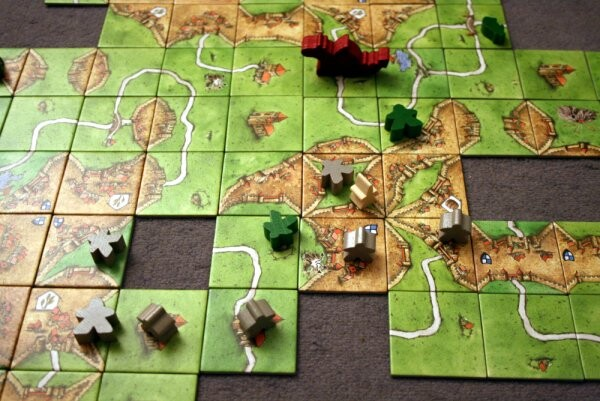
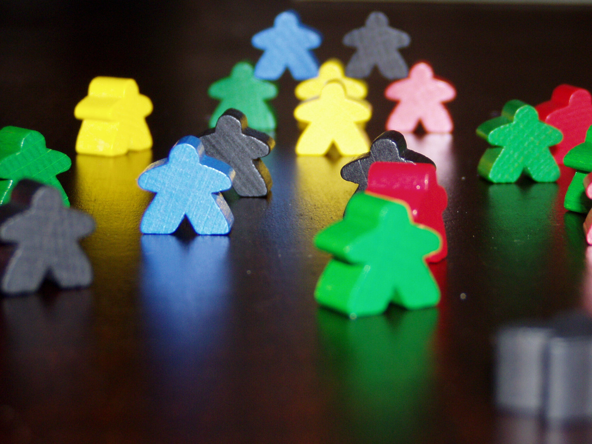

\
Lähde: [Wikipedia](http://en.wikipedia.org/wiki/File:Carcassonne-board.jpg)

Kuten tuossa lautapelailuani selittäneessä artikkelissa mainitsin niin tulen kirjoittamaan Carcassonnesta pienen artikkelin. Tässä olisi hieman tarkoitus kirjoitella omia mielipiteitä ja kokemuksia tästä mainiosta lautapelistä.

Carcassonnehan on Klaus-Jürgen Wreden nimisen henkilön suunnittelema lautapeli, josta on mielestäni tullut ajan saatossa suhteellisen suosittu peli. Peli on julkaistu vuonna 2000 ja suomenkielinen versio tuli ulos 2004. Siinä on suhteellisen simppelit säännöt, joten aloittelijat pääsevät helposti siihen mukaan. Vuonna 2004 Carcassonne valittiin vuoden perhepeliksi täällä suomessa. Ihan turha peli ei siis ole kyseessä.

Pelin kulun voisi ehkä helpoimmin selittää lainaamalla se [Wikipediasta](http://fi.wikipedia.org/wiki/Carcassonne_(peli)):

*”Peliä pelataan rakentamalla pelilaatoista keskiaikaista kaupunkiympäristöä, joka sisältää peltoja, teitä, kaupunkeja ja luostareita. Kukin pelaaja voi vuorollaan asettaa laatan ja halutessaan sijoittaa sille tai mahdollisesti jollekin muulle laatalle pelinappulan eli seuraajan (joita on rajoitettu määrä). Pisteitä saadaan, kun tie, kaupunki tai luostari on rakennettu valmiiksi. Pellot eivät valmistu, mutta niistä saa pisteitä pelin lopuksi. Aina rakennelman valmistuttua pelaaja saa nappulansa takaisin käyttöönsä. Rakennelmia voi tehdä myös yhteistyössä, mikä lisää pelin haastavuutta.”*

\
Lähde: [Wikipedia](http://fi.wikipedia.org/wiki/Tiedosto:Carcassonne_Miples.jpg)

Itse olen pelannut jonkun kymmenisen kierrosta tätä peliä vasta. Siihen päälle jokunen kierros iPadillä tekoälyä vastaan, joten pelikokemukseni on Carcassonnen kanssa vielä suhteellisen vähäinen. Sen huomion tein tässä joulunpyhien aikana, että kolmella pelaajalla kaipaa hieman lisää noita palikoita. Lisäosia siis pitää itse ainakin ostaa, jotta saadaan peliin hieman lisää pituutta sekä jännitystä.

Nyt kun mainitsin nuo lisäosat niin niitä on suomessa tullut useampikin kappale. Itsellä on tuo 10-vuotisjuhlajulkaisu, joten siinä jo tuli mukana lisäosa Juhlat. Siinä ei tosin tullut minilisäosaa Joki, joka olisi taas tuonut peruspelissä tulleen joen mukaan peliin. Sekin on tietysti mahdollista, että hankkii tuon peruspelin jollon saa tuon joen ja lisää laattoja. Tällöin taas saisi lisää pelikestoa ja mahdollistaisi useamman pelaajan pelinkin helpommin. Tietysti jokainen lisäosa tuo oman juttunsa peliin ja tätä kautta sen pelattavuus paranee ja sitä voi tahkota yhä useammin. Listaanpa tähän vielä julkaistut lisäosat: Kirkot ja Kievarit, Kirjurit ja Kauppiaat, Lohikäärme ja Linnanneito, Torni, Kreivi ja Kuningas, Kärryt ja Kartanot, Katapultti, Basaarit ja Bastionit sekä Juhlat.

Carcassonnelle on julkaistu jokunen sisarpeli, jotka ovat itsenäisiä pelejä. Näitä sisarpelejä ei siis voi pelata alkuperäisen kanssa, eikä näitä voi sekoittaa keskenään lisäosienkaan kanssa. Suomessa on tullut kaksi sisarpeliä Kivikausi ja Uusi Maailma. Näiden lisäksi on englanniksi saatavilla The Castle, The City ja The Discovery nimiset sisarpelit.

Suosittelen lämpimästi Carcassonnea kaikille, mikäli sinulla on tuttuja joilla on tämä niin kannattaa mennä kokeilemaan sitä.
