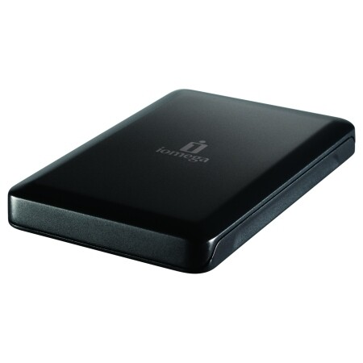

Ajattelin jakaa teille tämän pienen hankinnan etenemisen. Aloitetaan ihan siitä, että mitä tilassin. Tilasin Iomegan ulkoisen kiintolevyn jolla kokoa 320 GB ja hinta oli 39 euroa. Ja veinpä viimeisiä kappaleita kun sitä myydään nyt ennakkoon Gigantin sivuilla.

Tämän tilaaminen oli oikeastaan 2. yrityksen takana joten käydään molemmat läpi.

## Yritys 1

Kävin aamulla 10 jälkeen Gigantissa kyselemässä olisiko teillä tuotetta hyllyssä – ei ollut joten päätin tilata netin kautta.

Tilasin tuotteen verkkokaupasta ja laitoin toimituksen Kuopion Giganttiin, koska se oli sivujen mukaan mahdollista. Tilaus tapahtui 11.22.

Kyselin sitten asiakaspalvelusta sähköpostin kautta, että milloin tuote olisi noudettavissa. Minulle vastattiin yllättävän nopeasti (parissa minuutissa) ja hän vakuutti, että tuote olisi noudettavisa 2 tuntia tilauksesta. Iltapäivällä lähdin sitten Giganttiin kyselemään kiintolevyn perään. Heiltä vastauksena sain saman minkä aamulla, että heillä ei ole tätä kiintolevyä ja sivuston olisi pitänyt tietää tämä – eikä antaa tilata tuotetta Kuopion Giganttiin. Peruin tämän tilauksen kuultuani sen, että heille tuotetta tulee vasta kuun lopussa lisää. Tämän tiedon jälkeen päätin tilata kiintolevyn toimituksella lähimpään Siwaan (Yritys 2).

## Yritys 2

Ensimmäisen yrityksen epäonnistuttua, päätin tilata kiintolevyn toimitettuna lähimpään Siwaan. Tilasin tuotteen 5.1.2011 klo 16.41 ja maksoin samantien verkkopankin kautta.

Tänään 10.1 tuli aamulla viesti, että paketti on noudettavissa Kuopion keskustassa olevasta Siwasta. Okei… muuten hyvä, mutta Giganttikin on lähempänä kuin tämä Siwa. Särkiniemessä olisi ollut Siwa ja miksi ihmeessä sitä ei voinut toimittaa tähän Giganttiin, koska tästä Neulamäestä olisi lyhyempi matka siihen kuin keskustan Siwaan.

## Yhteenveto

Hyvää on se, että tuote on Siwassa ja saan sen noudettua huomenna sieltä. Gigantti voisi hieman pelata tässä vaikka niin, että voisi tosiaan noutaa sen tuotteen Gigantista sitten kun se sinne saapuu – ei luulisi olevan kovin vaikeaa?
