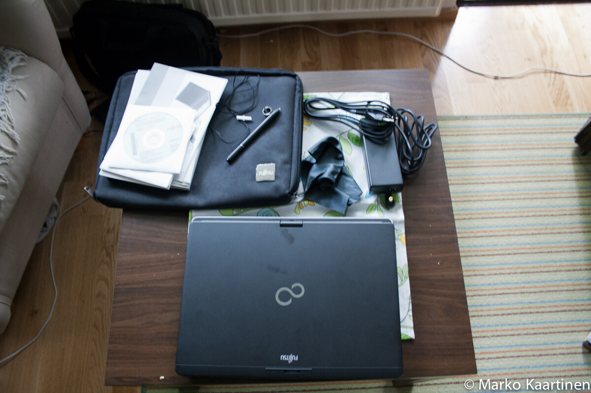
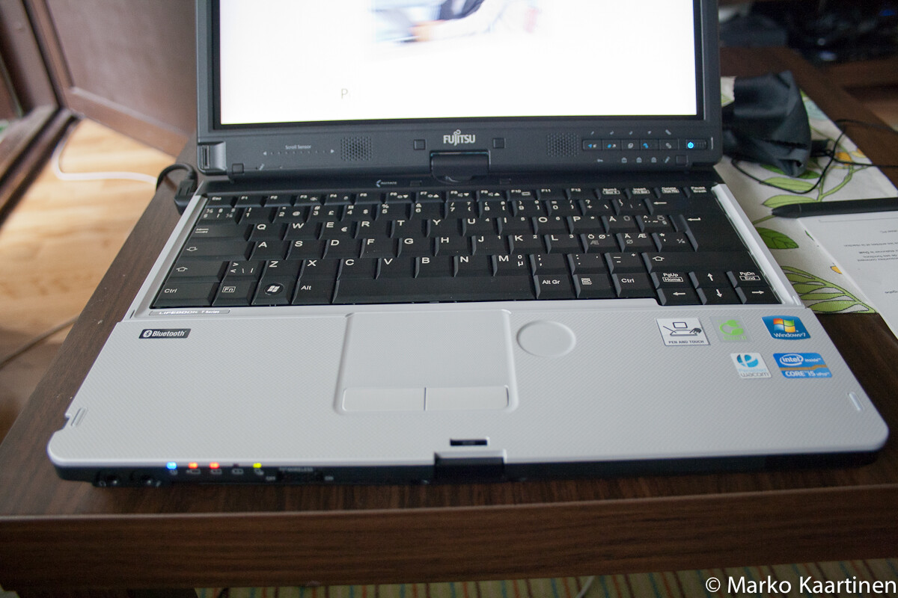
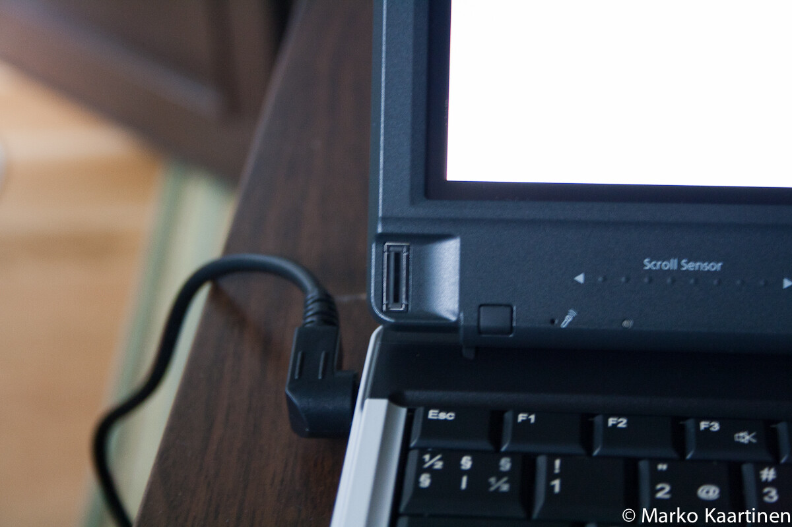

Sain siis käsiini LIFEBOOK T901 läppärin. Tästä mahdollisuudesta kiitos kuuluu Fujitsun LIFEBOOK4Life projektille. Tulen tässä artikkelissa käsittelemään hieman ensivaikutelmia tästä koneesta. Olen käytellyt tätä konetta nyt perjantaista asti ja olen saanut kaikki tärkeimmät asiat konffittua tähän.

## Yleisvaikutelma

Kooltaan kone ei ole mitenkään iso, mutta ensimmäisenä pistää silmään sen paksuus (peräti 36mm). Painoahan ei laitteella itsessään ole kuin hieman yli kaksi kiloa, joten kyseessä on tosi kevyt laite. Mainitaan vielä laitteen leveys (319mm) ja syvyys (244mm).

Toinen asia mikä pisti silmään on porttien määrä. Tässä on portti oikeastaan kaikkeen mahdolliseen, niitä nimittäin löytyy aina hdmi:stä – SIM-korttiin asti. Laitteessahan on seuraavat portit: muistikortinlukija (tukee yleisimpiä), ExpressCard, SmartCard, SIM-kortti, verkkoportti, USB 2.0 (2kpl), USB 3.0 (1kpl), Firewire, VGA, HDMI, Audio, Kensington lock sekä mahdollisuus telakkaan. Mielipideasiana sanon, että audio portit olisivat voineet olla laitteen sivulla – tämä lähinnä siksi, koska sylissä kuulokkeet ottavat kiinni.

Muotoilultaan laite on ”kulmikas”, mutta tämä ei itseä haittaa yhtään ja loppujen lopuksi tämä on oikein tyylikäs laite! Huomattavaa on se, että näyttö kääntyy näppiksen päälle, jolloin tätä voi käyttää tablettina (tässä on kosketusnäyttö, näytöstä lisää myöhemmin).

## Tehot

Tehoja tässä on tarpeeksi ja ehkä liikaakin perustoimintoihin. Tässä on nimittäin 4 gigaa muistia ja prosessorina toimiia Inter Core i5 2520M (2,5GHz). Kiintolevytilaa löytyy 320 gigatavua, eli tilaakin on tarpeeksi. Ainut asia mitä voisi parantaa on näytönohjain, se on nimittäin integroitu ja näiden suuri fani en itse ole.

## Näppäimistö ja touchpad

Aloitetaan näppiksestä, se on perushyvä näppäimistö ja tuntuma on oikein passeli. Ainut miinus olisi oikeastaan se, että tähän ei mahdu numpadia – tosin tämä ei ole itselle välttämättömyys nykyään.

Touchpad on tuntumaltaan oikein hyvä ja vaikka sen koko on pieni niin se tuntuu riittävän oikein hyvin. Itselleni erikoisena ratkaisuna löysin tästä tämmöisen pyöreän kohdan, jota pyörittämällä saa skrollattua sivua ylös tai alas – erittäin ovela ratkaisu!

## Näyttö

Näyttö on oikeastaan tämän koneen helmi. Kyseessä on nimittäin kosketusnäyttö ja tämän laitteen mukana tuli oma kynä jolla sitä voi käyttää. Voi sitä toki käyttää sormellakin, mutta itseäni alkoi pian ärsyttämään se kun kirjoittaessani kämmen osui näyttöön ja se laski sen kosketukseksi. Otin muuten pois päältä sormi käytön ja käytän sitä vain kynällä.

Tämä tunnistaa jopa minun käsialaa!  Tulen tekemään tästä pienen videon myöhemmin jossa testaan tunnistusta hieman tarkemmin.

Kokoahan näytöllä on 13,3 tuumaa ja natiivi resoluutio on 1280\*800 pikseliä. Tämä on oikeastaan aika passeli koko ja tilaa näytöllä on tarpeeksi.

## Turvallisuus

Tässä on otettu huomioon kyllä vaikka sun mitä! Tästä löytyy nimittäin sormenjälkitunnistin, joka toimii oikein hyvin. Löytyy myös joku ”advanced theft protection” -palikka, en ole tutustunut mikä tämä mahtanee olla. Luin jostain, että tässä on myös tiputuksen tjs. tunnistin, joka tunnistaa kun kone ottaa iskua ja tällöin lopettaa kovojen toimintaa yms. ettei tule isompaa vauriota.

## Muuta

Ovelana ominaisuutena sanottakoon, että dvd-aseman saa irti ja sen tilalle saisi lisäakun laitettua ja tällöin akkukeston saisi jopa 14 tuntiin. Yhdellä akulla en ole akkukestoa testannut, mutta minun suhteellisen tehokkaalla käytöllä se kestää kolmesta neljään tuntiin (ainakin).

LIFEBOOKin mukana tuli ohjelmisto sim-korttia varten, eli sen kautta pystyy ottamaan yhteyden käyttäen mobiiliverkkoa. Testasin tätä pikaseen ja sehän toimii heittämällä, ainoastaan Saunalahden APN -asetus piti laittaa oikeaksi.

## Yhteenveto

Tästä voisi vetää yhteenvetona sen, että kyseessä on erittäin hyvä Windows läppäri. Ainoana miinuksena näen tällä hetkellä näytönohjaimen. Itselläni kun ei läppäri ole pelikäytössä tämä on tällä hetkellä paras Windows läppäri mitä minulla on koskaan ollut.

Plussat\
\+ Sim-kortin lukija\
\+ Lisäakun mahdollisuus\
\+ Kosketusnäyttö (kynä+kosketus)\
\+ Muisti + prosessori\
\+ Touchpad\
\+ Porttien määrä

Miinukset\
– Näytönohjain\
– Audio porttien paikka edessä (pieni miinus)

Tulen testailemaan tätä laitetta lisää ja luvassa on ainakin kirjotuksen tunnistuksen testausta ja muuta mukavaa. Voitte ehdottaa minulle mitä haluaisitte minun testaavan!
