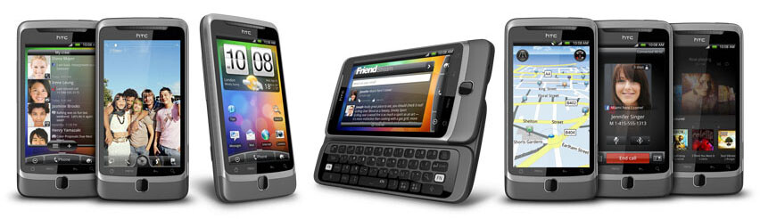
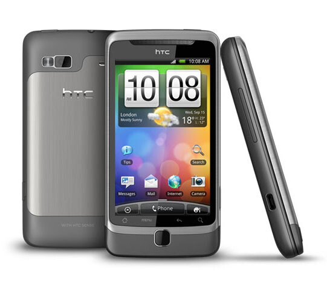
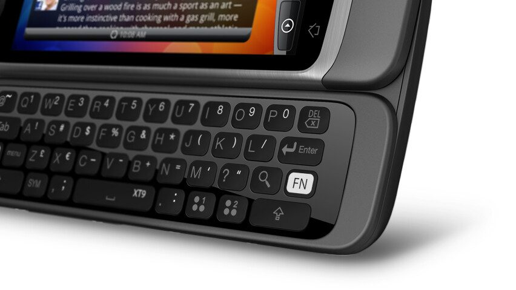
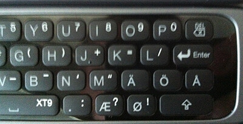

Tuli vihdoin ja viimein päivitettyä työpuhelin [Nokia 6760 slide](/2011/alypuhelimen-vanki) mallista hieman modernimpaan versioon. Ajoi sinällään asiansa ihan hyvin ja pystyi vastaamaan puheluihin ja kirjoittelemaan tekstareita. Tietäen omat tarpeet puhelimelle niin tuo ei tulisi kovin kauaa enää olemaan tehokas väline, niinpä se sai väistyä modernin Androidin tieltä.\

## Ensivaikutelma

Puhelimen ensivaikutelma tuli siinä vaiheessa, kun sen laatikko tuli avattua (tietenkin olin jo Googlaillut sekä käpistellyt tuota luuria monet kerrat ennen tätä). Sehän oli painava… piru vie. Verrattuna iPhoneen (137g) painoa on 43 grammaa  enemmän ja kyllä sen oikeastaan tunsi. Otetaan painovertailuun vielä työkaverin Samsung Galaxy S II, joka painaa sen 113 grammaa – on muuten kevyt puhelin, tosin tuntuu minun käteen hieman muoviselta (makuasia).

Kaiken kaikkiaan ensivaikutelma oli painon lisäksi se, että kyseessä on hyvänoloinen puhelin ja se tulee ajamaan asiansa paremmin kuin hyvin – kiitos fyysisen näppäimistön.

## Speksit!

Tiedän, että te kaikki rakastatte näitä tietoja! Painoahan sillä on siis **180 grammaa** ja sen koko on suhteellisen sopiva (**60,4mm\*119mm\*14,16mm** / L\*K\*P). Osa tuosta paksuudesta tulee siitä, että siinä on tosiaan **fyysinen näppäimistö** ja se ”liukuu” alhaalta esiin (tosiasiassa se ei liu’u sieltä vaan toimii saranoiden avulla). Näytön koko on **3.7 tuumaa** ja sen resoluutio on **480x800px**. Sitten on nämä kaikki perus 3G, Wifi, G-anturit, kompassit, GPS:t, prosessorit, muistit yms. härpäkkeet. Kamerahan tuossa puhelimessa on myöskin ja sillä saa **720p** videokuvaakin otettua ja tarkkuutta siinä on **viiden megapikselin** verran. Aivan tarkat speksit saatte HTC:n [omilta sivuilta](http://www.htc.com/www/product/desirez/specification.html).

## Paketin sisältö

Pakettihan oli suhteellisen tuttu jo iPhone 3G ajoista, tosin värinä oli valkoinen. Noooh sieltähän löytyi puhelin tietysti, USB-piuha, laturin palikka (USB-piuha kiinnitetään tuohon ja tuo palikka pistokkeeseen), suht hyvältä vaikuttavat kuulokkeet, ohjeita yms. lipettejä (ei muuten suomeksi ollut, mutta kuka niitä muutenkaan lukee?). Mainittakoon vielä, että ainakin itselläni puhelimen sisällä oli jo valmiiksi 8 gigan muistikortti! Tämä oli kiva ylläri, kun en tätä odottanut ja täten ei tarvitse hankkiakkaan muistikorttia!

## Mietteitä päivän jälkeen

Olen käyttänyt tuota puhelinta noin yhden päivän ajan ja vasta eilis iltana pääsin kunnolla käpistelemään sitä ja tuhlaamaan akkua oikein olan takaa :). Sovelluksiahan on paljon… siis aivan ÄLYTTÖMÄN paljon. On ilmaista ja on maksullista sovellusta, eli valinnanvaraa on jopa liikaakin. Tuli asenneltua perus Facebookit, Twitterit, Evernotet, Dropboxit ja muut itselle iPhonesta tutut ohjelmat. Tuli myös tutustuttua pariin uuteen appsiin ja säädettyä luuria hieman.

Ulkoasun kanssa en ole vielä ihan sinut, koska en ole saanut siitä täysin mieleistäni… Sekä pienoisohjelmia tahtoisin pistää lisää tuohon, koska ainakin yksi sivu on täysin tyhjä tuossa vempaimessa. Lukitusnäyttökin pitäisi saada hieman kivemmaksi, samaten taustakuva… Säätämistä siis riittää ja tuossa kun on noita mahdollisuuskiakin.

[Rolle](http://rollemaa.org) vinkkasi myös roottaamisesta, mitähän tämäkin taas tarkoittaa :D Pitää tutustua tuohon hieman tarkemmin tänään/huomenna. Samaten huomasin, että tuossa on vasta Androidin 2.2 versio ja tietääkseni 2.3 versio on myös tullut. Ilmeisesti ei Desire Z versioon sitten… tätäkin pitää tutkia lisää.

### Näppäimistö

Tästä pitää kirjottaa jo ihan oma settinsä. Desire Z:ssa on oma fyysinen näppis ja kosketusnäppis. Kun fyysinen näppis on piilossa voit käyttää kosketusnäppistä ja kun fyysisen näppiksen vedät esiin katoaa kosketusnäppis ja puhelin menee vaakatasoon (ellei ole jo). Parissa ohjelmassa ei mennyt kirjautumis-ikkunassa vaakaan, kun koitin fyysisellä näppiksellä kirjottaa. Todennäköisesti appsin tekijät eivät ottaneet tätä huomioon ollenkaan.

Tuntumahan tuossa on suhteellisen hyvä ja kirjoittaminen onnistuu aika hyvin. Harjoittelemista tuo tosin vielä vaatii, että päästään kunnollisiin nopeuksiin ja oikeasti sujuu esimerkiksi sähköpostiin vastaaminen täysin tuolla laitteella.

Kuvassa näkyvässä näppäimistössä ei ole skandeja ollenkaan, mutta Nordic version Desire Z:ssa on tietenkin skandit. Nappasin omasta luurista tuohon viereen iPhonella kuvan todisteeksi vielä siitä. Nyt kun skandeihin päästiin. Joissakin sovelluksissa ääkköset tulevat isoina kirjaimina, vaikka sinulla ei ole shiftiä pohjassa. Tämä on suhteellisen ärsyttävä ominaisuus fyysisessä näppiksessä, vielä en ole ratkaissut tuota ongelmaa, mutta tutkiskelen tässä tuotakin.

## Loppusanat

Uskon tuon puhelimen pienellä (tai no suurella) tuunauksella olevan erittäin hyvä vempele. Kuten tästä kirjoituksesta voi päätellä, on minulla vielä paljon tutkittavaa ja säädettävää! Puhelimen olisi tarkoitus pystyä hallitsemaan palvelimia SSH-yhteyden yli sillä voi tulla tilanne jossa palvelimelle on päästävä nyt eikä heti.

Teiltä voisin kysellä vinkkejä Android appseihin ja oikeastaan vinkkejä ihan HTC luuria tai Androidia varten! Kysymyksiinkin voin vastata, tosin muistakaa se, että olen vasta päivän käyttänyt tuota. Tulen kirjoittamaan lisää tästä laitteesta ja jossain välissä [firman](http://elysium.fi) puolelle varmaan jonkinlainen vertailu iPhone 4 / Samsung Galaxy S II / HTC Desire Z akselilta.
