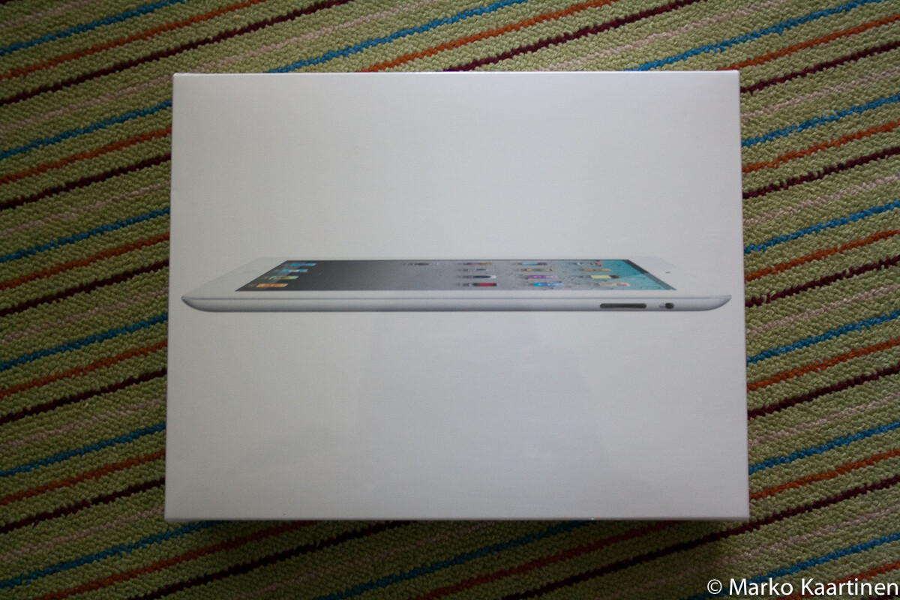
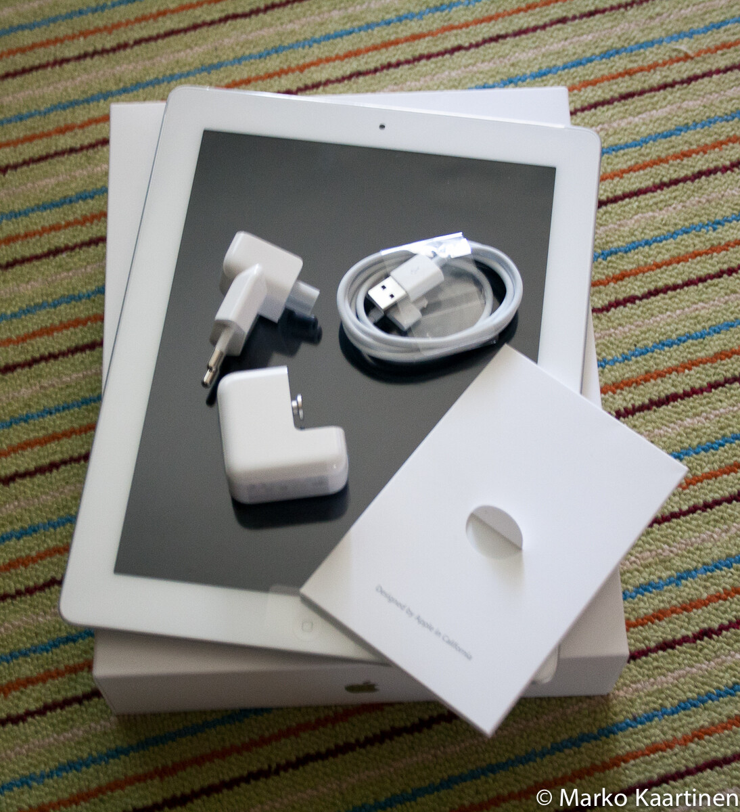

Tämä artikkeli on pitänyt kirjoittaa jo kaksi kuukautta sitten. Se tulee tällä kertaa hyvin paljon myöhässä. Olen siis hankkinut iPad 2:n – tästä on ollut juttua [Twitterissäni](http://twitter.com/MarkoK). Tässä kirjoituksessa tulen käsittelemään iPad 2:n käyttöä hieman laajemmalla aikavälillä. Kerron myös miten tätä on käytetty ja mitä appseja suosittelen teille.\

## Yleistä iPadistä

Applen tapaan laatikko on simppeli ja sen purkaminen käy kuin leikki. Käyttöönotto on myös yhtä vaivatonta, kuin ennenkin. Ainut ”työläs” homma oli odottaa, kun jo olemassa olevat ohjelmat siirtyy iPadille. Tämän jälkeen se ärsyttävin vaihe oli järjestellä kaikki kuvakkeet sopivaan järjestykseen.

Itsellänihän on tuo 16 giganen perus WIFI-malli – eli taitaa olla se halvin malli. Väriin oli vaikuttamassa tämän huushollin ”parempi” puolisko.

Tämän käyttämisenhän oppii hetkessä kaikki. Käytettävyys tuppaa olemaan suhteellisen kova näissä Applen tuotteissa. Tietysti on jokunen asia mitä näissäkin voi parantaa, mutta niitä saa hakemalla hakea – yleensä ärsyttävyydet tulevat esiin jonkin appsin kanssa.

## Pari mielipidettä

Pakollisia ostoksiahan tähän laitteeseen ovat näytönsuojat ja jonkinlainen kotelo. Itse ainakin ajattelen näin, sillä haluan näytön pysyvän hyvässä kunnossa – samoin kuin muun laitteen. Itse suosittelen suojan hankintaa! Applen oma [Smart Cover](http://www.apple.com/fi/ipad/smart-cover/) on ovela tuote jo itsessään. Siinä olevat magneetit nimittäin herättävät iPadin kun aukaset suojan ja laittavat iPadin nukkumaan kun suljet kannen. Suosittelen.

Ensimmäisiä asioita mitä iPadiin laitoin oli Kreikan matkan kuvat. On nimittäin loistava vempele kuvien näyttämiseen, varsinkin jos parille kaverille esittelet niitä.

Yksi syy valinnalle oli se, että minulla on ennestää jo iPhone ja osa sen appseista menee suoraan iPadiin. Niinhän siinä kävi ja sitten osa appseista pitää ostaa erikseen, koska osa on eritellyt iPhone ja iPad sovellukset erikseen (ikävä kyllä, tämä on totta).

## Missä käytössä tämä laite on ollut?

PDF-lukijana tämä on kyllä aivan loistava. On tullut jokunen PDF luettua ja tämä on huomattavasti paljon kevyempi kuin läppäri ja isompi kuin kännykkä. iPad sopii tähän tarkoitukseen kerrassaan loistavasti.

Pelit ovat tämän laitteen suola. Helkutti niitä on kiva pelailla. Tahkosin puolet Helsinki-Kuopio automatkasta Plants vs. Zombies -peliä. Tulen jossain vaiheessa kirjoittamaan pelkästään iPadin peleille tarkoitetun postauksen.

Sosiaalisia medioita tulee seurattua tuon kautta jonkin verran. Samaten uutisia, blogeja sekä muuta Internettiä tulee käytettyä.

Tämä laite tulee kopattua aika usein mukaan kun menee illalla sänkyyn tai kun tahtoo kotona nopeasti vilasta Facebookkia tai Twitteriä.

## Must have appsit

**Flipboard** on erittäin loistava appsi. Tämä kannattaa hankkia sillä tähän saat laitettua esimerkiksi Google readerin syötteet ja tätä kautta luettua blogeja. Itselläni on tässä appsissa laitettu Tumblr, Facebook, Twitter ja Google reader – sekä pari satunnaista syötettä, jotka löytyi Flipboardista.



**Facebook** toimii tässä vekottimessa jopa paremmin kuin verkossa. Simppeli käyttöliittymä ja sitä on vielä suhteellisen helppo käyttää. Se hyvä puoli on myös siinä, että voit lisätä useita Facebook tilejä. Tämä taas mahdollistaan sen, että useampi henkilö (meidän taloudessa 2) voi käyttää tuotakin.

**Twitter** toimii tässäkin hyvin, app on selkeä ja helppokäyttöinen. Käyttää oikeastaan hyvinkin mieluusti tätä.

Videoiden maailmasta suosittelisin taas **TED** (puheita) ja **Ruutu** (nelosen/jimin sarjoja) -sovelluksia. Ylen Areena ei toiminut vielä iPadillä (ainakaan kuin viimeksi katsoin). Taitaa muuten **Voddler** toimia myös iPadillä.

## Loppusanat

Ehdottomasti hyvä hankinta, en ole katunut tämän hankintaa kuin sen ohikiitävän hetken kun astuin kaupasta ulos. No, Applen tuota on aina Applen tuote. Tulen saamaan jonkinmoista Apple fanboy leimaa tästäkin. Huomatkaa, että harkitsin muitakin vaihtoehtoja pitkään ja hartaasti.

Kommentoikaapas, saa niitä kärkkäitäkin kommentteja pistää *(joku ei kuitenkaan arvosta Applen laitteita).*
