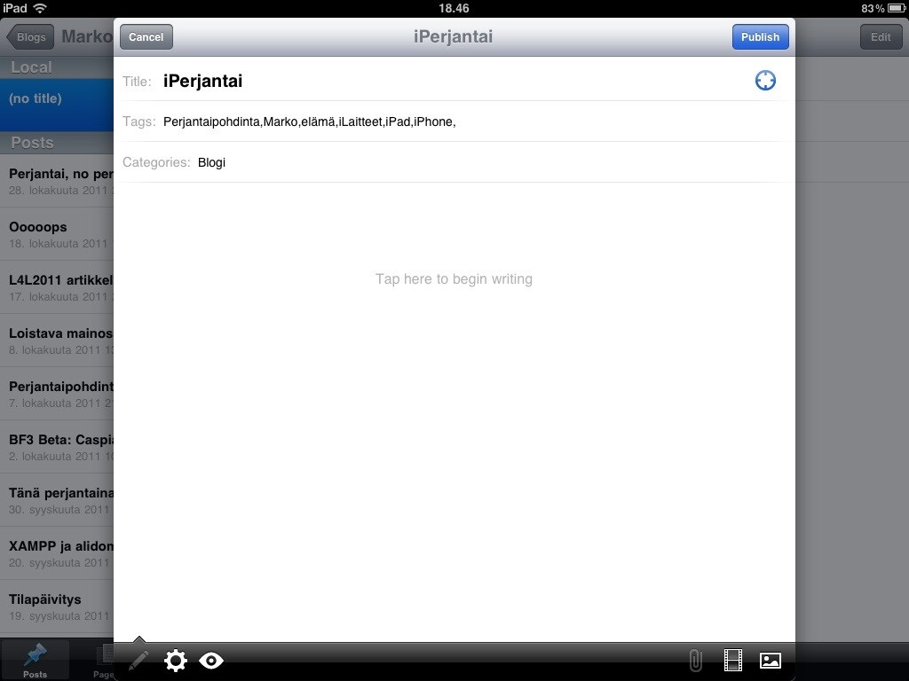
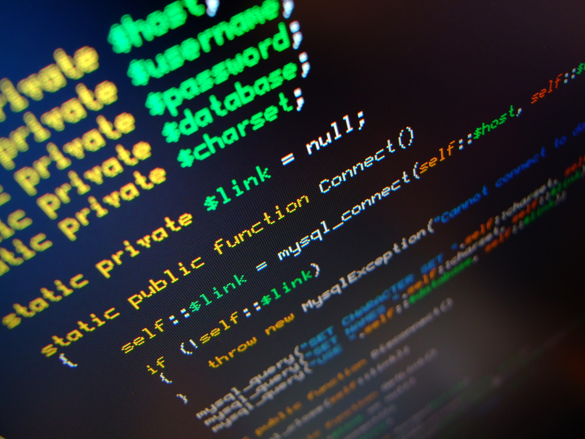

Kirjoittelen tätä pohdintaa vaihteeksi iPadillä. Tästä vekottimesta on pitänyt kirjoittaa arvostelu tai jonkinlainen juttu jo kauan. Pyrin viikonloppuna kirjoittamaan hieman kattavemman artikkelin tästä. Näin lyhyenä ränttinä sanottakoon, että laite on erittäin pätevä, mutta näppäimistö on vähän heikko kirjoittamiseen – ainakin pitempään tekstiin.

Jos hieman jatkaa vielä iPad aiheella, olen tässä koittanut rakentaa erittäin kevyttä ympäristöä siihen, kevyllä tarkoitan painoltaan kevyttä. Tällä hetkellähän tuo on ollut täysin viihdekäytössä, mutta tulen kokeilemaan saisinko jonkinlaista ohjelmointiympäristöä rakennettua sille. Tähän sain innoikkeen Markin [blogikirjoituksesta](https://yieldthought.com/post/12239282034/swapped-my-macbook-for-an-ipad). Sovelluksia saa ehdotella tänne päin ;)

Jatketaan iLaitteilla, onhan sentään iPerjantai. Olen pohdiskellut miten saisi tämän huushollin vanhan käytössä olevan 3G:n uusittua uudempaan malliin. Elisalla on hintataso huimasti korkeampi verrattuna Soneraan, toisaalta Soneraan en lähtisi enää ollenkaan, enkä oikein voikaan. Pitääköhän tässä odottaa hieman, josko hinnat laskisivat?

Sitten muihin aiheisiin. Olen alkanut koodaamaan omia projektejani eteenpäin, työn alla on yksi uusi laajempi systeemi ja yksi WP teema. Mikäli sinua kiinnostaa palkata minut koodaamaan niin ota yhteyttä [yritykseni](http://elysium.fi) sivujen kautta – [www.elysium.fi](http://www.elysium.fi) – toteutamme järkihinnoilla sovelluksia/verkkosivuja/muita IT-palveluita. (heh ”ovela” mainos…)

Kova halu olisi kehittää [RantSiteäkin](http://rantsite.net) eteenpäin, tähänkin saa tehdä ehdotuksia. Uusi teema, uutta sisältöä ja joku uusi koukku? Heittäkää nörtille idea ;)

Tämä artikkeli tuotettiin käyttäen iPadia ja Macbook Prota ;)
