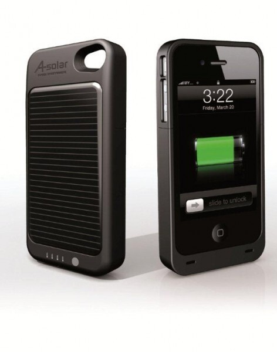

Testasin tätä aiemmin saamaani [aurinkokennolaturia / lisäakkua](/2011/iphone-4-power-pack) iPhoneen. Sanotaanko näin, että tämmöistä suosittelen kaikille iPhonen omaaville, sillä älypuhelimissa akku voi mennä suhteellisen nopeaan (riippuu miten paljon rämppää sitä) ja iPhonessa kun ei ole suoraan irroitettavissa olevaa akkua niin tämänkaltainen ratkaisu on juurikin passeli!

Aurinko lataa tuota settiä suhteellisen hyvin, mutta en ole saanut pidettyä sitä niin kauan auringossa, että olisin saanut ladattua sen täyteen. Tulen tekemään tästä laturista vielä jutun, kun lähden Kreikkaan sillä siellä sitä aurinkoa vasta riittää! Sekä uskon tuon olevan matkailijalle erittäin hyvä apuväline kun pistoketta ei olekaan saatavilla joka paikassa. Tästä sitten lisää ensi kuun puolella vielä!

Auringon lataamiseen liittyen sain vinkkiä tuotteen toimittaneen yrityksen edustajalta, että iPhonea ei tosiaan kannata pitää lisäakussa kun lataa sitä auringossa, tämänhän jo osittain tiesin ja tästä olikin jo puhetta edellisen kirjoituksen [kommenteissa](/2011/iphone-4-power-pack#comments).

## Testi

Tein suhteellisen hyvän testin sillä tavalla, että annoin iPhonen akun kulua kokonaan nollille ja sen jälkeen pistin lisäakun kiinni ja jatkoin normaali käyttöä ja annoin sen ladata iPhonen niin täyteen kuin pystyi. Tämän jälkeen käytin iPhonen akun taas tyhjiin. Tällöin näin mitenkä tuo akku parantaa omassa peruskäytössä iPhonen akunkestoa.

Testi alkoi lauantaina klo 8.30 kun otin täyteen ladatun iPhonen pois laturista. En osaa sanoa miten paljon puheluita, sähköpostin lukemista, pelaamista yms. tämän testin aikana tehtiin, mutta suurin osa siitä oli sähköpostin lukemista ja sosiaalisen median käyttöä. Akku päätti loppua tiistaina kolmelta. Sain siis iPhonesta irti 3.5 päivää.

Tämän jälkeen kun akku loppui laitoin lisäakun kiinni ja katsoin kauanko tuolla menee täyttää iPhonen niin täyteen kuin se pystyy. Tunnissa se täytti iPhonen akun 71 % asti ja mainittakoon, että iPhone ja lisäakku lämpeni hieman tuon prosessin aikana.

Lataamisen jälkeen akku kestikin sitten torstai iltaan asti eli sain noin 2.5 päivää irti vielä siitä. Yhteensä tuon lisäakun ansiosta sain iPhonesta irti 6 päivää tämän testin aikana. Mainitsen myös sen, että testihän on vain suuntaa antava, eikä millään tavalla virallinen. Tämä testasi minun käytöllä tätä lisäakkua ja teillä nämä tulokset voivat vaihdella!

## Loppusanat

Olen erittäin tyytyväinen tuohon lisäakkuun ja siihen, että sitä on mahdollsta ladata auringossa tai USBin kautta. USB-liitin on tosin micro USB liittimellä, joten tämä on itselläni miinus – vain sen takia, että muita laitteita ei ole tuolla liittimellä.a

Kiitoksia vielä tuotteen toimittaneelle [A-Solarille](http://a-solar.eu/).  Tuotteellahan on hintaa heidän [verkkokaupassaan](http://a-solar.eu/EN/solar_chargers_%20super_charger_for_iphone4.htm) 59 euroa. Huomasin myös, että heille on tulossa uusi [Slimpack](http://a-solar.eu/EN/slimpack_for_iphone_4.htm), jonka erona tähän on se ettei siinä ole aurinkokennoa ja se on hieman tehoiltaan heikompi. Se on siis pelkkä lisäakku, mutta kooltaan tuo on erittäin ohut.

**Päivitystä!**

Katso myös toinen [artikkeli](/2011/iphone-4-power-pack) aiheesta sekä [video](/2012/iphone-4-power-pack-video)!
