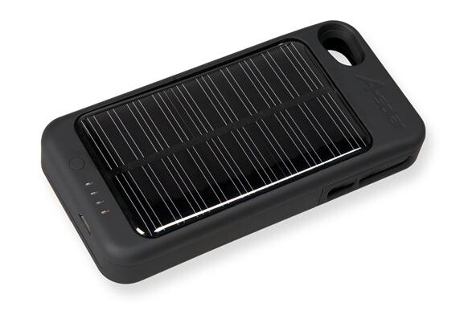
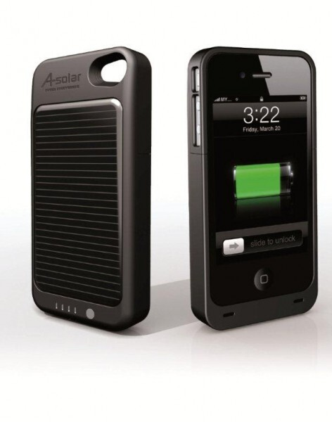

Tänään tapahtui jotain ainutlaatuista koko blogin historiassa! Sain nimittäin arvosteltavaksi aurinko voimalla toimivan akkupaketin iPhone 4:lle! Kerron tässä viestissä hieman ensikokemuksia tuosta laitteesta ja tulen palaamaan vielä tarkemmin kunhan olen saanut käytettyä tuota ja testattua auringolla lataamista.

Ensimmäisenä pistää silmään tuon koko, ilmaiseksihan ei lisäakku puhelimeen tule. iPhonelle tulee lisää paksuutta jonkin verran, ehkä vähän vajaa toisen iPhonen paksuus. Pitää ottaa huomioon, että selkäpuolella on aurinkopaneeli ja pitäähän se akku olla myös jossain. Leveyttä tulee pari kolme milliä lisää sekä pituutta tulee sentti pari lisää.

Ensimmäinen ongelma tuli oikeastaan jo siinä, kun koitin puhelinta tuohon ja otin pois. Itselläni oli nimittäin iPhonessa reunoissa suojatarrat ja ne ottivat hieman vastaan, kun iPhonea otti pois. Mukana tullut näytön läpinäkyvä suojakalvo sekä itselläni ollut taka tarra sopivat hyvin laitteeseen. Sivulle en suosittele yhtään mitään, sillä se hankaloittaa iPhonen pois ottamista.

Mukana tuli myös USB-kaapeli, jossa oli micro USB liitin, eli akku käyttää micro USB:tä ja tämä on hieman harmi sillä itselläni tämä on ainut tätä liitäntää tukeva laite. Sen verran kokeilin, että tuon kautta voi myös synkata iPhonen eli iTunes tunnisti puhelimen moitteetta.

Toiminnasta sen verran, että ilmeisesti laite lataa ensin iPhonen akun täyteen ja tämän jälkeen alkaa itse kuluttamaan omaa akkuaan. Oman akun loputtua alkaa iPhonen akku kulua. Laitteen voi myös laittaa pois lataamasta, vaikka olisikin kiinni iPhonessa. Takana on myös ledit, josta näkee paljonko on laitteessa vielä virtaa.

Laitteen kotisivuilla mainitaan, että lataaminen USB:n kautta kestää 3 tuntia ja aurinkokennon kautta jopa 10-14 tuntia. Sekä mikäli oikein tulkitsin niin puhelimen akun se lataa täyteen 3-4:ssä tunnissa.

Tulen testaamaan mitenkä kauan puhelin kestää minun käytössäni kun käytössä on tuo lisäakku täyteen ladattuna. Sekä mitenkä hyvin se ottaa auringosta sitä virtaa (mitenkähän tuotakin testaan… hmm). Kaiken kaikkiaan mielenkiintoinen vekotin ja tulee tarpeeseen, koska en omista mitään lisäakkua puhelimelle.

Tuotteen toimitti [A-Solar](http://a-solar.eu/), joten kiitos heille! Tuotteella on hintaa heidän [verkkokaupassaan](http://a-solar.eu/EN/solar_chargers_%20super_charger_for_iphone4.htm) 59 euroa. En osaa sanoa onko tämä halpa vai ei, koska en ole tehnyt vertailua. Eikä Suomessakaan ole jälleenmyyjää (ainakaan vielä). Heillä näkyy olevan myös paljon muita aurinkopaneelin avustuksella toimivia tuotteita.

Nyt on teillä mahdollisuus vaikuttaa testaamiseen ja kertoa kommenteissa mitä haluatte tietää tästä!
