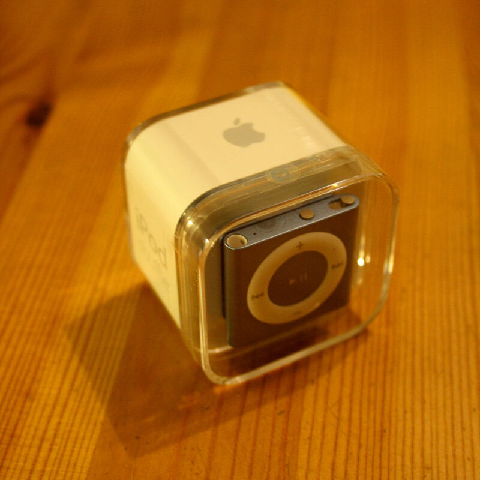
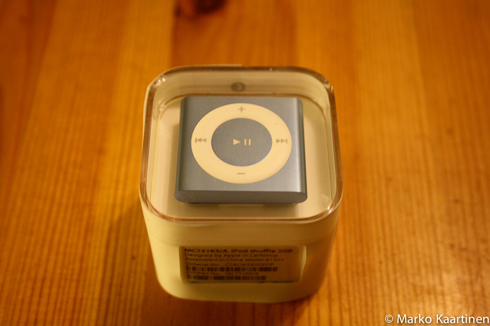
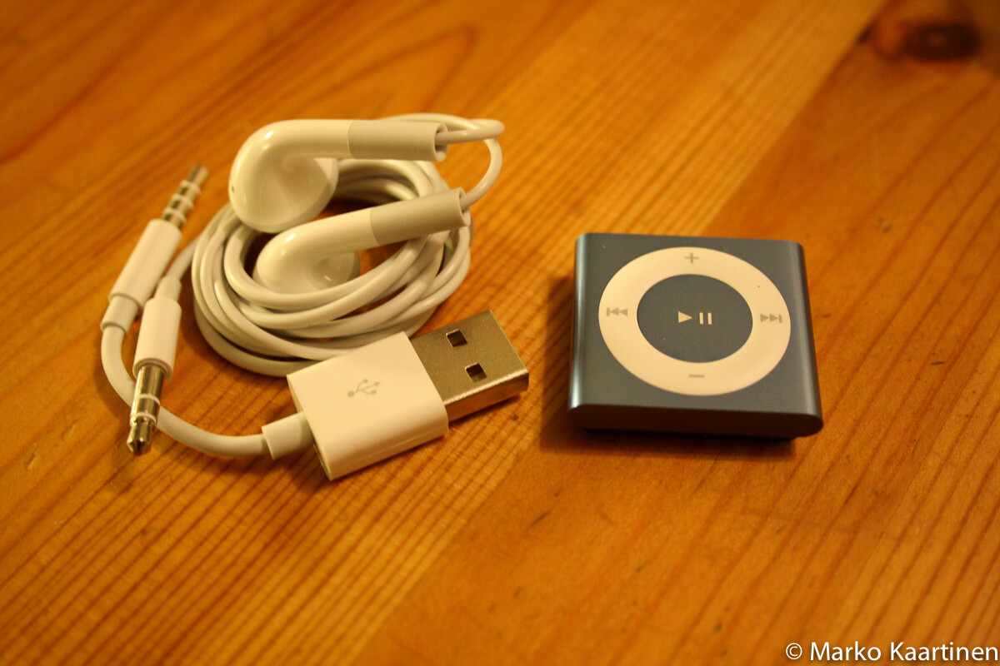
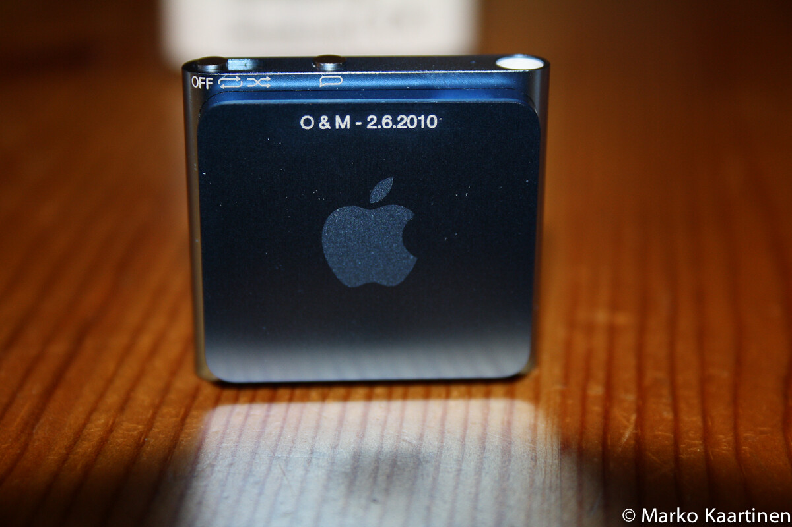

Posti toi tänään yhden omppu tuotteen lisää. Nyt oli vuorossa iPod shuffle! Tämän hankinnan syynä oli se, että itsellä ei ole mp3 soitinta tällä hetkellä ja puhelimen akku kuluu suhteellisen aktiivisesti. Tietysti laitteen pieni koko ja näppäryys on eduksi!

Seuraavaksi kerron hieman tästä laitteesta ja kerron ensivaikutelman tästä pienestä, mutta pippurisesta vekottimesta. Parin viikon tai kuukauden päästä tulee sitten artikkeli, jossa kerron mitä olen pitänyt tästä laitteesta. Tarkkailtavia asioita saa siis kertoa!

Otetaan nämä tekniset tiedot ensin käsittelyyn. Kokoahan tällä vekottimella ei ole juuri lainkaan! Leveys on **31,6mm**, korkeus on **29mm** ja syvyys on **8,7mm** (klipsin kanssa) – painoakin on vain **12,5 grammaa**! Musiikkia tähän menee **2 gigatavua**, joka riittää omaan tarpeeseen varsin mainiosti. Applen [sivut](http://www.apple.com/fi/ipodshuffle/specs.html) lupaa joka **15 tunnin** akkukestoa, joten sekin on minusta kunnossa! Ja siihen käy normaalit **3,5mm plugilla** olevat kuulokkeet!

Ensivaikutelmana tuli mieleen, että onpa se pieni! Laitteen koko ei nimittäin ole päätä huimaava! Soitin oli pakattu Applemaisesti, joten tämänkin paketin aukaseminen oli helppoa ja vaivatonta (ei kirosanoja tarvittu!).

Itse valitsin tämän sinisen värisenä, koska se näytti yksinkertaisesti parhaimmalta ja pidän sinisestä. Jostain syystä tuo pinkki ei oikein uppoa minuun… jännä juttu, eikös?

Paketissa tuli itse soittimen lisäksi mukana kuulokkeet, usb-piuha, pikaohje ja omppu tarra! Kuulokkeet ovat Applen perus kuulokkeet ja usb-piuha on siitä ovela, että se menee soittimen 3.5mm liitäntään ja sitä kautta ladataan ja siirretään musiikkia koneelle. Ovelaa kerrassaan!

Käyttöönotto oli myös helppoa. Laitoin usb-piuhalla kiinni koneeseen, avasin iTunesin ja synkkasin luomani soittolistan iPodiin. Ei paljon helpompaa voisi olla enää! Tietysti akkua pitää ladata jonkin verran ja lataus onnistuu vain tämän usb-piuhan kautta. Pitää kokeilla joskus toimiiko iPhonen verkkovirta laturi tämän soittimen kanssa.

Mainittakoon laitteen painikkeista vielä pari juttua. Niitä on nimittä vain muutama. On nämä perus seuraava/edellinen, lisää/vähemmän volyymiä ja play/pause – sekä näiden lisäksi nappi josta saa puheena korvaan kappaleen nimen tai sitten akun tilan. Äänenä on tietysti mikropuhemainen ääni! Sekä liukukytkin mistä soitin menee päälle voi suoraan valita soittotilan, eli soittaako shuffle-tilassa vai normaalissa tilassa. Sopiva määrä painikkeita ja mitään ylimääräistä ei ole!

Meinasi unohtua, tämä kerran mainittu klipsi. Tämän avulla saat soittimen kiinni näppärästi vyöhön tai melkein mihin vaan keksit sen klipsin pistää.

Toinenkin asia meinasi unohtua! Otin soittimeen kaiverruksen – tämähän ei maksanut mitään ja saat laitteesta vielä yksilöllisemmän. Paljastettakoon, että ostin ystävänpäivälahjaksi toiselle puoliskolle samanlaisen soittimen, mutta pinkkinä ja samalla kaiverruksella.

Kuten sanoin niin tulevaisuudessa tulee sitten artikkeli tämän soittimen kokemuksista!
