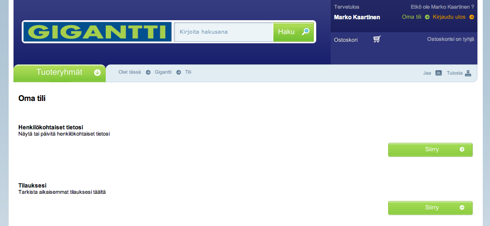
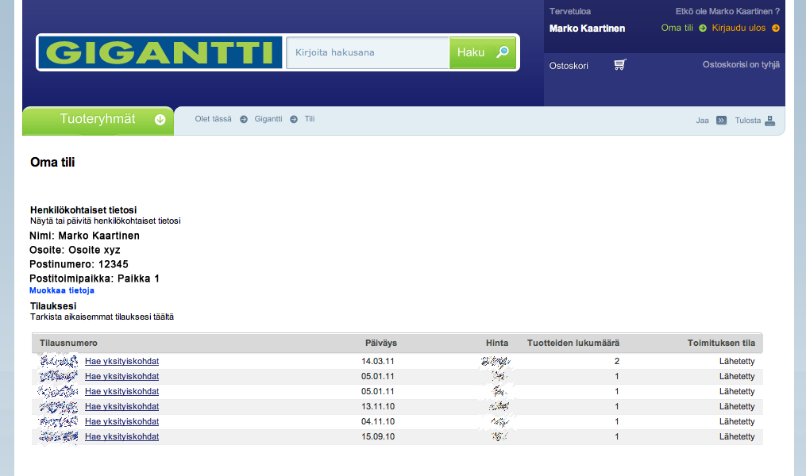

Harvemmin alan jakelemaan parannusehdotuksia livenä, mutta kerta se on ensimmäinenkin. Törmäsin Gigantin uudistuneilla sivuille erääseen häiritsevään käytettävyys mokaan.

Uudella Oma tili -sivulla on nimittäin painikkeiden asettelu hiukan hakusessa:\

Teksti kun on asetettu vasempaan reunaan ja Siirry -painike onkin sitten oikeassa reunassa. Tämä on ensinnäkin ärsyttävää ja suhteellisen hämäävää, kun Henkilökohtaiset tietosi ja Tilauksesi otsikoiden alla on tismalleen samanlainen painike.

Korjausehdotuksena esittäisin, että painikkeet siirrettäisiin kyseisen otsikon alle. Tai täytettäisiin Oma tili -sivu hieman informatiivisemmalla tiedolla. Tuohon saisi nimittäin laitettua näkyviin omat tietosi ja siihen vaikka Muokkaa -painike ja tilauksista pieni yhteenveto ja vaikka Näytä lisää -painike.

Esimerkiksi vaikka näin:\

Hyvin nopea räpellys jossa on asiat jo hieman paremmin kuin nykysellään. Tilauksesi taulukko on suoraan otettu napin takaa. Henkilökohtaiset tiedot voisivat olla paremminkin ja muokkaa tietoja -painike voisi olla paremmassa paikassa. Tämä olikin vain viitteellinen kuva millainen se voisi olla.
