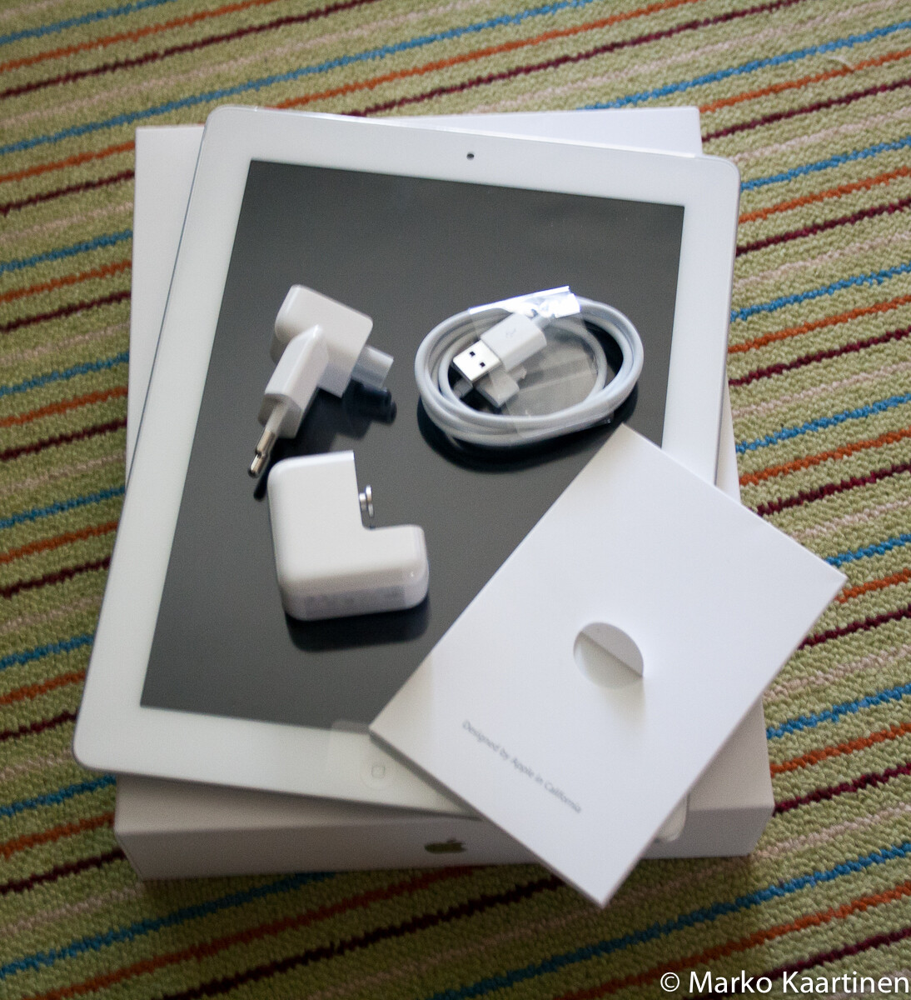

Tänä jouluna moni varmaan sai tabletteja lahjaksi – nyt en siis puhu pöydälle tulevista jutuista vaan ns. täppäreistä tai ”taulutietokoneista”. Osalle ehkä helpoin, että sanoin iPad tai muut vastaavat vekottimet. Kysehän on siis miniläppärin ja kännykän välimuodosta eli käytössäsi on käytännössä vain kosketusnäyttö, jolla teet kaiken mitä tarvitset. Tietysti on erinäköisiä lisälaitteita olemassa, kuten bluetooth näppiksiä ja muita vastaavia vekottimia.

Nyt olisi hieman tarkoitus pohtia mikä onkaan paras tablet. Ikävä kyllä en ole päässyt Android laitteita testaamaan kovinkaan hyvin, joten voin spekuloida niiden osaa lähinnä sen kautta mitä tiedän niistä ennestään. Omistan [iPad 2](/2011/ipad-2 "iPad 2"):n joten siitä laitteesta on jo ennakkoon tietoa aika paljon.

## Ohjelmat/appsit

Androidin tabletteihin on tarjolla huima määrä eritasoisia ohjelmia, joista osa maksaa ja osa on ilmaisia. Tässä taas on se kääntöpuoli, että taso tosiaan vaihtelee hurjasti ja toimivuus samaten. Jotkut ohjelmat voivat kaataa koko tabletin suhteellisen helposti kun ei sitä tarkempaa controllia ole. Androidissa taas on se vapaus valita mitä ohjelmaa käytät ja jopa mitä versiota tabletin käyttöjärjestelmästä käytät (eli rommin voit halutessa vaihtaa täysin toisenlaiseen).

Applen iPadissa on myöskin tarjolla huima määrä sovelluksia joista voit valita mitä lystäät tai no melkein mitä vain. Taso Applen AppStoressa on parempi kuin Androidilla sillä siellä jokaisen ohjelman hyväksyy Apple eli ei ole niin iso riski koko tabletin kaatumisesta. Tässäkin on haittapuoli, kehittäminen ei ole ihan niin vapaata kuin Androidilla ja olet aika pitkälti sidottu siihen käyttöjärjestelmään.

## Käytettävyys

Androidin käytettävyyteen osaan sanoa jotain [HTC Desire Z](/2011/htc-desire-z "HTC Desire Z"):n takia, mutta muuten tämä osio perustuu hieman spekulaatioon. Tämä voi olla osalle aika ratkaisevakin asia sillä iPadissä käytetävyys on hyvä sillä se on aina oikeastaan ollut Applen laitteissa näin. Itse olen pitänyt siitä, että ne on helppoja sekä yksinkertaisia käyttää ja niissä on innovatiivisuutta. Nykyään tosin on vaikea keksiä uusia temppuja. Androidissa on taas se puoli, että nörtit ja muut asiasta kiinnostuneet voivat käytännössä tehdä tabletista täysin omanlaisensa jolloin saavutetaan täysin uniikki kokemus.

Aika pitkälti ollaan suhteellisen samoilla viivoilla, mutta erona on tässä lähinnä mielipide-erot. Tästä kannattaa teidän antaa omia mielipiteitä minulle sillä en osaa niin sanoa Android puolesta kun en ole käyttänyt Androit täppäriä täysipäiväisesti.

## Hinta?

Hintahan riippuu aina ominaisuuksista ja siitä miten paljon mitäkin haluaa. iPadeissä hinta eroaa lähinnä siitä miten paljon gigatavuja haluat laitteeseen sekä haluatko 3G:n vai et. Android tabletteja taas on monen hintaisia ja halvimmat ovat alle satasen ”kiina ihmeitä”. Noihin en välttämättä koskisi ollenkaan, ellen sitten tietäisi sitä suhteellisen toimivaksi vekottimeksi.

Katsoin ihan vertailun vuoksi paljonko maksavat Gigantissa halvin ja kallein iPad sekä Android tabletti. Halvin on itseasiassa Acerin ICONIA TAB A500 hinnalla 399 euroa, kun taas halvin iPad 2 maksaa 445 euroa (16GB ei 3G). Kallein Android tabletti on Samsung Galaxy Tab 10.1″ hintaan 799 euroa (3G + 64GB) ja kallein iPad 2 taas 795 euroa (3G + 64GB). Mainitsen vielä, että halvin Samsung Galaxy Tab 8.9″ (16G ei 3G) on 459 euroa.

Hinnoissa ollaan siis suhteellisen samoissa linjoissa, tässähän ei oltu otettu huomioon ollenkaan noita erittäin halpoja ”kiina ihmeitä”.

## Sekalaista

Tässä on nyt käytö oikeastaan kolme isompaa tai oikeastaan vaikuttavaa tekijää tabletin hankinnassa ja niiden vertailussa. Tabletin käyttöön tietysti vaikuttaa kaikki lisähärpäke mitä on saatavilla, itse olen esimerkiksi iPadiin hankkinut tommosen simppelin suojan johon sen voi laittaa, Smart Coverin, näytönsuojakalvon sekä bluetooth näppiksen. Olenpa jokusen rivin koodiakin vääntänyt tuolla vekottimella.

Näin jälkiviisaana sanoisin, että 3G olisi ollut pirun näppärä ominaisuus tuohon vekottimeen. Tabletille on muodostunut itsellä erittäin selkeä visio ja tarve, että sen pitäisi olla aina verkossa. Tällä hetkellä hoidan sen kännykän netin jakamalla (WLAN hotspotin yli), mutta tämä kuluttaa tietysti akkua. Olisi erittäin pätevää mikäli tabletilla pääsisi aina verkkoon kun haluaisi. Tämä tuleekin olemaan seuraavan tabletin hankintaperuste sitten joskus.

## Lopuksi

On erittäin vaikea sanoa minkä leiriin lähtisi, koska molemmissa on hyvät ja huonot puolensa. Itse tein päätöksen osittain niin, että katsoin mitä minulla muuten on. iPhonen ja iPadin appsit kun käy osittain yhteen niin oli luontevaa, että hankin iPadin, koska AppStoreen minulla on roinaa eniten. Tietysti jos sinulla sattuu olemaan Android puhelin niin voi olla luontevaa mennä Android leiriin.

Mikäli maailma olisi täydellinen paikka niin minulla olisi molemmat laitteet, niin Android tablet kuin iPad. Tahtoisin nimittäin testata hieman enemmä tuota Androidia, varsinkin tuota uudempaa Galaxy Tabia sillä se voi olla suhteellisen kova vastus iPad 2:lle.

Parhaan tabletin titteliä en siis suoraan anna vaan tämä on taas erittäin paljon riippuvainen siitä mistä käyttäjä itse tykkää. Eikö ollutkin suhteellisen poliittinen vastaus tai oikeastaan savolainen ;)

Kertokaa omia kokemuksia ja mielipiteitä – sana on vapaa!
