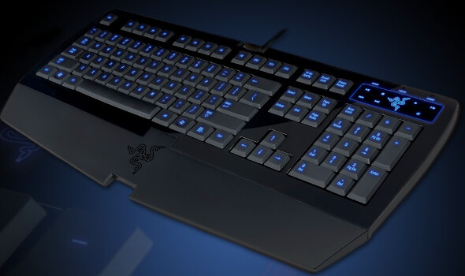

Posti kiikutti tänään lisää roinaa. Tuli nimittäin uusi näppäimistö! Entinen näppäimistö (Logitech Wave) sai väistyä Razerin tieltä, koska langaton Wave ei enää toiminut yhtä vakaasti kuten olisi pitänyt(näppäimet ns. lagittivat). Olisin ostanut Waven langallisena, mutta kun niitä ei tahdo saada mistään – tyydyin siis koittamaan uutta merkkiä.

Otetaan aluksi tämä tekninen jargon käsittelyyn. Näppäimistöhän on ensisijaisesti pelaajille tarkoitettu, joten ominaisuudetkin on sitä varten ajateltu. Näppäimistön pinta on ilmeisesti jotain kumipinnoitetta tai vastaavaa – itse ainakin pidin sen tuntumasta. Näppäimet ovat myös taustavalaistu! Painikkeet voi ohjelmoida itse ja makrotoiminnot ovat myös mahdollisia. Mainitaan nyt vielä vasteaika, se on nimittäin 1ms.

Ensivaikutelma näppiksestä on loistava. Pelailin tällä illan ja se vaikutti hyvältä näppäimistöltä ja en ole ainakaan vielä katunut sen hankintaa. Toinen asia mikä herätti huomiota, on nimittäin VALOT! Kyllä, tässä on valot! [Macbookissa](/2010/macbook-pro-magic-mouse) totuin jo tähän ja pitihän se sitten saada pöytäkoneeseenkin. Tämän näppiksen valoissa on vielä kolme eri moodia: on / off / wsad only – eli suomeksi: päällä / pois / wsad painikkeet päällä.

Kaiken kaikkiaan näppäimistö vaikuttaa hyvältä ja olen tällä hetkellä erittäin tyytyväinen hankintaan. En osaa sanoa tulenko tästä kirjoittelemaan sen enempää, mutta jos teitä kiinnostaa niin saa heittää kysymystä tänne suuntaan!
