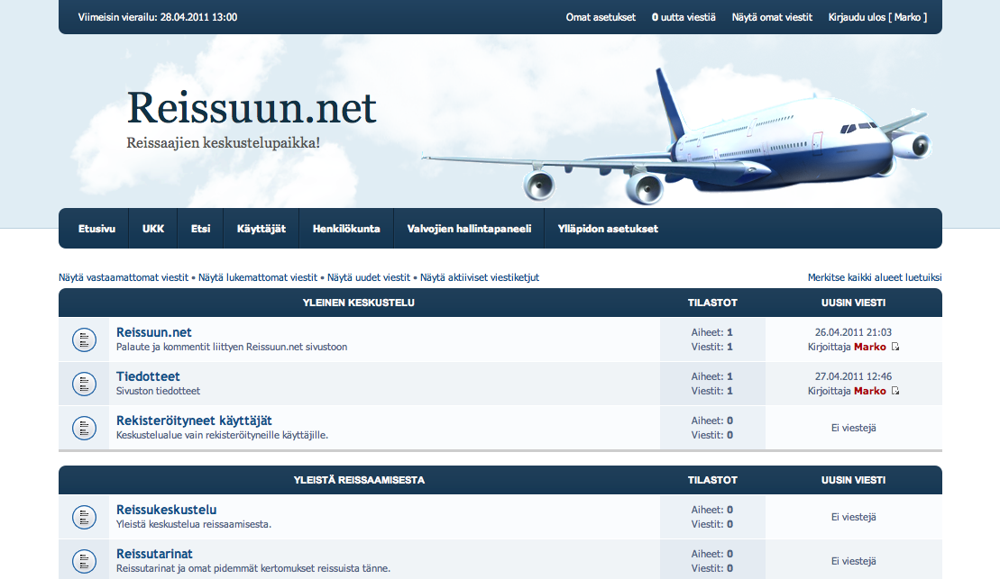

Kuten [Twitterissä](https://twitter.com/#!/MarkoK/status/63526084150427648) jo lupasin niin julkaisen teille uuden projektin, jota olen kaikessa hiljaisuudessa työstänyt. Mikäpä olisi parempi julkaisupäivä kuin allekirjoittaneen syntymäpäivä? En tiedä! (Ubuntukin btw julkaisi uuden version tänään, joten he ovat samaa mieltä kanssani!)

Asiaan… Reissuun.net on uusi keskustelufoorumi kaikille matkailusta kiinnostuneille. Idean tälle sain pääsiäisen aikana kun tuli varailtua matkaa etelän lämpöön ja ei ainakaan minun silmääni vastaavaa foorumia sattunut.

Pari huomiota voisin kuitenkin nyt jo heittää ilmoille. Foorumi vaatii rekisteröitymisen mikäli haluat osallistua keskusteluun ja katsella foorumia ilman mainoksia. Tämä siksi, koska haluan pitää keskustelun laadukkaana ja pitää kaikenmaailman botit kaukana. Trolleja tulee aina, mutta nekin saadaan aisoihin.

Alustana on PhpBB foorumisovellus ja tämä sen takia, koska löysin tuon teeman ja pienellä muokkaamisella sain siitä oikein hyvän teeman tälle foorumille ja olen halunnut koittaa PhpBB:n ylläpitoa jo pidemmän aikaa. Tällä mennään ja katsotaan mitä tapahtuu, kaikki vinkit ovat muuten tervetulleita!

Toivon, että saadaan aikaiseksi hyvä foorumi ja levittäkää vapaasti tätä linkkiä! Osoitehan on [www.Reissuun.net](http://reissuun.net/)

**Tervetuloa Reissuun!**
