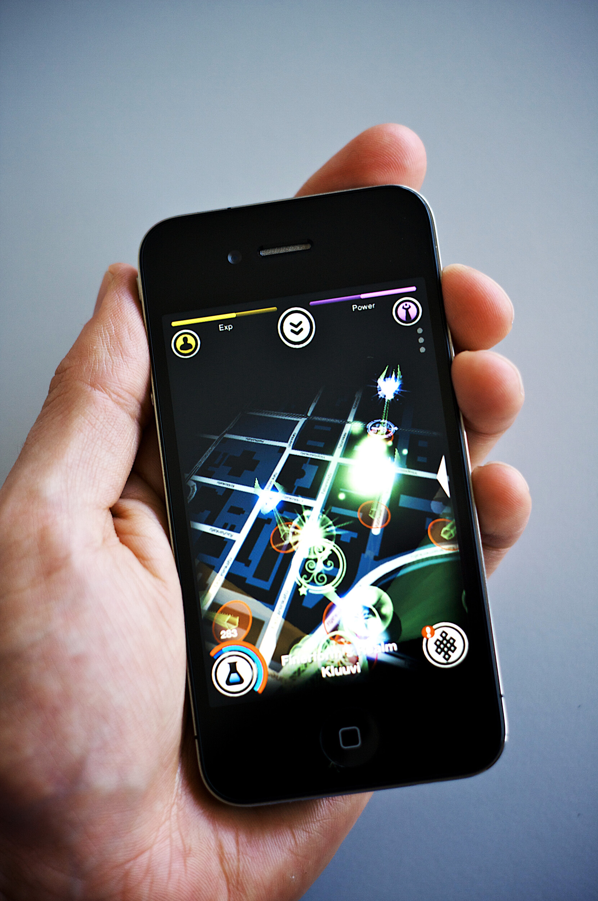

Löysin nyt vasta iPhonelle pelin nimeltä Shadow Cities. Kyseessä on sijaintiin perustuva peli ja taitaapi olla vielä suomalaisten tekemä! Suomessa se on julkaistu ensimmäisenä ja vähän aikaa sitten lähti valloittamaan maailmaa. Tästä johtuen pelin chatissa keskustelu on aika pitkälti suomalaisten hallussa. Suomeahan siellä haastellaan, eilen taisin nähdä jonkun solkkaavan englantiakin.

Pelin takana on firma nimeltä Grey Area ja täytyy sanoa, että on tehty todella komeaa jälkeä! Ai niin… mainitsinko sen, että peli on ILMAINEN! Pelissä on maksullisia osiakin, voit nimittäin ostaa lisää mana-pulloja pelin sisäisen kaupan kautta.

Minuthan saa lisätä kaveriksi, olen arkkitehtien puolella nimimerkillä **SnakeDoc**. Ilmoitelkaa itsestänne tämän postauksen kommentteihin!

Pelin kotisivut ovat osoitteessa [www.shadowcities.com](http://www.shadowcities.com/)
