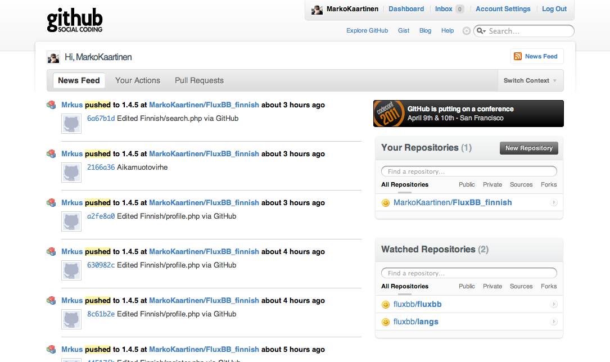

Otsikon sanoilla [GitHub](http://github.com) niminen palvelu mainostaa itseään. Oikeastaan se on täysin totta! Tässä on nimittäin samoja piirteitä kuin Twitterissäkin. Seuraa toisia koodareita ja toisia projekteja. Saat niiden päivitykset suoraan etusivullesi. Commit viestit ajavat tilapäivitysten virkaa. Hieno systeemi koodarille.

Voisi ehkä hieman valaista tarkemmin tuota GitHubia. GitHub on tarkoitettu Git versiohallinnan repositoryksi eli sinne saat laitettua koodisi ja saatpa samalla toimivan versiohallinnan kun käytätä Git versionhallintaa.

Ilmaistunnareilla voit tehdä julkisia repoja niin monta kuin sielu sietää, mutta muista että julkisia repoja voi tarkastella kuka vain. Joten jos teet koodia jota et halua jakaa muille, pitää sinun maksaa tilistäsi jolloin saat yksityisiä repoja.

Innostuin oikeastaan GitHubista vasta äskettäin, koska aloin kääntämään parin kaverin kanssa FluxBB foorumia suomeksi ja nyt tämä alkaa olla loistava työkalu. Tulen tuonne julkaisemaan jotain pientä ja jännää. GitHubissa on myös mahdollista Wikille ja jonkinlaiselle bugitrackerille. Eli saat ilmaiseksi avoimille projekteille erittäin hyvän alustan.

Mainittakoon nyt vielä, että käytän Gittiä MacBookillani ja sen saa toimintaan myös Windowsilla ja Linuxilla. MacBookille suosittelen loistavaa appsia nimeltä [Tower](https://www.git-tower.com/) (opiskelijat saa muuten -50% tästä Towerista kun toimittaa kopion/kuvan opiskelijakortista).

Tämmöistä tällä kertaa. Sosiaalisuus on myös koodareiden apuna tänä päivänä. Tuossa käännösprojektissakin on minun lisäksi kaksi muuta tekijää. Jotka voivat käytännössä milloin vain tehdä muutoksia käännökseen. Versiohallinnan etuna on se, että muutos näkyy ja edellisen version saa palautettua helposti. Versionhallinnasta tulee lisää joskus toiste.

**Hyvää alkanutta viikkoa!**
