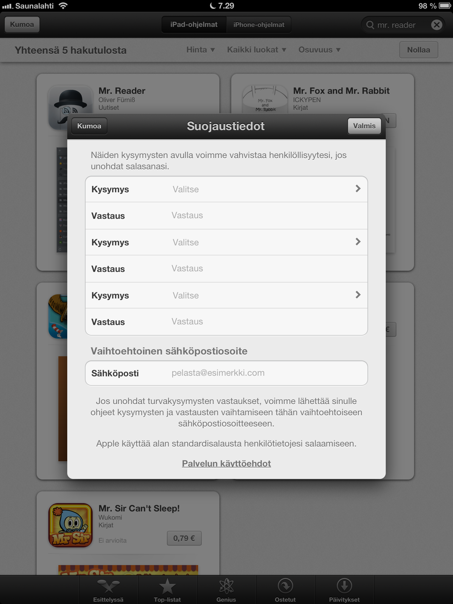
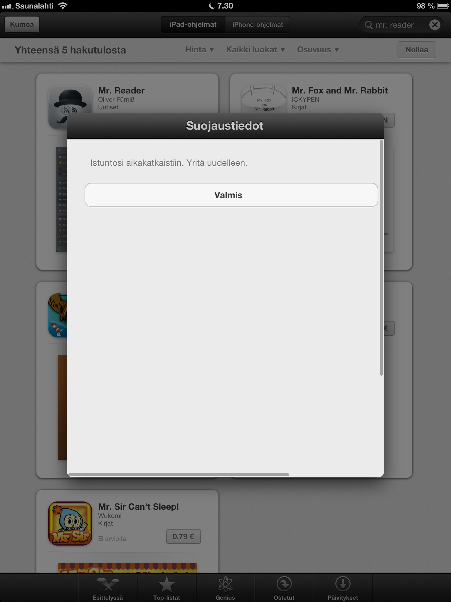

Koitin aamulla asentaa erästä ohjelmaa AppStoresta, mutta törmäsin pieneen ongelmaan joka estää ohjelman ostamisen. AppStore haluaa, että täytän kolme turvakysymystä ja sähköpostin johon voi laittaa apuja. Ok, kuulostaa ihan hyvältä idealta.

Tuohan olisi ihan hyvä jos se toimisi, törmäsin monesti siihen, että homma aikakatkaistiin ja täten et voi tätä ohjelmaa ostaa. Tällä hetkellä en siis saa ostettua yhtään mitään AppStoresta.

Päätin äsken koittaa vielä uusiksi, mutta tällä kertaa sainkin tyhjän sivun eteeni. Tämä alkaa olla jo harmillista!

Tämä on asia mikä pitäisi korjata heti! En tiedä onko muilla tätä vastaavaa sattunut?
