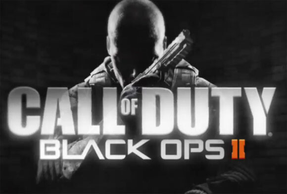
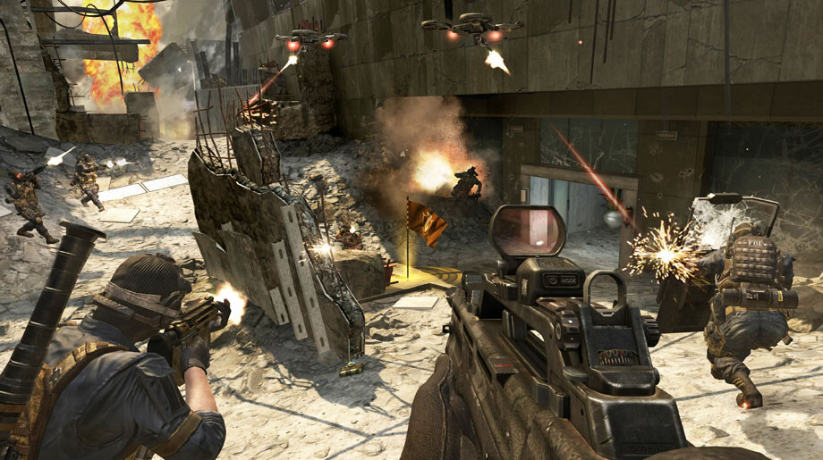
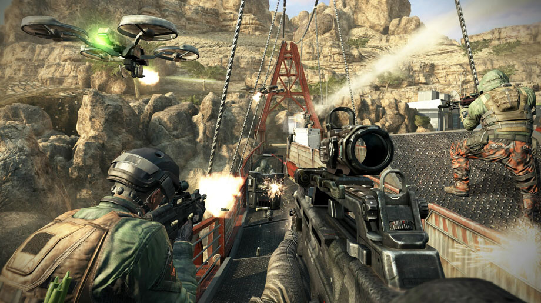

Olen nyt reilun viikon pelannut uusinta CoDyä ja olen saanut moninpelistä suhteellisen hyvän kuvan. Vielä on tietenkin asioita, joista en osaa sanoa yhtään mitään. En ole esimerkiksi lähtenyt vielä Prestigeä hankkimeen sotilaalleni. Yhden aseen olen jo ”prestannut”, nimittäin MSMC nimisen SMG:n. Paljon on uutta tullut myös scorestreakkeihin ja moneen muuhun osa-alueeseen. Aseluokkien tekeminenkin on erilaista, voit pistää 10 asiaa per aseluokka.\

## Mutta ne ongelmat

Toki moninpelissä on ongelmia, varsinkin alussa ennen kuin tulee korjauksia niihin. Tällä hetkellä ärsyttävin ongelma on NAT. Veljen kanssa on ärsyttävä alkaa partyssä pelaamaan kun hänellä on NAT: Strict, joten partyn muodostus ei onnistu. Minulla taas on NAT: Open, **mutta** sen saaminen on tuskallista. Yleensä nimittäin NAT onkin Moderate, jolloin ei partyn tekeminen onnistu. Tuntuu olevan täysin satunnaista millä asetuksilla tuo NAT: Open minulla tulee. Olen koittanut ohjata portteja, UPnP on päällä ollut ja joskus on ollut pois samaten DMZ.

Tarpeeksi kun CoDyä aukaisen ja sammutan niin saan jossain vaiheessa tuon NATin Open tilaan ja silloin voimme tehdä sen partyn, joskus ei muuten onnistu Open tilassakaan tuon partyn muodostaminen. Tätä ongelmaa en muista, että olisi ollut aiemmin ensimmäisessä Black Opsissa ollenkaan.

Verkon kanssa on muutenkin välistä ongelmia. Välillä tuntuu, että pingi heittelee aivan älyttömästi ja panokset ei tällöin osu maaliinsa ollenkaan (pingiä on muuten hyvä syyttää!). Host migrationiin en ole vielä törmännyt, **mutta** connection interrupted teksti on jokusen kerran tullut ruudulle. Samaan aikaan Skype yhteys on toiminut ja oma verkko muutenkin, eli voiko tästä vetää johtopäätöksen ettei host migrationia ole PC:llä?

Dedikoituja palvelimiahan tässä versiossa ei ole, joka on harmi. Itse tykkään siitä, että voi pelaille lempipalvelimella tuttujen kesken. Olenpa joskus pyöritellytkin omaa CoD palvelinta, harmillista ettei se ole tämän kohdalla mahdollista. Pelaaminenhan tapahtuu niin, että joku aulan pelaajista on hosti ja hän käytännössä hostaa tämän pelin ja muut yhdistää hänen koneellensa. Kun hosti katoaa niin pitäisi tapahtua tuo em. host migration, mutta tätähän ei ole vielä tapahtunut…

***Lisäys:** Tähän NAT ongelmaan on saattanut tulla jo ratkaisu. Testailen viikonlopun aikana tätä lisää.*

## Aseet

Nyt päästiin itse asiaan, nimittäin aseisiin. Aseet ovat vaihtuneet sitten ekan Blopsin ja nyt niitä on taas ihan riittävästi. Jokainen varmasti löytää itselleen oman suosikin. Uutena on tullut aseiden ”prestaamisen”, kun ase saavuttaa tason 16 voit aloittaa niin sanotusti alusta ja lähteä keräämään aseen unlokit uudelleen.

SMG:tä näkee nyt paljon enemmän kuin rynnäkkökiväärejä, itsekin käytän tällä hetkellä mielummin SMG:tä. Tämä johtuu myös siitä, että kartat ovat pienempiä kuin ennen (tästä kuitenkin lisää omassa kappaleessaan). Sniperit ovat tälläkin kertaa haastavia aseita ja ne jotka osaa käyttää niitä ovat pirun taitavia. Moni haukkuu heitä xiittereiksi, mutta kyllä niissä on taitoakin takana sillä aika hyviä suorituksia näkee quickscope ja noscope rintamalla.

Haulikot, näistä on kyllä pakko pari äkäistä sanaa laittaa. Tällä hetkellä ne tuntuu olevan suht overpowered sillä aika moni käyttää niitä ja pahimmillaan niillä ei tarvitse ampua kuin vähän sinne päin ja ne tappaa sinut kerrasta. Haulikkoja voisi siis ns. nerffata hieman tulevissa päivityksissä.

## Kartat

Kartat ovat pieniä, siis todella pieniä jos verrataan ensimmäiseen Blopsiin. Isoimmat kartat ovat ehkä keskikokoisia jos vertaa ekan Blopsin karttoihin. Tämä tekeekin pelistä suhteellisen intensiivistä ja ehkä joissain tilanteissa jopa ahdasta. Spawnit tuntuvat myös heittelevän kartoissa vähän sinne sun tänne eli tätäkin voisi hieman parantaa.

Graafisesti kartat ovat hienoja ja niistä ei oikein muuta valitettavaa löydy. Niitä on ihan hauska tahkota ja vieläkin suurin osa kartoista on sellaisia etten tunne niitä kunnolla ja tämä vaikuttaa tietysti peliin.

## Theater -mode

Teatteri -moodi on tila jossa voit katsoa omia pelejäsi käytännössä mistä kuvakulmasta tahansa. Tätä pelikuvaa voit sitten nauhoittaa esimerkiksi Frapsilla. Theater -mode antaa myös nauhoittaa ja julkaista pelivideoita suoraan Youtubeen, mutta ne ei voi olla kuin maksimissaan kahden minuutin mittaisia. Tämä on hyvä ominaisuus niille, jotka haluavat nauhoittaa peliä mutta ei ole tehokasta konetta jolla saa nauhoitettua peliä yhtä aikaa kun pelaat.

On tuota itsekin tullut kokeiltua ja testattua. Mielessä on alkaa tekemään enemmänkin pelivideoo ja muutakin videoo kun vain aikaa siihen löytäisi tarpeeksi. Call of Dutin pelivideoita löydät muuten [Youtubesta](http://www.youtube.com/playlist?list=PL8ZdtsQQY_KbjkRZv-o2jd9hpANtGdpXy).

## Yleistä

Moninpelin on oltava koukuttava sillä muuten pelistä loppuisi into nopeaan sillä yksinpelit ovat aika nopeasti näissä pelattu läpi. Karttojen tuominen DLC pakettina on rahastusta ja en ole tainnut ostaa yhtään aiempaa CoDyn karttapakettia. Harvemmin ne on rahan arvoisia ollut, 15 euroa parista kartasta – ei kiitos.

Suosittelisinko peliä? Lyhyesti, kyllä. Tätä on ollut hauska pelata ja näen vielä monia käytettyjä tunteja tämän pelin parissa. Tietty moninpelissä voisi olla SpecialOps tehtävät Cooppina pelattavaksi niin saisi vielä lisää irti tästä pelistä. Jos pelin tässä joulun alla saat kohtuulliseen hintaan (tarjouksia ja etukoodeja jaellaan joulun alla paljon) niin kannattaa ehdottomasti hankkia! Miksi ei normaalilla hinnalla, suosittelen silti katsomaan hieman hintatasoa ettei ihan ryöstetyksi joudu.
