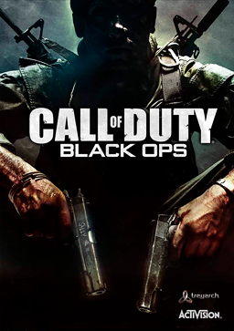

Tämä pelihän tuli jo vuonna 2010 ja kirjoitin siitä pienen artikkelin jo [silloin](/2010/call-of-duty-black-ops "Call of Duty: Black Ops"). Sen jälkeen on tullut CoD MW3 mutta se ei iskenyt niin kovasti kuin BO. MW3 tuppaa olemaan aina xiittereitä täynnä kun menen pelaamaan sitä. Sen takia se ei viime aikoina ole iskenyt ollenkaan.

Tänään kuitenkin asentelin pitkästä aikaa Black Opsin ja helkutti oli kaikki profiilit ja kaikki valmiina. Ajattelin sitten, että piru koitetaan taas. Hämmästys oli suuri kun ekassa pelissä jollain kitillä joka oli mulla valmiina olin ensimmäinen… TÄH! Koitin sitten toisen matsin eri kitillä ja olin toinen, tosin häviävässä tiimissä.

Tästä heräsi ajatus, aletaanko pelaamaan taas CoD BO:ta? Itse en omista ainuttakaan lisäriä tuohon ja näyttää vieläkin pörräävän aika kovasti. Tietty jonkun lisärin voisi hankkia niin saisin vähän uutta sisältöä vanhaan peliin.

Olisiko teillä innostusta alkaa pelaamaan tätä minun kanssani? Mikäli saataisiin pieni porukka kasaan niin voisin jopa kustantaa palvelimen, jossa olisi mahdollisesti varatut slotit MarkoKaartinen.net sivuston lukijoille!

**Nyt kommentteihin säpinää! Minä lähden pelaamaan hieman lisää!**
