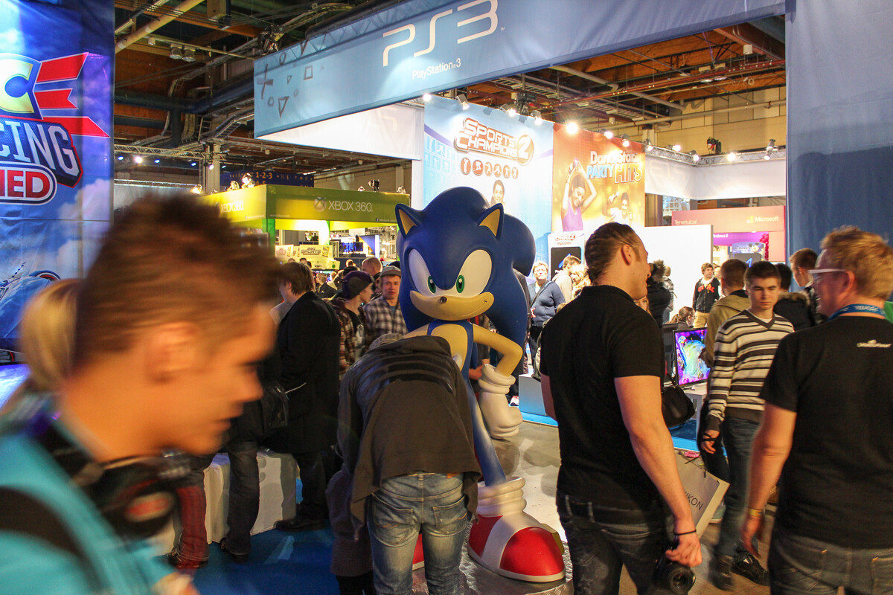
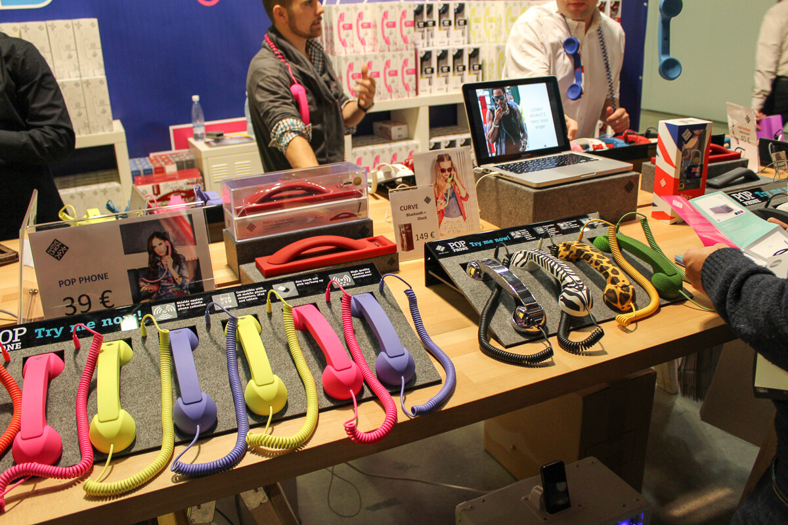
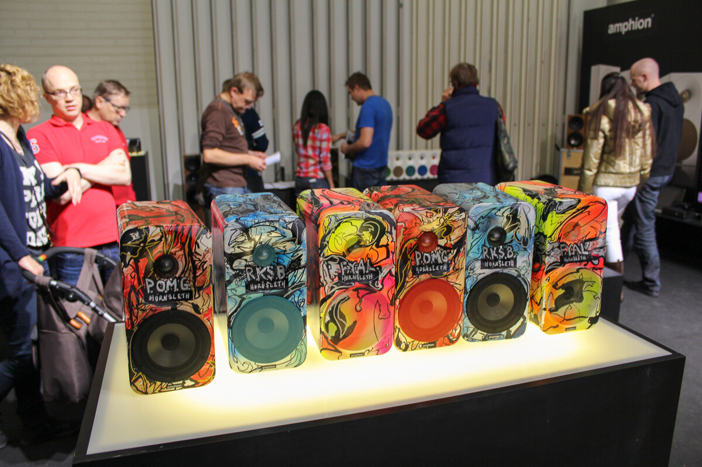
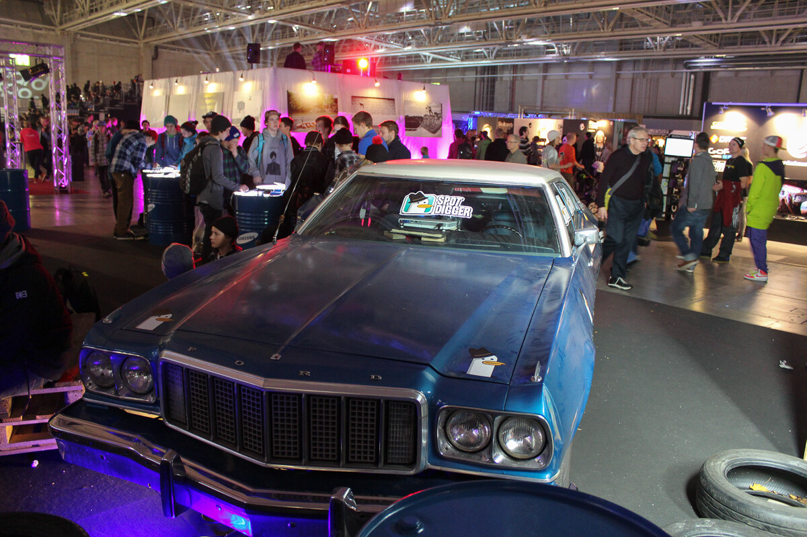
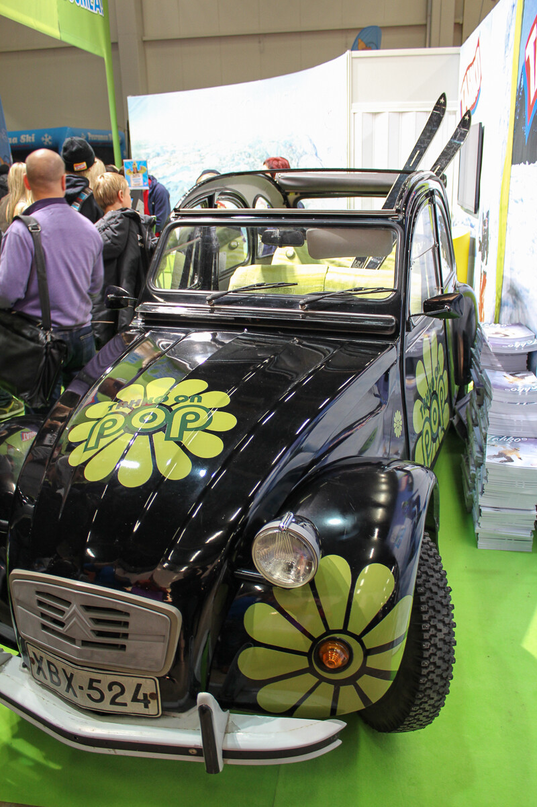
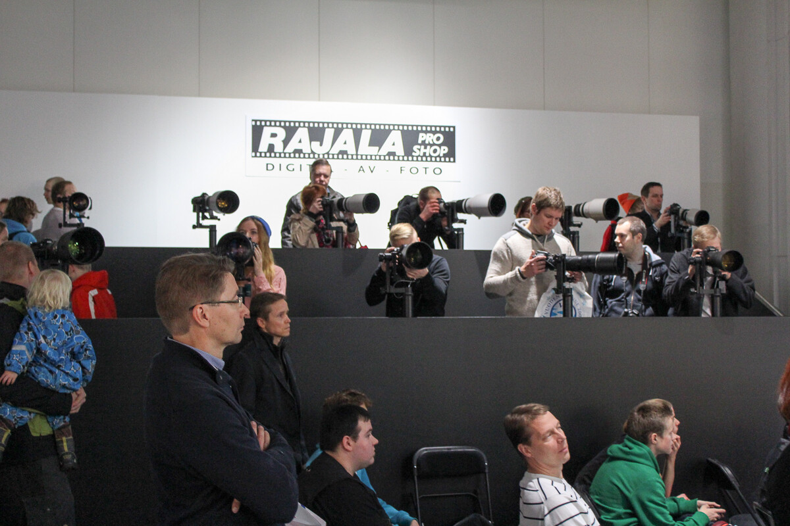
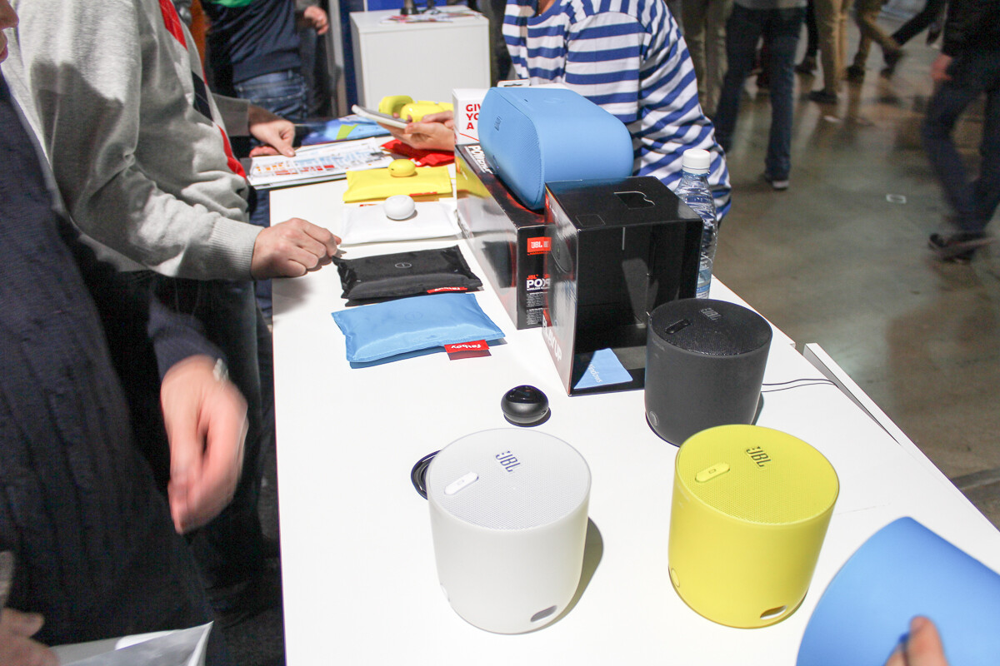
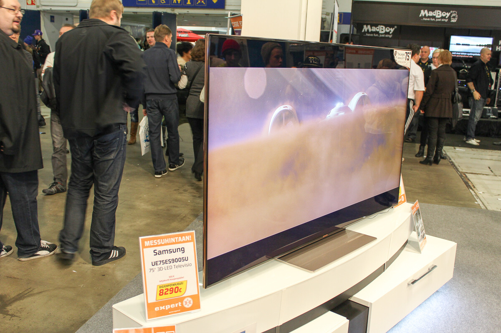

Sain Canonin kautta pari lippua Digiexpoille, jotain päätin veljen kanssa lähteä käväisemään Etelä-Suomessa. Tiesin, että päivästä tulee pitkä sillä junamatka täältä Pasilaan kestää reilu neljä tuntia ja pitäähän sitä aikaa varata expoille sekä syömiseen. Käytimme hyväksi VR:n kamppista, jolla sai ostettua 10 eurolle lauantaille junalippuja, hintaa reissulle ei tullut sii paljoa.

Lauantaina porukkaa oli ihan tarpeiksi asti. Hyvä, että pari savolaista sekaan mahtui ja tämä vaikutti tietysti siihen Digiexpo kokemukseenkin. Tuotteiden kokeilu vaikeutui sillä joka paikassa oli porukkaa. Tuli siellä kokeiltua laitteita jotka maksavat enemmän kuin laki sallii ja kotiinviemisiä olisi löytynyt useammankin pankkilainan verran.

Löysin sieltä mielestäni hieman ”old school” tyylistä tekniikkaa, nimittäin ”hands free” josta on kuva alla.

Kaiuttimia ja äänentoistoa tuolla oli vaikka muille jakaa ja niistä jokusen olisi voinut kotiinkin asti tuoda. Alla on esimerkki hieman erilaisesta kajarista tai no erilaisuus on lähinnä vain kuviossa.

Tekniikan lisäksi messuilla oli siis samaan aikaan Skiexpo, hifiexpo sekä Lätkä&Säbä expot – keskityin lähinnä digiexpon puolelle, mutta tuli sieltä bongattua pari autoakin.

Itselleni ehkä messujen parasta antia oli pitkillä putkilla ”leikkiminen”. En nimittäin ole ennen tommosia värkkejä päässyt kokeilemaan ja en tule ehkä ikinä tuommoista saamaan jo ihan hinnan puolesta.

Nokian 920 puhelin on tulossa tämän kuun 22. päivä joten tietysti kiinnosti ihmetellä sen langattomia latausvaihtoehtoja.

Ettei nyt aivan älyttömän isot asiat loppuisi maailmasta niin pitihän se ihmetellä **vaan** 75 tuumaista töllöä. Kuvasta huomaa myös sen hintalapun, aika halpaa?

Olisi ehkä pitänyt valita parempi päivä lähteä messuille kuin lauantai jolloin kaikki muut paikat oli kiinni. Tällöin tosin olisi junamatkasta saanut maksaa huomattavasti paljon enemmän. Kaiken kaikkiaan ihan jees reissu ja katsellaan ensi vuonna uudestaan!

Tietysti voisi tutkailla muitakin mahdollisia messuja, saa ehdottaa!
