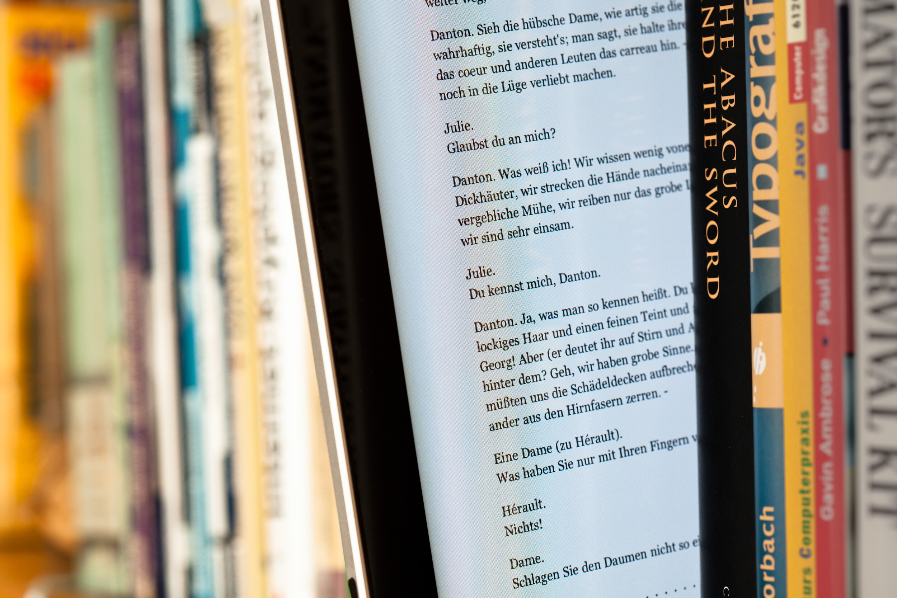

Kirjoittelin e-kirjan saatavuudesta ja hinnasta tuossa [äskettäin](/2012/e-kirjat-mistahan-pirusta "E-kirjat, mistähän pirusta?"). Nyt voisin hieman verrata noita kahta eli oikeata kirjaa ja e-kirjaa. Oikealla kirjalla tarkoitan ihan paperille painettua opusta. Tulen hieman pohtimaan asiaa eri kantilta kuten hinnalta, hyödyistä ja muusta vastaavasta.

Aloitetaan vaikka hinnasta. Tällä hetkellähän e-kirjat on aika lailla samoissa hinnoissa kuin oikeat kirjat. Tämä hieman ihmetyttää sillä e-kirjassahan häviää kaikki kuljetus-, pakkaus- ja muut vastaavat kulut, tosin e-kirja tuo mukanaa hostauksesta syntyvät kulut. En usko tosin, että e-kirjan kulut olisivat suuremmat kuin oikean kirjan. Tällä pohdinnalla e-kirjan pitäisi olla halvempi. Tämän voi toki korjata joku joka tietää enemmän tästä asiasta kuin allekirjoittanut.

E-kirjan hyötyhän normaaliin kirjaan on suoraan se, että lukijaan menee useita kirjoja (riippuu paljonko tilaa on), kun taas yksi oikea kirja on yksi kirja. Oikean kirjan paino riippuu taas onko se pokkari, kovakantinen vai mikä lie onkaan. E-kirjan paino taas riippuu lukijalaitteesta ja jos sinne menee 100 kirjaa niin lukijalaitteen paino ei tietysti nouse.

Mietitään skenaariota, jossa olet lähdössä lomalle ja haluaisit lukea jokusen opuksen samalla kun otat aurinkoa. Jokunen pokkari tietty lähtee mukaan ja pokkarit ei paina juurikaan, kovakantisia en lähtisi kantamaan. Pitäähän sitä tilaa olla tuliaisillekkin. Kun mietitään tuota tilannetta, olet rannalla ja siellä on hiekkaa ja aurinkoa. Vanha kunnon kirja ei hätkähdä tämmöisestä tilanteesta jos hieman sattuu hiekkaa tai merivettä menemään sivuille. Lukijalaite saattaa hieman hätkähtääkkin, se taas riippuu minne sitä hiekkaa tai vettä menee. Rantalomalle ottaisin rannalle perinteisiä pokkareita ja jättäisin sen lukijalaitteen hotellille, lentokoneessa se on kuitenkin kivempi.

Molemmissa on siis loppujen lopuksi niin hyvää kuin huonoa. Itse osittain tahtoisin siirtyä enemmän tuohon e-kirja puolelle, mutta järki ei anna periksi jos oikean kirjan saa samalla hintaa. Se on oikean kirjan etuna, että sitä voit lainata kavereille tai tutuille – e-kirjaa ei taida pystyä, ellet sitten koko lukijaa lainaa.

Olen puhunut artikkelissa lähinnä lukijasta tai lukijalaitteesta. Tämä sen takia, koska vaihtoehtoja on useampia. On olemassa Applen iPadia, Androidin tabletteja ja Kindle. Valintaa siis on, tässäkin tulee vastaan se haluaako pelkän e-kirjan lukuun tarkoitetun laitteen vai monikäyttöisemmän tabletin.

Tulen itse seuraamaan e-kirjojen kehittymistä, tosin lähinnä tuon iPadin näkökulmasta. Tulen varmaan kasvattamaan tuota e-kirjojen määrää, tällä hetkellä niitä ei kauheasti ole. Löytyy lähinnä jokunen ilmainen opus ja pdf:nä hankittu julkaisu.

**Kumpaa itse suosit tai käytät? **

*Photo credit: [Maximilian Schönherr](http://en.wikipedia.org/wiki/File:EBook_between_paper_books.jpg)*
