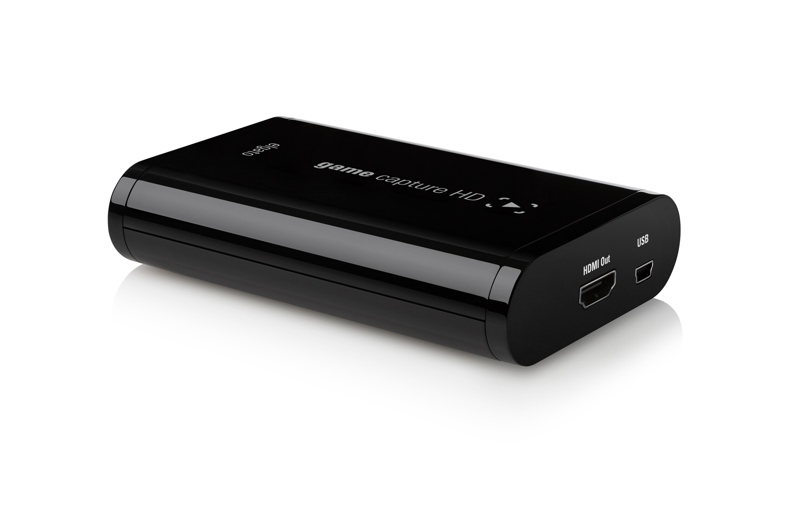
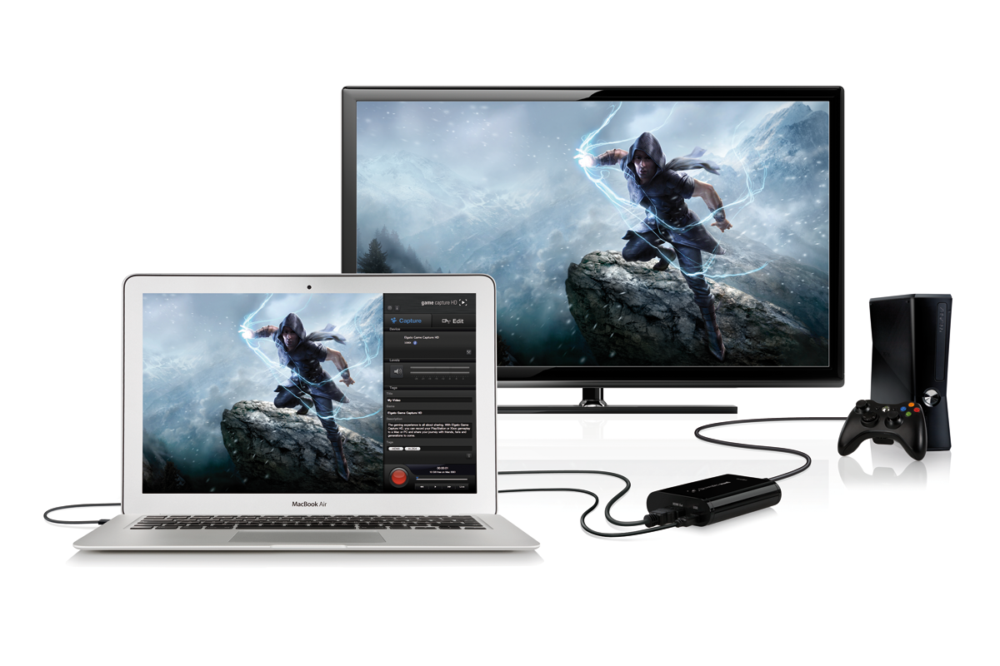

Törmäsin tähän Elgato Game Capture HD -laitteeseen jo joskus aiemminkin, mutta tänään törmättyäni uudestaan päätin kirjoittaa siitä lyhyen katsauksen. Elgato Game Capture HD on laite jolla voit tallentaa pelivideoita XBOXilta ja PS3:lta joko PC:llesi tai MACillesi.

Laitteen mukana tulee itse laite, USB kaapeli jolla laitteen saa kiinni koneeseen, HDMI piuha jolla XBOXin saa kiinni laitteeseen sekä PS3 piuha jolla saa pleikkarin kiinni laitteeseen sekä tietysti pikaopas. Paketissa tulee siis kaikki tarvittava nauhoittamista varten, joten mitään muuta et oikeastaan sitten tarvitsekaan. Tietysti sen Youtube tilin, mutta se sinun pitää tehdä aivan itse.

Kuulemani mukaan videon pitäisi tallentua ilman minkäänlaista viivettä ja häiriötä pelissä sekä laadun pitäisi olla hyvä. Ovatpa he vielä tehneet ohjelmankin nauhoittamiseenkin. Laite maksaa suomessa noin 200 euroa eli ihan mistään halvasta vekottimesta ei ole kyse. Tämä on ehkä suurin syy siihen miksi en itse ole tätä hankkinut.

Game Capture HD on mielestäni erittäin mielenkiintoinen vempain ja tuota olisi hauska päästä testailemaan sekä käyttämään. Xboxilla tulee pelattua jonkin verran ja voisi olla hauskaa nauhoittaa sitäkin. PC:llä kun tuo homma onnistuu jo nykyisin työvälinein.

Saatte Elgato Game Capture HD:stä lisätietoa heidän [kotisivuiltaan](http://www.elgato.com/elgato/na/mainmenu/products/capture-convert/GameCaptureHD.html).
