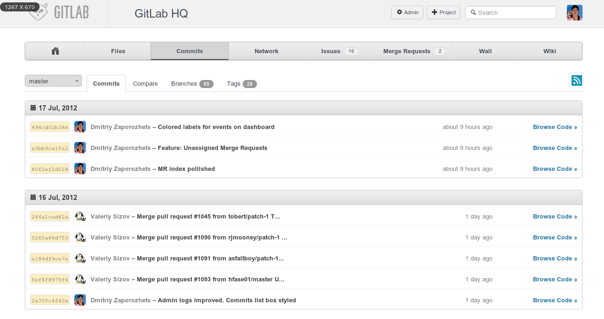
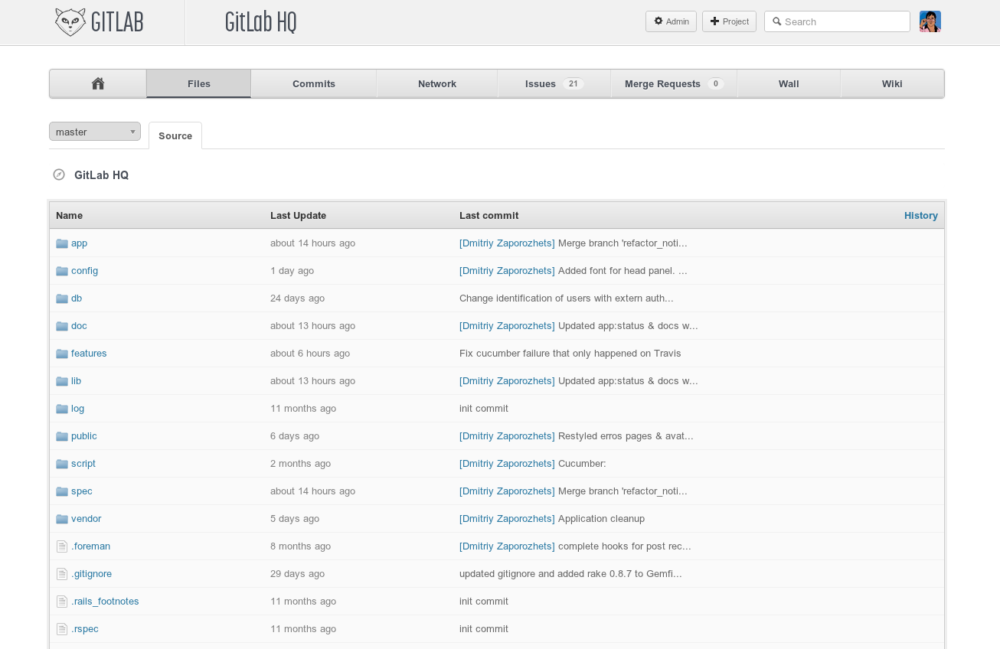

Gitlab oli myös yksi must have softia omalle palvelimelleni. Sen kanssa tuli säädettyä jo perjantaina, mutta eilen vasta sain laitettua sen siihen kuntoon että lisäilin omia projekteja sinne. Itsellähän oli myös Githubiin privaattirepoja, mutta tämä hoitaa asian ilmaiseksi ja mikä parasta tätäkin kehitetään aktiivisesti.

Ainut huono puoli tässä on oikeastaan se, että tämä on rakennettu Ruby on Railsin päälle ja itselläni ei ole tuosta kielestä mitään kokemusta. Luotetaan siis siihen, että se toimii ilman minun säätämistäkin! Sen jälkeen kun Gitlabin oli saanut asennettua on sen käyttö ollut suhteellisen simppeliä ja helppoa, ongelmia ei ole sinällään ollut.

Asennusohjeita en ala tähän laittamaan sillä Gitlabilla on pätevät [ohjeet](https://github.com/gitlabhq/gitlabhq/blob/stable/doc/installation.md) asentamiseen. Suosittelen muuten tekemään asennuksen ohjeiden mukaan, älä siis käytä valmista skriptiä mikä on saatavilla. Saat näin itse paremman kuvan siitä mitä tapahtuu missäkin vaiheessa.

Onhan tämä systeemi hieman ”hardcore” viritys yhdelle hengelle, mutta minulla on mahdollisuus luoda käyttäjätilejä jos haluan alkaa kehittämään jonkun kanssa jotain tai haluan näyttää jollekkin jonkun projektin koodia.

Suosittelen kokeilemaan tätä softaa ja ottamaan tämän käyttöön mikäli pidät tästä. Jos haluat omalla koneella asennella tämän niin virtuaalikone on hyvä väline testaukseen. Asentelet virtuaalikoneelle Ubuntun ja siihen asennat Gitlabin.

*Kuvien lähde: [Gitlab](http://blog.gitlabhq.com/screenshots/)*
