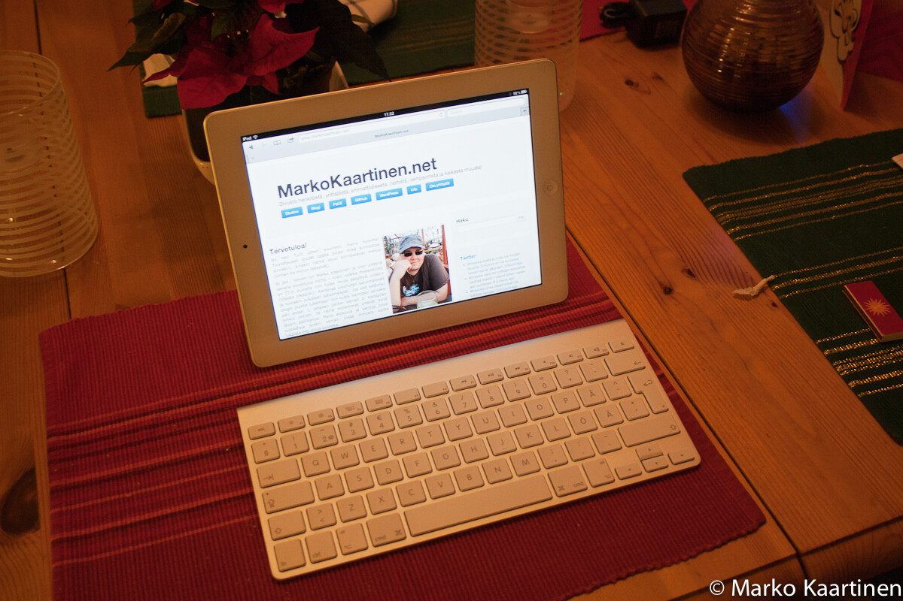

Applen iPad 2 on tosiaan loistovekotin. Tämä on ainakin oma mielipiteeni ollut siitä lähtien, kun olen hankkinut tämän. Tässä artikkelissa pohdiskelen voisiko iPad 2 korvata läppärini päivittäisessä käytössäni. En tule käsittelemään työkäyttöäni tässä jutussa vaan se tulee sitten myöhemmin.

Olen kirjoitellut aiemminkin [iPad 2](/2011/ipad-2 "iPad 2"):sta ja pohdiskellut parasta [tablettiakin](/2011/paras-tablet "Paras tablet?"), mutta tämänkaltainen kirjoitus voi herättää hieman keskusteluakin (toivottavasti).

Webbiä tietysti pitää päästä selaamaan ja se onkin iPadissä hoidettu Applen omalla **Safarilla**, joka ajaa asiansa paremmin kuin hyvin. Sähköpostiinkin riittää vakiona tuleva **Mail** apps, joten sitäkään ei tarvitse etsiä. Näillä kahdella sovelluksella pärjää jo suhteellisen pitkälle, blogia voin päivitellä **WordPressin** omalla sovelluksella ja muistiinpanot siirtyvät kätevästi pilveen **Evernoten** avulla.

Tiedostot synkkautuu muutenkin aika pitkälti **Dropboxin** avulla. Musiikkikin huutaa **Spotifyn** kautta. On tarvittaessa sovellukset niin **Youtubelle**, **TEDille** kuin **Ruutu.fi:lle**. **Elisa Viihde** julkaisi myös appsin iPadille ja sillä onnistuu nauhoitusten katsominenkin, tämähän on kerrassaan loistavaa.

Piti ihan tutkiskella, mutta näyttää Microsoftilla olevan oma **MSN** ohjelmakin app storessa. Irkkaaminenkin onnistuu sillä on olemassa **iSSH** niminen app, tuota kautta onnistuu myös koodaaminenkin jos haluaa. **Twitterin** ja **Facebookin** omat appsit auttaa sosiaalisen median seuraamisessa. **Flipboard** on muuten loistava app blogien ja sosiaalisten medioiden seuraamiseen.

Pelaaminen meinasi unohtua ihan kokonaan! Itse en MacBookilla juuri pelaa, mutta iPadillä tulee pelattua muutenkin. Siihen on jokunen koukuttava peli tullut hankittua kuten **Carcassonne**, **Scrabble**, **Where’s My Water?**, **Angry Birds** ja joitain muitakin sieltä löytyy. Viihde puolikin on siis kunnossa tuossa laitteessa (muutenkin kuin musiikin ja videoiden kautta).

Taitaa näyttää siltä, että oikeastaan kaikki onnistuisi myös tällä iPadilläkin. Edellä mainitut sovellukset ovat vain omia mielipiteitä näihin toimintoihin. Itselle vapaa-ajalla tuppaa nuo riittämään ja tarvittaessa pystyn myös koodaamaan iPadillä.

Ainut puute omassa iPadissäni on tuo 3G:n puute ja tällöin pitää olla langattomaan verkkoon yhteydessä, että pääsee verkkoon. Mikäli meinaa käyttää iPadia hieman enemmän kirjoittamiseen niin suosittelen erittäin lämpimästi bluetooth näppäimistön hankkimista. Itse olen hankkinut iPadille Applen bluetooth näppiksen ja voin sanoa, että on pirun näppärä vekotin tämän iPadin kanssa.

Tämän postauksen kautta tulikin mieleen, että voisi tehdä pienen testin. Voisi testata sitä voisinko korvata tuon MacBookkini tällä iPadillä, vaikka edes yhden päivän ajaksi. Tässä kun ei oteta työkäyttöä ollenkaan huomioon niin tulen tekemään tämän testin joku viikonloppu. Ehkäpä jo tulevana viikonloppuna? Tulen tästä informoimaan teitä täällä blogissa ja [Twitterissäni](http://twitter.com/MarkoK).

**Kaikki kysymykset ja ehdotukset ovat tervetulleita!**

*Tämä artikkeli kirjoitettiin muuten iPad 2:lla käyttäen WordPress sovellusta.*
