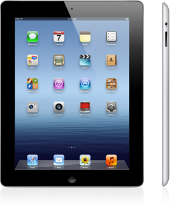

Viime viikolla Apple julkisti uuden iPadin joka ei saanutkaan numeroa perään joten sitä sanonkin uudeksi iPadiksi tai iPad 4G:ksi. Itsellänihän on iPad 2, mutta nimenomaan tuo karvalakkimalli ilman mitään mobiiliverkkoyhteyksiä. Olen kuitenkin kokenut tämän erittäin tarpeelliseksi ominaisuudeksi iPadissä, varsinkin kun semmoista ominaisuutta ei ole. Mitä eroja näissä kahdessa siis loppujen lopuksi on?

Prosessori on ensimmäisenä erona, iPad 2:ssa on A5 ja uudessa on A5X joka tuo mukanaan Quad Core grafiikat, eli tehotko ei tolla osalla ole muuten kuin grafiikan kautta parantuneet? Muistiahan on uudessa gigan verran kun vanhassa oli 512 megaa. Näyttö on kuitenkin se isoin ero, uudessa on retina näyttö ja resoluutio on jopa 2048\*1536.

Uudessa iPadissä on myös uusi 5 Mpix iSight kamera, joka voi taltioida HD laatuista videotakin (vanhassa 720p ja uudessa 1080p). Kooltaan laitteet eivät juurikaan eroa, eikä väreiltään – samat musta ja valkoinen vaihtoehtona. Uudessa iPadissä on uutta Bluetooth tekniikkaa, siinä on nimittäin 4.0 BT. LTE ei suoraan taida suomessa toimia (ainakaan tämän hetkisten tietojeni mukaan). Hinta on myös erona, nimittäin uudesta saat maksaa 100 dollaria enemmän. Uskon, että suomessa hintaero on noin 100 euroa (järjetöntä tämä erilainen hintataso suomessa ja jenkeissä).

Mitä tässä pitäisi siis tehdä? En suoraan sanottuna osaa sanoa kumpi kannattaa hankkia, nimittäin tuo LTE verkon toimimattomuus täällä pohjolassa tuo ison miinuksen. Itse harkitsen vakavasti tällä hetkellä mitä tekee tuon vekottimen suhteen. Suomeenhan tämä uusi iPad tulee perjantaina 23.3.

**Kertokaa te oma kantanne!**
