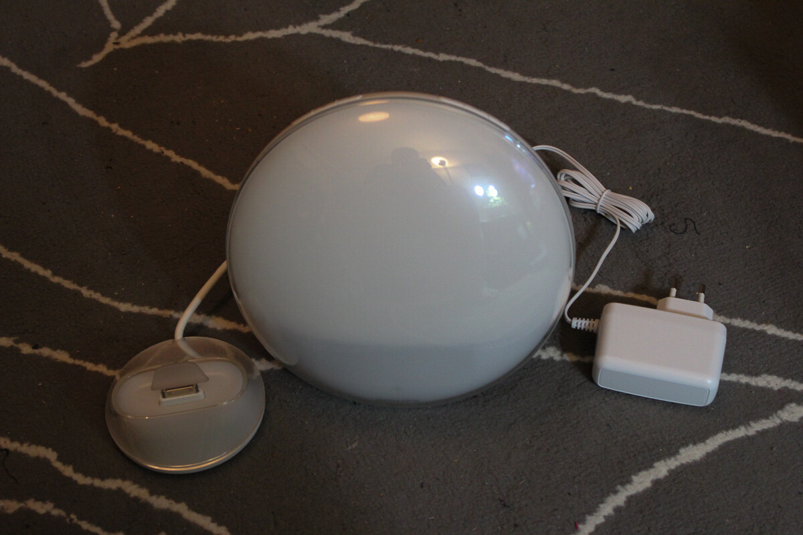

Kuten aiemmin [ilmoitin](/2012/kokeiluun-saapui-philips-wake-up-light "Kokeiluun saapui Philips Wake-up Light"), sain Wake-up -valon testattavaksi. Kokeilin sitä tässä nyt reilun viikon ajan ja omat tulokset ovat hieman epäselvät sillä olen hieman erikoinen herääjä niin sanotusti. Aloitetaan kuitenkin itse laitteesta.

Testissä ollut malli oli malli jossa on iPhone telakka ja tämä malli vaatii siis toimiakseen iPhonen ja ilmaisen Wake-up sovelluksen App Storesta. Sovelluksella saat asetettua herätyksen ajan ja kaikki muutkin asetukset aina herätysäänestä nukkumisääniin saakka. Valon käyttöönotto oli helppoa, pistit piuhan seinään ja telakan kiinni valoon – tämän jälkeen pistit iPhonen telakkaan ja samalla kellonaika muuttui oikeaksi. Oli ehkä vähän liiankin helppoa.

Wake-up -valon iPhone sovellus toimii erittäin hyvin. Saan siinä säädettyä vaivatta sen monelta herään ja milloin. Kun puhelimen pistän telakkaan ja aktivoin herätyksen (haluan itse aktivoida herätyksen ja nukkumistilan) niin valo hämärtyy ja sammuu viidessä minuutissa (tämänkin saa itse päättää). Aamulla valo alkaa puolta tuntia ennen herätystä hiljalleen syttymään ja jos et herää valoon niin valitsemasi ääni alkaa herättämään (itselläni kukko huusi aamusella).

Laitteen isoin kompastuskivi on ehkä iPhone sidonnaisuus, tosin jos et halua iPhone telakkaa niin osta se toinen malli jossa ei ole iPhone sidonnaisuutta. Tämä on kuitenkin hyvä kombinaatio kahta maailmaa sillä puhelimen ollessa telakassa tulee ainakin puhelin ladattua yöllä. Itse valossahan on vain valojen kytkimet sekä äänenvoimakkuuden säädöt.

Mutta herättikö valo ja miten se vaikutti minuun? Myönnän jo heti, että tätä pitäisi kokeilla pitempään kuin viikon verran – viikossa saat selville sen toimivuuden ja uskallat luottaa valoon ilman, että pidät toista herätystä päällä. Se miten tämä vaikutti minuun jää arvoitukseksi ainakin tältä erää – en nimittäin osaa sanoa. Heräsin nimittäin useasti ennen kuin valo oli edes päällä ja ajattelin, että ei kannata puolen tunnin takia alkaa enää nukkumaankaan (normaalia minun kohdallani herätä ennen kellonsoittoa). Kun heräsin valon palamisen aikana niin kertaakaan ei kukko päässyt kiekumaan, heräsin varmaan siihen valoon?

Pelkäsin aluksi, että valo olisi liian kirkas kun se ensimmäisen kerran menee päälle. Asia ei ollut kuitenkaan näin, valo aloittaa syttymisen pehmeästi ja kirkastuu ajan kuluessa. Tämä lienee syy siihen miksi en herännyt valon syttymiseen. Puhelimen ja valon yhteiselohan sujui kuin tanssi, itse en löytänyt mitään ongelmia tässä asiassa.

Itsehän herään heti kun kello soi tai totean sen, että ei kannata enää nukkua – en harrasta torkuttamista enkä liiemmin sängyssä rötväilyä. Ehkä siis kannattaa antaa valo tyttöystävälleni testattavaksi joka kyllä torkuttaa ja rötvää sängyssä. [Outi](http://ice-cherry.net) saakoon siis lampun testiin seuraavaksi.

Kaiken kaikkiaan tuo valo on erittäin mielenkiintoinen kapistus ja tulemme taistelemaan tässä huushollissa siitä kumpi tuota saa käyttää ;) Todennäköinen voittaja on tyttöystävä sillä hänellä on iPhone pääasiallisena puhelimena ja itse olen siirtynyt jo Nokia Lumia 900 puhelimeen. Pitänee katsoa jos joskus tulisi tuo perusversio hankittua (siis se mikä ei vaadi iPhonea).

**Plussat**\
\+ Hienon näköinen\
\+ Pehmeä valo\
\+ Yksinkertainen säätö\
\+ Kyllä siihen oikeasti herää

**Miinukset**\
– iPhone kytkös (ei ole miinus jos ottaa eri mallin)

Lopuksi vielä vaihtoehtoinen herätystapa Wake-up -valolle:


