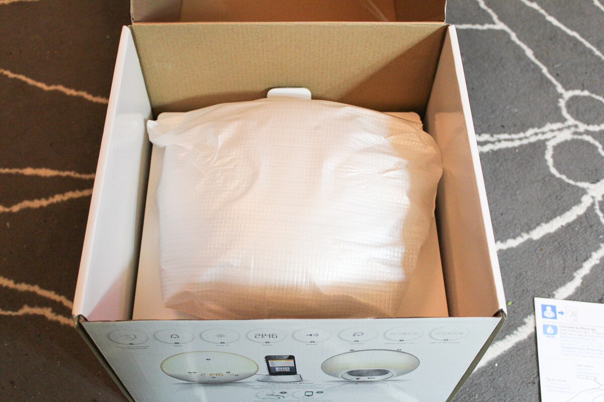
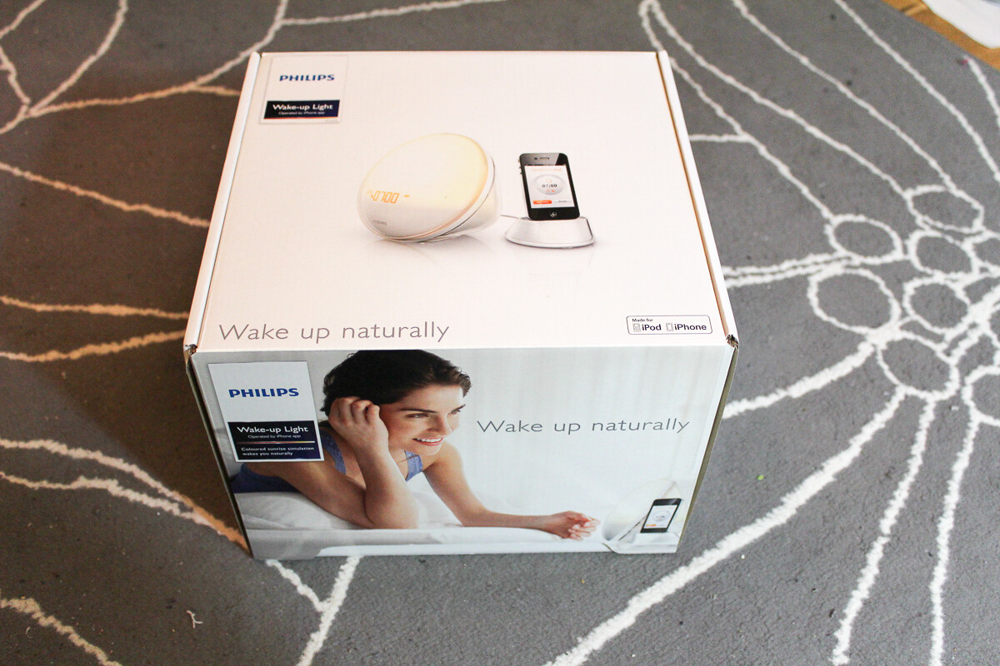
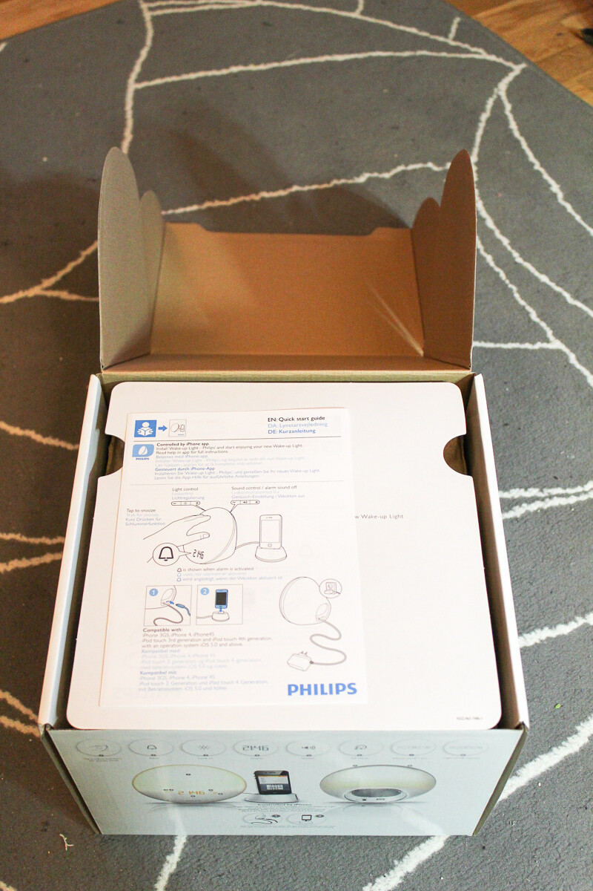
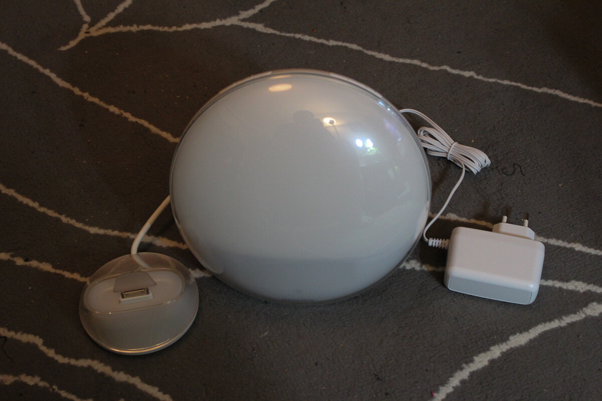

Sain Philipsiltä kokeiltavaksi Philipsin Wake-up Lightin. Sain sen juuri käsiini ja avasin sen juuri paketista. Tämä malli sattuu olemaan vielä se malli, johon voit pistää iPhonen telakkaan ja tätä taidetaan hallitakin aika pitkälti iPhonella.

Jännä nähdä miten tämä valo tulee vaikuttamaan omiin aamuihin sillä itse herään yleensä ennen herätyskelloa. Tämänhän pitäisi aloittaa herättäminen ennen kellon soittoa ja näin pyrkiä siihen että heräisin mahdollisimman pirteänä.

> Useimmat tuntevat olonsa energisemmäksi kirkkaan ja aurinkoisen kesäkauden aikana voidessaan nauttia ulkona luonnon valosta. Sekä auringon- että päivänvalo aktivoivat meitä. Oikean tyyppinen valo tasapainottaa päivärytmin ja helpottaa heräämistä. Philips on kehittänyt valikoiman valoterapiatuotteita, jotka jäljittelevät luonnollista valoa ja lisäävät energisyyttäsi. [*Philips.fi*](http://www.philips.fi/c/light-therapy/38722/cat/)

Tulen testaamaan itse tätä jonkin aikaa ja kerron sitten teille mitä tämä hieman erilainen herätyskello on tehnyt minulle. Oman testauksen jälkeen annankin lampun testattavaksi huushollin paremmalle [puoliskolle](http://ice-cherry.net), joten saas nähdä mitä mieltä hän on siitä.




