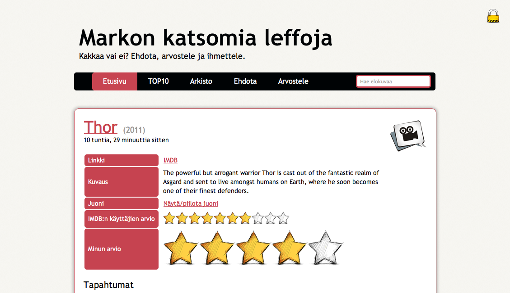

Osa varmaan muistaa, että joskus pidin kirjaa katsomistani leffoista täällä sivustolla. Silloin se oli WordPressin päällä ja lisäosan avulla toiminnassa.

Nyt kuitenkin olen koodannut täysin oman systeemin joka ei ole riippuvainen WordPressistä mitenkään. Vieraat voivat ehdottaa elokuvia ja kommentoida, kommentoinnin yhteydessä voit antaa oman arviosi elokuvasta. Sovellus näyttää jopa trailerin suoraan Youtubesta ja hakee dataa IMDB:stä.

Tarkoituksena ei ole antaa mitenkään syvällisiä elokuva-analyysejä. Itse annan vain tähden ja ehkä kommentin elokuvasta. Tavoitteena on lähinnä pitää listaa leffoista ja jättää oma tähtiarvio elokuvasta.

Joitain lisäfeatureja saatan koodailla tuonne vielä, nythän siellä on seuraavat:

- Arkisto
- Top10
- Leffojen listaus (x kpl per sivu)
- Haku
- Kommentointi / arviointi
- Ylläpitäjän leffojen lisäys (arviointi)
- Hakee IMDB:stä perustietoja
- Hakee Youtubesta trailerin
- Spämmin esto Akismetin avulla

Osoitehan on [Leffat.MarkoKaartinen.net](http://leffat.markokaartinen.net/).

**Elokuvia saa ehdottaa!**
