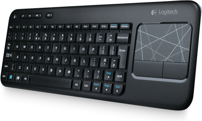

Tuli tuossa pari kuukautta sitten hankittua tämmönen pikkunäppärä näppäimistö olohuoneeseen. Itselläni on nimittäin yksi kone kiinni telkkarissa ja siitä tulee katseltua sitten vähä sitä sun tätä. Langaton näppäimistö tuli siis aiheelliseksi ja päädyin hankkimaan tämmösen missä on näppis ja touchpadi samassa.

Logitechin K400 käyttää Unifying vastaanotinta joten kaikki muut Logitechin tuotteet, jotka käyttävät tuota tekniikkaa voivat yhdistää koneeseen saman USB donglen kautta. Akkukestosta en osaa sanoa mitään muuta kuin sen, että en ole vielä kertaakaan paristoja tähän laitteeseen vaihtanut.

Pelaamiseenhan touchpadistä ei ole muutenkaan, mutta surffailuun ja kaikkeen muuhun tämä on kyllä erittäin passeli näppis. Olohuoneeseen siis aivan loistava vekotin. Koko tässä näppäimistössä on suhteellisen pieni ja siis passeli olohuoneeseen. Näppäimistössä on ns. ylimääräisinä nappeina äänenvoimakkuuden säätö ja kotinapit – mitään muuta ei oikeastaan tarvitse ollakkaan.

Päivitetäänpä tätä nyt vielä hieman ja sanotaan sen verran vielä, että tämän saa hankittua edullisesti esimerkiksi [CDONista](http://clk.tradedoubler.com/click?p(345)a(2037951)g(16952822)url(http://cdon.fi/kotielektroniikka/keyboard_logitech_wireless_touch_keyboard_k400_(nordisk)-17454332)). Siellä sen hinta on 39,95 euroa ja voin sanoa, että ajaa tuolla hintaa täysin asiansa tietokoneen kaverina.

Suosittelen tätä näppäimistöä jos tarvitset hyvän näppäimistö-touchpad yhdistelmän olohuoneeseen.
