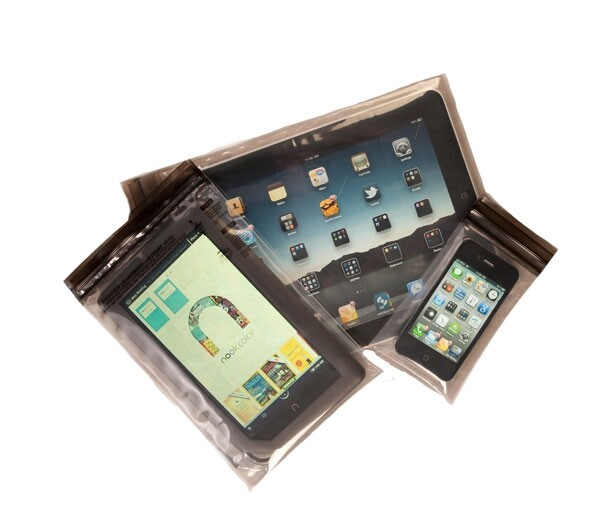

Sain testattavaksi aLOKSAK-pussin, jonka tarkoituksena on pitää puhelin tai tabletti suojassa pölyltä, vedeltä ja muilta elementeiltä kuten hiekalta. Tähän väliin haluan kiittää Biwak Outdooria siitä, että he lähettivät nämä minulle testattavaksi, saatte myös lisätietoa aLOKSAKistä heidän [kotisivuiltaan](http://www.biwak.fi/Aloksak.html).

aLOKSAK on valmistettu Jenkeissä ja laatu on mielestäni hyvää ja pussi vaikuttaa erittäin kestävältä materiaalilta. Pussi on vedenpitävä jopa 60m syvyyteen asti, testin suorittanut USA laivaston sukellusyksikkö (näin he ilmoittavat).

Pussin voi myös halutessaan pestä ja käyttää uudelleen, niin kauan kuin pussi on ehjä on se myös toimintakunnossa. Itse huomasin, lyhyen testin aikana sen, että materiaali on vahvaa ja videossa näkyvä venytetty aLOKSAK-pussi on kokenut kovia.

Suosittelen lämpimästi hankkimaan kyseisen pussin varsinkin jos olet menossa rantalomalle, jossa puhelimesi voi olla kosketuksessa hiekan tai veden kanssa. Puhelinta pystyy myös käyttämään pussin läpi, joten ei ole tarve ottaa puhelinta/tabletti pois pussista rannallakaan.

Lopuksi se paljon puhuttu video, jossa iPhone pääsee uimaan!


