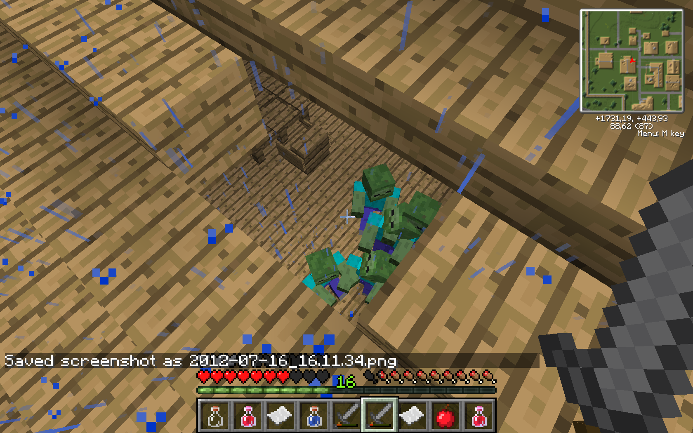
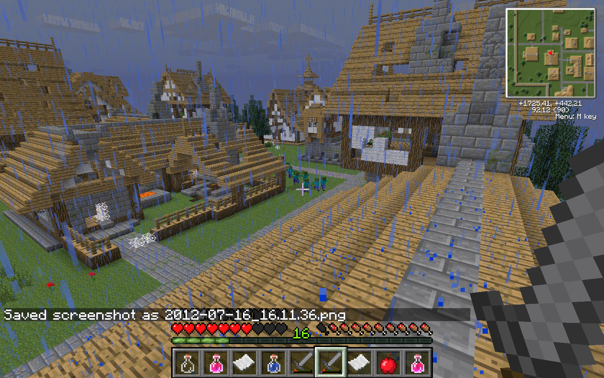
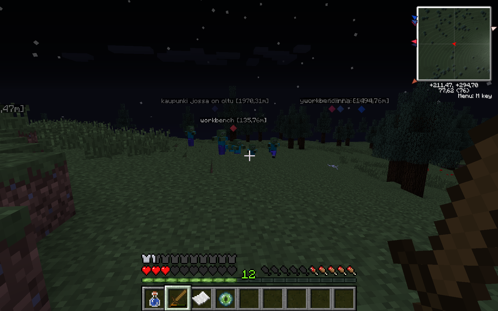

Minecraftia tuunataan koko ajan, pirulainen sitä peliä jaksaa pelata näiden modien ja servereiden takia yhä enemmän ja enemmän. Nyt olen löytänyt suosittuun Arma 2 pelin DayZ modiin perustuvan Minecraft serverin. MineZ palvelimet ovat vielä beta vaiheessa, mutta silti ne tuppaa toimimaan suhteellisen hyvin!

MineZissä ideana on yksinkertaisesti selviytyä. Uhkana MineZissä ovat Zombit (joiden älyä on parannettu), toiset pelaajat (jotka saattavat tappaa sinut), nälkä, jano ja tietty oma typeryys jos tiput/hukut tai muuta vastaavaa. Voit rikkoa vain tiettyjä blokkeja, tietyillä työkaluilla ja et voi rakentaa oikein mitään paitsi tiettyjä itemeitä kuten ruokaa. Peli on siis suhteellisen haastava ja sitä kautta peliin tulee lisää haastetta ja mielenkiintoa.

Pelistä voit löytää lisää tietoa heidän [Redditistä](http://www.reddit.com/r/minez) tai [kotisivuiltaan](http://minez.net/).

Alla on pari kuvaa itse pelistä, joten voitte itse päätellä pelin kulkua hieman kuvien perusteella.

