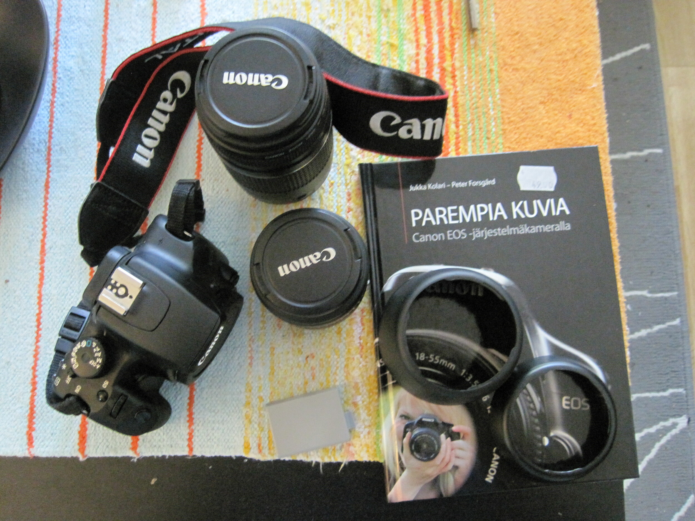

Myydään täydellinen aloituspakkaus aloittelevalle kuvaajalle! Ainut mitä sinun pitää hankkia on sopiva muistikortti! (SD-/SDHC-kortti)

Paketissa on Canon EOS 1000D järjestelmäkamera, mukana tullut kittiobjektiivi EFS 18-55m sekä vähän isompi objektiivi EF 75-300mm. Molemmat objektiivit ovat Canonin omia objektiivejä!

Mukaan tulee myös ylimääräinen akku kameraan, sekä vastavalosuojat molemmille linsseille! Sekä tietysti myös laturi akuille.

Listattuna vielä kaikki mitä saat:\
– Canon EOS 1000D runko\
– Canon EFS 18-55mm objektiivi\
– Canon EF 75-300mm objektiivi\
– Vastavalosuojat molemmille objektiiveille\
– Ylimääräinen akku (tarvikeakku, ei siis Canonin oma – toimii silti!)\
– Laturi akuille\
– Canonin ohjekirjanen

Kaupan päälle saat vielä Parempia kuvia – Canon EOS järjestelmäkameralla -kirjan. Kirjan arvo yksinään jopa 39,90 euroa! ([Booky.fi](http://www.booky.fi/product.php?id=9789525668193&book_id=9789525668193))

Kamerasta lisää infoa: [Canon.fi](http://www.canon.fi/For_Home/Product_Finder/Cameras/Digital_SLR/EOS_1000D/)

**Kamera myyty!**
