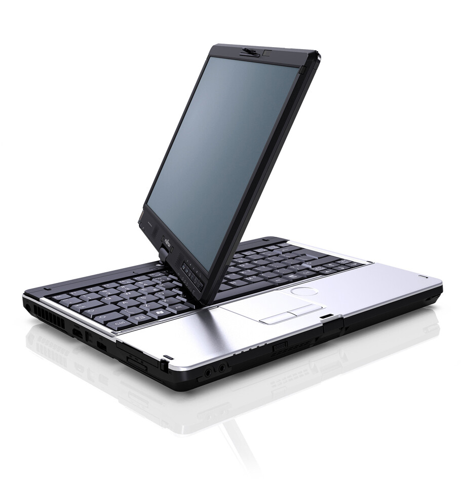

Lähden mainostamaan tämän läppärin myymistä nyt täällä blogissani. Myyn LIFEBOOK T901:n lähinnä sen takia, koska minulla ei ole mitään käyttöä tälle ja parempi että joku muu ottaa tämän koneen käyttöön sillä se on käytännössä kuin uusi.

Sain koneen LIFEBOOK4Life projektin kautta ja nyt se on oikeastaan turhan panttina seisomassa toimiston pöydän nurkalla. Toiveissa olisi, että tämän saisi myytyä Kuopion seudulla asuvalle henkilölle, mutta tietysti muutkin paikkakunnat onnistuu. Postin kautta tietysti voisi pistää tämän menemään, mutta kyseessä on kuitenkin suhteellisen arvokas laite niin jokin kuriiripalvelu voisi olla aiheen – tämän tietysti maksaa ostaja ja homma tehdään muutenkin osittain ostajan ehdoilla.

Koneesta ei ole minulla mitään kuittia tai vastaavaa sillä se on saatu projektin kautta, mutta takuusta voitte kysellä Fujitsulta suoraan tai heidän yhteistyökumppaneiltaan. Takuuhan ei tietty kata kaikkea ja kone on saatu Syyskuussa 2011.

**Koneen teknisiä tietoja:**

- Intel Core i5-2520M 2.5 GHz prosessori
- 13.3″ Multi-Touch LED WXGA (1280 x 800) näyttö, heijastamaton (magnesium-kansi)
- 4 GB DDR3 1333 MHz keskusmuisti
- 320 GB 7200rpm SATA kovalevy
- Intel HD 3000 näytönohjain
- DVD+/-RW SuperMulti asema
- Laitteessa on seuraavat portit: muistikortinlukija (tukee yleisimpiä), ExpressCard, SmartCard, SIM-kortti, verkkoportti, USB 2.0 (2kpl), USB 3.0 (1kpl), Firewire, VGA, HDMI, Audio, Kensington lock sekä mahdollisuus telakkaan.
- Akku: 6-kennoinen, käyttöaika jopa 9 tuntia (takuu 12 kk)
- Paino 2.1 kg
- Mitat (L x K x S): 31.9 x 3.6 x 24.4 cm

Koneessa on sim-kortille paikka, joten voit hankkia liittymän siihen ja surffata täten missä vain. Signaalia voi vahvistaa integroidulla antennilla joka oikeasti toimii!

Kosketusnäyttö on kuitenkin tämän koneen erikoisuus, sitä voit käyttää joko sormin tai sitten mukana tulevalla kynällä. Itse olen käyttänyt sitä mukana tulevalla kynällä, joten sillä voi kirjoittaa. Näyttö myös kääntyy näppäimistön päälle!

Hintaan sisältyy se, että voin tehdä tarvittaessa joitain asennuksia koneelle. Koneen tulen oston jälkeen kuitenkin tyhjäämään ja asennan siihen mukana tulleilta levyiltä puhtaan asennuksen.

Mukaan tulee myös Fujitsun fleece pussukka, jossa konetta voi kuljetella!

**Lisää tietoja koneesta:**

- [https://markokaartinen.net/lifebook-t901-unboxing/](/2011/lifebook-t901-unboxing)
- [https://markokaartinen.net/ensivaikutelmat-lifebook-t901sta/](/2011/ensivaikutelmat-lifebook-t901sta)
- [https://markokaartinen.net/pieni-esimerkki-kosketusnaytosta/](/2011/pieni-esimerkki-kosketusnaytosta)
- [https://markokaartinen.net/kirjotustesti-todo-listan-avulla/](/2011/kirjotustesti-todo-listan-avulla)
- <http://www.fujitsu.fi/yrityskannettavat/LIFEBOOK-T901.html>

Käytännössä ostaminen tapahtuu niin, että kun näen rahat tililläni niin saat kannettavan itsellesi. Kuopion alueella voimme sopia tapaamisen ja saat koneen suoraan tai sitten sovitaan kuljetus muulla tavalla!

### MYYTY!
