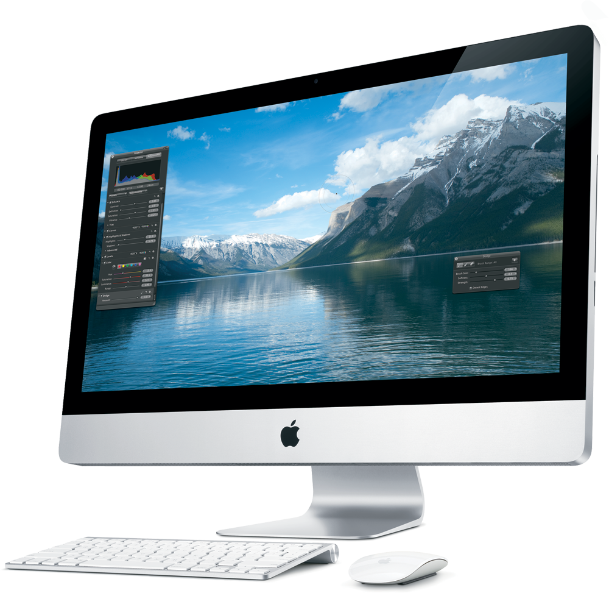
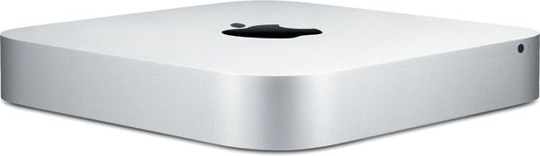

On taas omppu (Apple) -aiheisen kirjoituksen aika. Osa teistä varmaan alkaa jo ärsyyntyä näihin, mutta ei sillä ole mitään väliä! Tässä kirjoituksessa esittelen (taas) pari laitetta jotka voisin omistaa ja tulen varmaan jossain vaiheessa hankkimaankin, mikäli niitä on tulevaisuudessa vielä edes myynnissä.

## iMac

Otetaan ensimmäisenä Applen pöytätietokoneen tappaja. Nimittäin iMac on pöytätietokone jossa ei olekaan normaalia keskusyksikköä vaan kaikki on näytön sisässä. Logistisestihan tämä on aivan loistava ratkaisu, mutta hieman päivitettävyys kärsii (näin ainakin uskon).

Sitten päästäänkin siihen teknisempään puoleen. iMacia saa kahdessa eri koossa, toisessa on 27″ näyttö ja toisessa 21,5″ näyttö, en osaa sanoa vielä kumpi sopisi itselle paremmin. Todennäköisesti tuo pienempi näyttöinen versio. ”Huonoin” prosessori tämän hetkisissä iMaceissä on 2,5 GHz Quad Core i5 ja paras minkä saa on 3,1 GHz Quad Core i5 (valinnaisena saa myös 3,4 GHz Quad Core i7 prosessorin). Muistia tulee oletuksena 4 gigaa mukana, mutta sen saa tietty päivitettyä joissain malleissa jopa 16 gigaan asti. Näytönohjain heikoimmillaan on AMD Radeon HD 6750M 512 Mt ja parhaimmillaan AMD Radeon HD 6970M 1 Gt.

Tietty iMacissä on myös USB-portteja, Thunderbolt -portti, FireWire -portti ja Mini-DisplayPort sekä Ethernet-portti. Löytyy myös SDXC-korttipaikka, ääniliitännät (ulos ja sisään), Wi-Fi ja Bluetooth.

iMac ei oikeastaan tulisi itselleni pääkoneeksi vaan tyttöystävälleni pöytäkoneeksi, tietysti itsekin tuota käyttelisin sillä onhan tuossa näyttötilaa ja tehoa huimasti paljon enemmän kuin MBP:ssäni. Voin jo nähdä tämän koneen työpöydälläni, tämä olisi oikeastaan työpaikallekkin loistava kone ellen suosisi niin paljon kannettavaa sillä sen voi kopata mukaan asiakastapaamisiin yms.

Omistatko iMacin? Onko sinulla kommentteja tähän laitteeseen liittyen? Kerro toki!

## Mac mini

Sitten onkin vuorossa erittäin pienikokoinen tehopesä nimeltään Mac mini. Tämän ajattelin survaista kiinni televisioon ja käyttää sitä olohuone surffikoneena ja leffakoneena. Nykyisellään itselläni on tai oikeastaan oli televisiossa kiinni iso pöytäkone joka on vähintäänkin kömpelö siihen käyttöön. Mac minin pieni koko on erittäin iso etu siihen verrattuna ja varsinkin kun siinä on suoraan HDMI liitäntä ja muut tarpeelliset portit niin tämä on jo melkein pakkohankinta jossain vaiheessa.

Mac miniä on oikeastaan kahta eri mallia, mutta molemmat ovat täysin saman kokoisia fyysisesti. Erona on ainoastaan prosessori (2,3 GHz Dual Core i5 vs. 2,5 GHz Dual Core i5), muisti (2 Gt vs. 4 Gt – päivitettävissä ylöspäin) ja näytönohjain (Intel HD Graphics 3000 vs. AMD Radeon HD 6630M). Mac minissä on Thunderbolt-portti, HDMI liitäntä, DVI-lähtö, USB-portteja, FireWire-portti, SDXC-korttipaikka, Ethernet-portti ja äänen sisään ja ulostulo. Tietysti löytyy myös bluetooth ja Wi-Fi .

Ainut mikä mietityttää tässä Mac minissä on se, miten tämän päivitettävyys. Uskoisin kuitenkin, että ainakin muistia saa lisättyä suhteellisen helposti (joko joka tietää voi kertoa lisää).

Omistatko Mac minin? Onko sinulla kommentteja tähän laitteeseen liittyen? Kerro toki!

## Yleistä lätinää

Todennäköisesti leimaudun yhä enemmän Apple fanboyksi, mutta eipä tuo itseäni haittaa. Itse olen hankkinut lähinnä laitteita jotka sopivat tarpeisiini ja en ole katunut yhtään hankintaa tähän mennessä. Periaatteessa saman tasoisen koneen saisi kasattua ”normaaleista” komponenteista, mutta OSX:ssä on jotain mitä ei Windowsissa eikä Linuxissa ole. Olen myös erittäin tykästynyt OSX:n sovelluksiin ja niiden kehittäjiin, he nimittäin tekevät OSX:n ohjelmista sen mikä jaksaa kiinnostaa.

Omena päivässä pitää nörtin tyytyväisenä!
