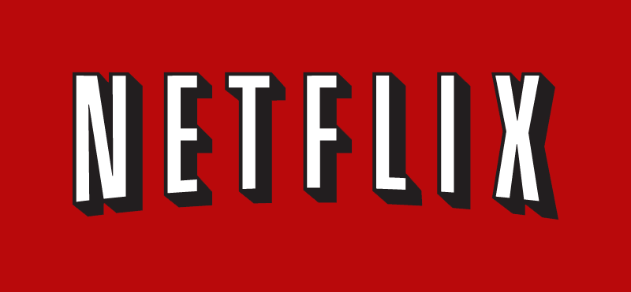

Suomeen tuli saataville tänään Netflix niminen palvelu. Jos yksinkertaisesti sanon niin palvelu on elokuvien ja sarjojen Spotify.

Netflixin  tarjoamia elokuvia ja sarjoja voit katsoa tietokoneella, tableteilla (ainakin iPad) ja pelikonsoleilla (Xbox, PS3, Wii). Tarkemman listan kaikista vekottimista kuten myös televisioista voit nähdä Netflixin omilta [sivuilta](https://signup.netflix.com/Watch).

Nyt kun rekisteröidyt niin saat kuukauden ajan käyttää ilmaiseksi Netflixiä ja kokeilla sen toimintaa. Mikäli olet Spotifyn käyttäjä ja maksat siitä niin saat loppuvuoden käyttää ilmaiseksi Netflixiä.

Itse kokeilin tänään hieman Netflixiä. Ensimmäinen miinus tuli siitä, että kokeiluakin varten piti syöttää luottokortin tiedot. Laitoinpa kalenteriin samaten muistutuksen, että muistan perua ennen kokeilun loppua tämän mikäli en totaalisesti innostu. Toinen ”miinus” tuli siitä, että materiaali on aika vanhahtavaa. Vanhvahtavalla tarkoitan sitä, että ei taida ihan uusimpia elokuvia ja sarjoja tulla sinne niin kuin haluaisin – eli mahdollisimman nopeasti.

Koitin selaimella Netflixiä pikaisesti ja Silverlightin asennuksen jälkeen homma pelasi hyvin. Mitään ongelmaa en siinä huomanut tai ei tullut vastaan. Koitin myös Xboxillani Netflixin käyttöä ja sen käyttäminen tuntui hieman hitaalta. Xboxilla koko ajan oli latausta ja pientä hitautta havaittavissa. Sitten kun pääsit katsomaan elokuvaa/sarjaa niin homma toimi vallan mainiosti. Omalla iPadilläni en ole vielä kokeillut Netflixiä, mutta asensin ilmaisen appsin siihen.

Suosittelen ainakin kokeilemaan Netflixiä sen kuukauden ajan mitä se on ilmainen! Sitten jos tuntuu, että palvelu tarjoaa sinulle vastinetta vajaan 8 euron kuukausimaksun verran niin hanki ihmeessä! Itse todennäköisesti odotan mitä HBO tulee tarjoamaan oman palvelunsa kautta, Game of Thrones kun kiinnostaa!
