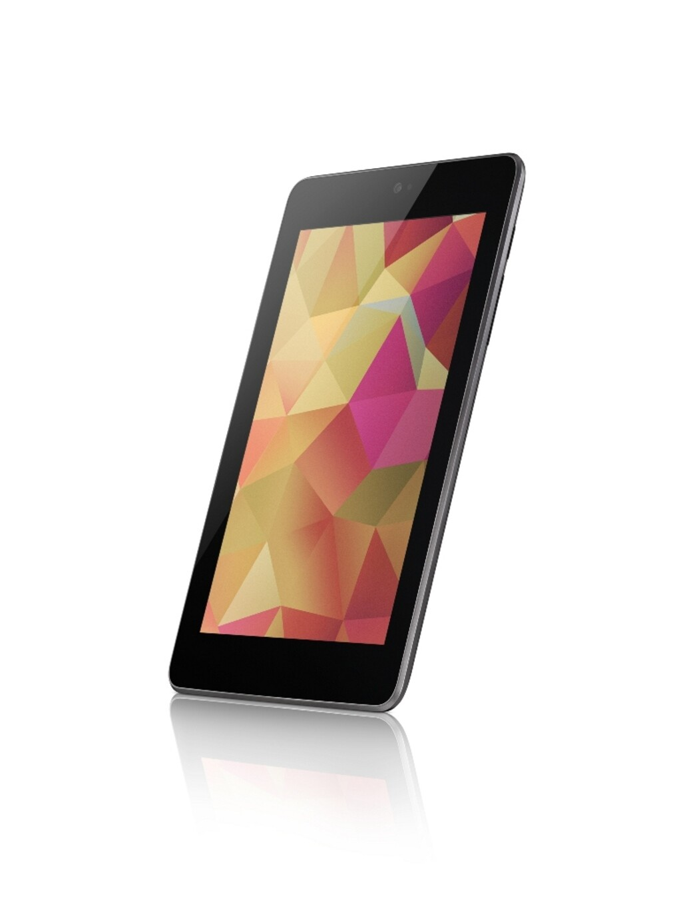

Kuten [Twitteristäni](http://twitter.com/MarkoK) ja [YouTubesta](http://www.youtube.com/user/markokaartinen) on saatettu jo huomata, olen saanut käsiini Googlen Nexus 7 tabletin, jonka on valmistanut Asus. Julkaisin nimittäin alhaalla olevan videon jo pari päivää sitten YouTubeen ja sitä on voinut siellä ihmetellä.

Kyseessähän on 7 tuuman taulutietokone eli tablet eli täppäri. Tätä voisi sanoa oikeastaan jo hieman budjettimallin tabletiksi sillä 32 gigainen WiFi malli maksaa vain 269 euroa ja jos siihen haluaa vielä 3G ominaisuuden kaveriksi niin hintaan voi lisätä sen 60 euroa.

Kokohan on tämän laitteen ison valtti sillä se on juuri sen kokoinen, että sitä on hyvä pitää kädessä ja se mahtuu siihen kunnolla. Se ei ole myöskään liian painava sillä se painaa vain 340 grammaa.

Itselläni on tämä WiFi malli, joten sen lisäksi laitteessa on tietysti Bluetooth sekä yllättävää kyllä NFC mahdollisuus Android Beamin välityksellä. Prosessorin virkaa ajaa yllättäen NVIDIA® Tegra® 3 quad-core prosessori jossa tuntuu ehoja olevan tähän hintaan nähden aivan riittävästi!

Koska Nexus 7 on Googlen tekele niin se saa myöskin suhteellisen nopeasti uusimmat päivitykset, koska kenenkään valmistajan ei niitä enää tarvitse testata ja muokata – tällöin välikädet jäävät pois. Tällä hetkellä tuossa on uusin versio 4.2.1 (videolla näkyvä versio on vielä vanhempi).

Akkukestoksi luvataan jopa 9-10 tuntia ja itsellä se tuntuu kestävän kyllä ihan hyvin näin lyhyen käytön jälkeen. Olen kyllä laturissa pitänyt sitä välistä, joten ihan tarkkaan akunkestoa en pysty sanomaan.

Kaipasin myös aikoinaan iPadiin sitä, että sinulla voisi olla käyttäjäprofiileja – tässä niitä voi olla. Tämä on todennköisesti Androidin ominaisuus? Joku fiksumpi voi varmistaa sillä tämä on ensimmäinen Android-tabletti minkä olen omistanut. Kaipaisin tähänkin sitä, että voisit jakaa sovelluksia sen toisen käyttäjätilin kanssa. Nyt kun ne taitaa olla molemmat sidoksissa Google tiliin.

Kuten osa varmaan tietää niin sain tämän käsiini sunnuntaina ja huomasin silloin siinä jo ongelman. Nimittäin vasen reuna näytöstä tuntui painuvan sisään ja silloin kuulit kun liima ”rätis”. Näyttö oli siis liimattu huonosti. Vein takaisin Prismaan maanantaina ja sain uuden tilalle – kiitos tästä. Uusi kappale oli siis virheetön ja mitään ongelmaa ei ole sen jälkeen ollut.

Tulen testaamaan Nexus 7 tablettia enemmän vielä ja tulen tekemään lisää videoita siitä. Tuolle on nimittäin hieman mielenkiintoisempia suunnitelmia ja mahdollisuuksia kuin iPadillä pystyisi tekemään. Mainittakoon sen verran, että OTG piuhalla saa tuohon kiinni USB-tikkuja ja jopa gamepadin.

Näin alun jälkeen voin lämpimästi suositella Nexus 7 tablettia joululahjaksi joko itselle tai jollekkin muulle. On kyllä tuon reilun parin sadan euron edestä arvoa tuolla jos verrataan iPad miniin joka maksaa 439 euroa (32gb wifi malli). Kannattaa ainakin käydä liikkeessä kokeilemassa tätä mikäli mahdollista!


