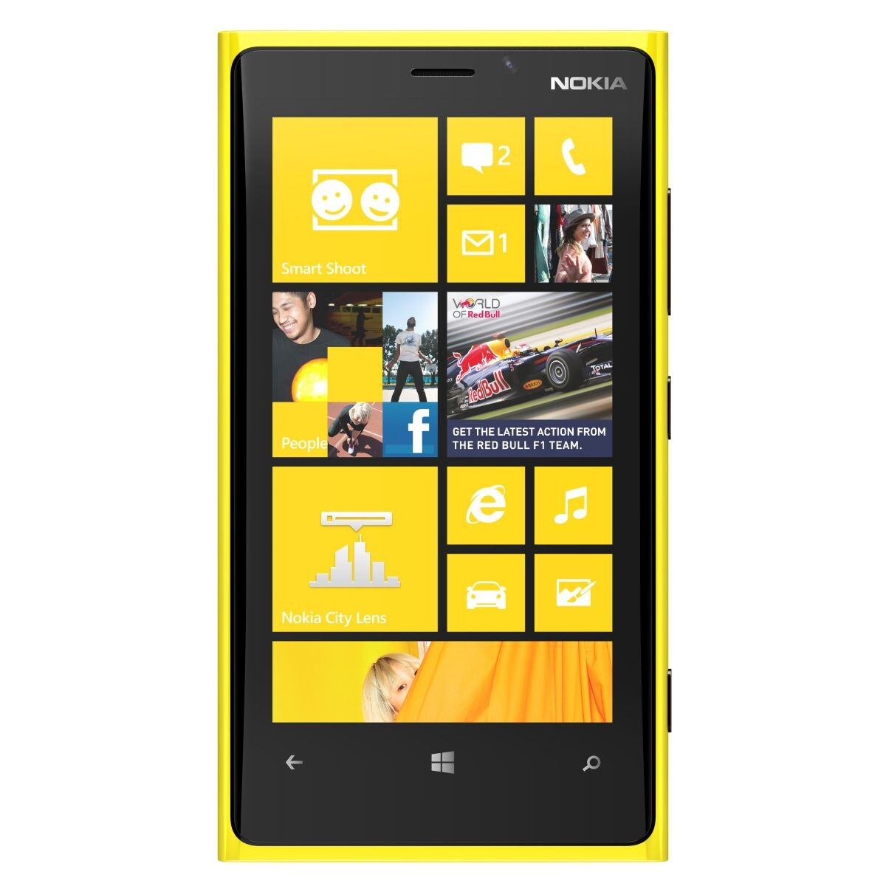
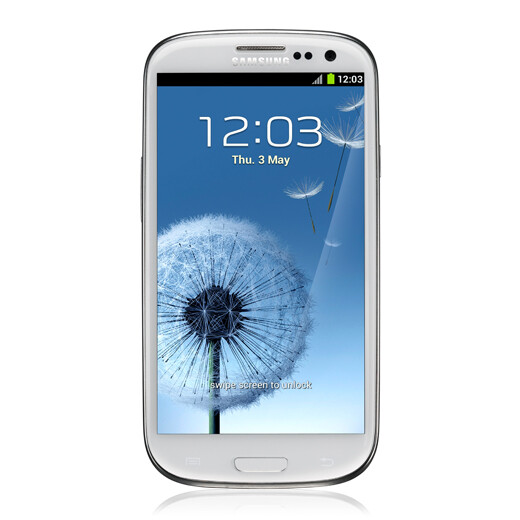
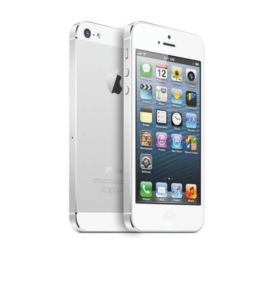

Kolme puhelinta, kolme valmistajaa ja kolme käyttöjärjestelmää. Edellisessä kirjoituksessa uhkasin ostaa iPhone 5 puhelimen syksyn aikana, silloin vertasin sitä vain iPhone 4 puhelimeen eli nykyiseen malliini. Tänään aloin pohtimaan asiaa uusiksi ja pitänee alkaa vertailemaan puhelimia hieman laajemmaltakin rintamalta. Pohdiskelin miten lähtisin vertaamaan näitä kolmea puhelinta sillä en ole koittanut ensimmäistäkään ja kahta niistä ei saa vielä sekä Nokian saatavuudesta ei ole mitään tietoa. Päätin ottaa jokaisen puhelimen käsittelyyn erikseen.

## Nokia 920

En olisi ihan äsken uskonut, että pohtisin hankkivani Nokialaisen, mutta mielenkiintoa on ollut Nokian suuntaan hetken verran. Ihan varma en ole mitä näistä Windows-puhelimista ajattelen ja Nokiaa on parjattu monelta suunnalta.

Aloitetaan ulkonäöstä, sillä värit pistävät ainakin silmään. Värivaihtoehtoja on viisi erilaista: musta, valkoinen, harmaa, punainen ja keltainen. Olisin toivonut kuitenkin jotain limen vihreän ja edellisten Nokialaisten sinistä mallia myöskin. Muotoilultaan tämä on sinänsä passelin oloinen sillä siinä on pyöreät reunat ja suht tasainen pää. En nyt mitään huonoakaan siitä osaa ulkonäöltä sanoa, muuta kuin nuo värit.

Otetaas pari ominaisuutta tästä puhelimesta esille. Aloitetaan langattomasta latauksesta jota Nokia hypetti ja ilmeisesti langatonta laturia ei tule edes myyntipakkauksessa mukana. Kameraa Nokia hypetti myöskin ja surullista kyllä demovideot osottautuivat feikeiksi ja siitä nousi sitten suhteellisen hyvä kohu. Paperilla kamera vaikuttaa kuitenkin hyvältä vekottimelta, kännykän kameraksi!

Windows 8 käyttöjärjestelmästä ei ole mitään tietoa puhelimien saralta, mutta ei se ihan susikaan voi olla? Mitenhän lie muuten sovellusten asentaminen ja hallinta? Jonkinlainen kauppapaikka tuollakin, kertokaapas tästä minulle!!

920 puhelimen saatavuudesta saati julkaisusta ei ole minulla mitään tietoa joten on täysi arvoitus (itselleni) milloin tätä edes voisi saada.

Tehojakin tässä laitteessa tuntuisi olevan ja ominaisuuksia enemmänkin kuin mitä olen tässä maininnut. Voitte tutkailla puhelimen ominaisuuksia ja kuvia Nokian omilta [sivuilta](http://www.nokia.com/fi-fi/tuotteet/puhelimet/lumia920/).

## Samsung Galaxy S 3

Samsungin puhelin on ollut itselläni tasan yhden kerran joskus kauan sitten. Siitä jäi silloin kyllä hyvät kokemukset, joten mitään pahaa sanottavaa ei menneisyydestäkään ole. Ainut asia mikä Samsung Galaxy S 2 versiossa häiritsi oli sen muovinen tuntuma, tätä en ole hypistellyt joten en osaa siitä sanoa mitään.

Ulkonäöltään tämä on suhteellisen kivannäköinen sillä siinä on pyöreitä muotoja. Ainut asia mistä kritisoin tätä on tämän sininen malli – en tykkää siitä väristä juurikaan tässä tapauksessa. Tässäkin olisin toivonut ehkä hieman kirkkaampia värejä.

Spekseiltään Samppa on perushyvä tehokäyttäjän luuri sillä tehoa tuntuu löytyvän ja oikeastaan mitään vikaa en äkkiseltään löytänyt niistäkään. Tässähän on Android ja se mahdollistaa puhelimen kustomoinnin aika pitkälle halutunlaiseksi (jos haluaa/osaa säätää tarpeeksi).

Tämä ehkä lähtee altavastaajana tähän taisteluun tai sitten ei. En osaa oikein sanoa mitään huonoa tästä tai oikein mitään mullistavaakaan. Tietty Samppa mainostaa puhelimen älykkyyttä, jakamista ja loistavuutta – on siellä loistavia ominaisuuksia ja erioten hauskoja sellaisia kuten Smart Alert.

Vaikuttaa ihan vängältä luurilta ja tämä on ainut mikä on tällä hetkellä saatavissa kaupoista! Tämä voi olla yksi vaikuttava tekijä ostopäätökseen – en tiedä. Tahtoisinkin kuulla kommentteja teiltä!

Lisää puhelimesta voitte lukea Samsungin omilta [sivuilta](http://www.samsung.com/fi/consumer/mobile/mobilephones/smartphones/GT-I9300RWDNEE).

## iPhone 5

Tämä on ehkä tämän kisan ennakkosuosikki sillä olen käyttänyt iPhone 3G ja iPhone 4 malleja. Käyttöliittymä ja toiminnot ovat siis suhteellisen tuttuja poislukien Siri ja muut 4S:lle tulleet ominaisuudet.

Tässähän on päivitetty prosessoria, kameraa ja ties mitä verrattuna minun iPhone 4 malliin. Tässä jos kuitenkin otetaan pelkkä iPhone 5 niin muotoilu on tässä suhteellisen sama kuin aikaisemmissa ja hieman on materiaalia takakannessa vaihettu. Puhelinta on saatu myös ohuemmaksi ja samalla myös puhelimen pituutta kasvatettiin (muuthan kasvattaa näytön koon naurettavan isoksi).

iPhone 5 mallissa vaihtuu myös sim-kortti nano-simmiksi joka ei niinkään lämmitä mieltä samaten liittimen vaihtuminen häiritsee elämää koska omistan mm. telakan iPhone 4:lle. Sillä pohdinkin, että pitäisikö lähteä vaihtamaan kokonaan toisenlainen puhelin kun joutuu lisälaitteita muutenkin uusimaan.

Mainitsenpa vielä, että tämän mallin mukana tulee vihdoin ja viimein uudet ja paremmat kuulokkeet – olen aina parjannut Applen kuulokkeita! Vihdoin he uudistivat niitä ja vaikuttaa ainakin paremmilta kuin nykyiset.

Apple uudisti myös kartat kokonaan tähän malliin tai oikeastaan iOS6 versioon ja he hylkäsivät tässä Googlen kartat kokonaan. Yllättäen kaikki ominaisuudet ei toimi täällä kylmässä pohjolassa.

Lisää iPhonesta voitte lukea Applen omilta [sivuilta](http://www.apple.com/fi/iphone/).

## Loppusanat

Päätöksiä pitäisi tehdä ja ne tulevat olemaan vaikeita sillä en ole enää oikein varma tuosta iPhone 5 mallistakaan. Tässähän on kolme varteenotettavaa puhelinta ja jokaisessa on jotain hyvää. Ehkä eniten kiinnostaisi lähteä kokeilemaan Nokialaista pitkästä aikaa, mutta sen päätöksen kanssa pitää elää sitten pari vuotta.

Sen verran voisin parjata Nokiaa, että kyselin sieltä päin testiin tuota ja sieltä tuli linkki jossa oli tarjolla Nokialaisia. Ongelmana tässä oli kuitenkin se, että ei ollut 920 mallia tarjolla eikä artikkeleita voinut tehdä suomeksi tuon kautta. Suomalainen yhtiö ja suomalaisia artikkeleita ei blogeissa haluta nähdä? Jep jep… Tämä ei sinällään vaikuta itse puhelimeen mitenkään.

Haluaisin todella kovasti teidän mielipiteitä tästä aiheesta sillä itse olen hieman umpikujassa! En ole tehnyt vielä mitään päätöstä saati mitään ennakkotilausta!
