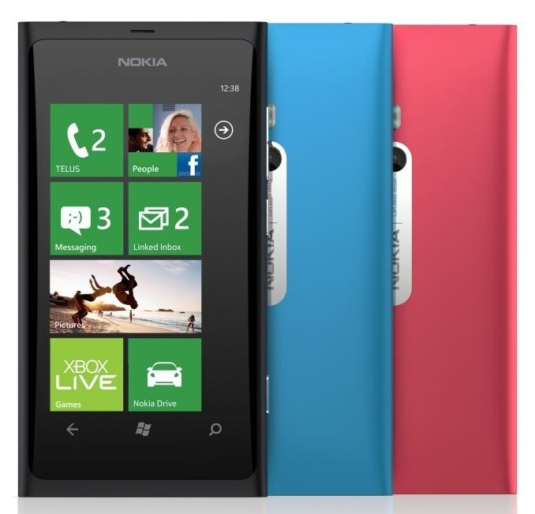

No nyt jotkut lukijoista miettivät ”onko tämä jannu aivan sekaisin?”. Olette huomanneet, että olen ollut Apple myönteinen aina siitä asti, kun iPhone 3G:n suomeen tulosta alettiin huhuta. Nyt kuitenkin puhutaan Nokiasta, ei Androidista eikä Applesta vaan Nokian uusista Lumia puhelimista. Koko tämä ajatus lähti tuosta alla olevasta Tweetistä liikkeelle.

\[tweet https://twitter.com/MarkoK/status/169017975213535232\]

Löysin Lumioita kaksi kappaletta Nokian [tuotesivuilta](http://www.nokia.com/fi-fi/tuotteet/kaikki-puhelimet/). Näiden kahden onnekkaan mallit ovat Lumia 800 ja Lumia 710. Tulen tässä pohtimaan vain speksien perusteella näitä puhelimia sillä en osaa sanoa näppituntumalta yhtään mitään. Ainoat testaukseni perustuvat vain hyvin lyhyeen kokeiluun liikkeessä ja sillä testaamisella en voi vetää minkäänlaisia johtopäätöksiä.

Molemmissa Lumioissa on Windows taustalla ja molemmista löytyy suhteellisen pirteitä värivaihtoehtoja. Lumia 800 on kolmessa eri värissä ja 710 on jopa 10 eri värivaihtoehtoa. Näyttö on kooltaan molemmista 3.7″ (480’800), ainoana erona on se, että Lumia 800:ssa on AMOLED näyttö. Kamerassa on pieni ero sillä 710:ssa on 5 megapikseliä ja 800:ssa on 8 megapikseliä. Molemmat puhelimet kykenevät myös ottamaan videokuvaa, laadusta en osaa sanoa oikein mitään ilman testaamista.

Molemmista puhelimista löytyy tietysti myös sähköposti, selain, musiikkisoitin, navigointi ja muut härpäkkeet. Pelkkien speksien perusteella on suhteellisen vaikea sanoa yhtään mitään näistä puhelimista. Molemmat näyttää paperilla hyviltä, mutta eniten askarruttaa tuo Windows käyttöjärjestelmänä.

Hauskahan näitä olisi käpistellä ja sitä kautta voisi saada hieman paremman kuvan näistäkin vekottimista. Sen vain sanon, että Nokia on panostanut suhteellisen paljon näiden markkinointiin ja toivottavasti saa jonkin verran myyntiäkin aikaiseksi.

Vaikea on sanoa lopullista mielipidettä ilman käpistelyä. Windows on kuitenkin itselleni täysin tuntematon käyttöjärjestelmä puhelimissa.

*Vinkkinä Nokian väelle *(ja miksi ei muillekkin valmistajille)*: Laitteita saa laittaa testattavaksi ;)*
