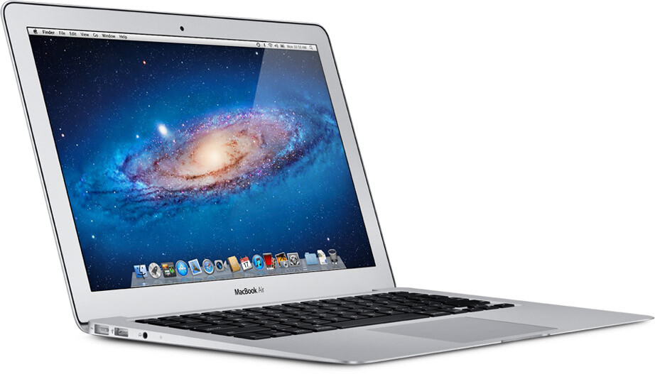
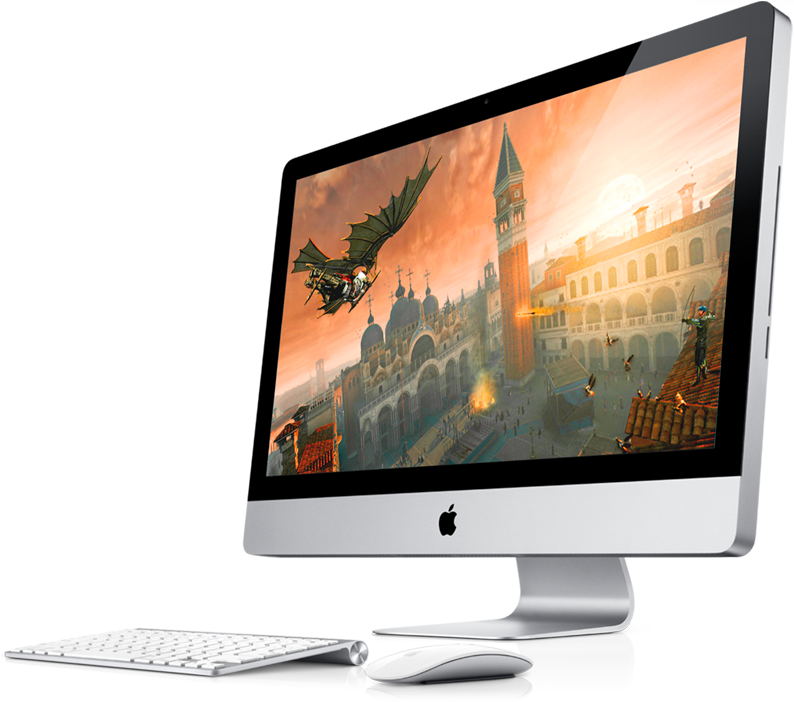

Kaikkihan tietää nykyään, että pidän Applen tuotteista ja niitä olisi kiva omistaa enemmänkin. Päätin siis pyhittää yhden postauksen täysin Applen tuotteille ja lähinnä niille mitä olisi kiva omistaa, mutta en omista ja en osaa sanoa tulenko koskaan omistamaan. Onneksi haaveilu ja haluaminen on täysin ilmaista!

## MacBook Air

Ensimmäisenä tehdään kuitenkin poikkeus yllä olevaan sillä tämä läppäri on seuraava hankintani. Siis heti kunhan tämä MacBook Pro saa jäädä eläkkeelle aktiivikäytöstä! Kannettavan pitää olla oikeastaan juuri tämmöinen: kevyt, ohut, tehokas, hyvän näköinen ja ennen kaikkea toimiva. PItää kuitenkin tutkailla miten tämä kehittyy vuoden parin kuluessa sillä tämä kone on ollut minulla käytössä reilun vuoden ja uskon saavani siitä vielä saman verran irti! Muistin päivitys tulee olemaan jossain välissä edessä.

## iMac

Kukapa voisi sanoa ettei tahtoisi yhtä näyttöä pöydälle jossa olisi samassa paketissa kaikki? Applella on aina ollut erittäin miellyttävä design ja se pitää paikkansa myöskin tämän koneen kanssa. Sanoisinko, että tuo näyttäisi erittäin hyvältä työpöydälläni ja hyvinkin mielellään käyttäisi tuota konetta. Aina on onneksi lupa haaveilla ja käydä hypistelemässä näitä vekottimia Gigantissa tai muussa liikkeessä.

Ehkäpä sitten kun huushollissa on täysin oma ”työhuone” olemassa ja hieman enemmän pöytätilaa harrastaa. Tietysti toimistollekkin kävisi hyvin tämmönen vekotin – pitää pistää pohdintaan.

## Tulossa olevat iLaitteet

Tarkoitan siis laitteita joita ei ole edes julkaistu vielä, niistä liikkuu siis lähinnä vain huhuja. Itsellä on lähinnä mietteissä iPad 3 ja iPhone 5 (jospa se tulisi eikä 4SSSSSSSSSSSS). SItäkään ei tosin tiedä mitä Apple kehittelee tulevaisuudessa, mutta tulen seuraamaan sitäkin ahkerana.

Tämmöinen omppu postaus tällä kertaa, kivojahan nämä olisi mutta rahaa ei ole ihan tämmöisiä varten tällä hetkellä. Älkää siis huoliko, ette tule lukeman iMac tai MacBook Air postauksia ainakaan hetkeen.
