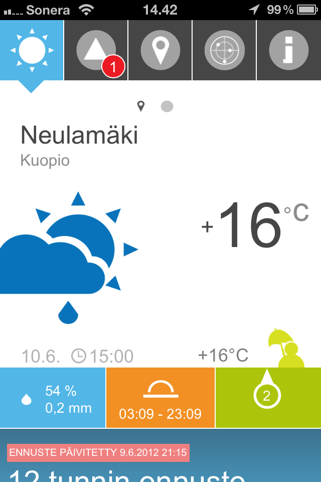
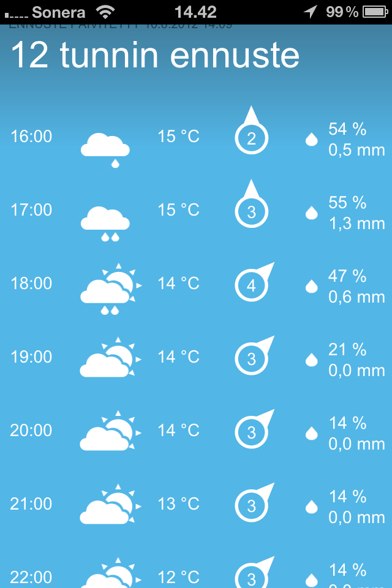
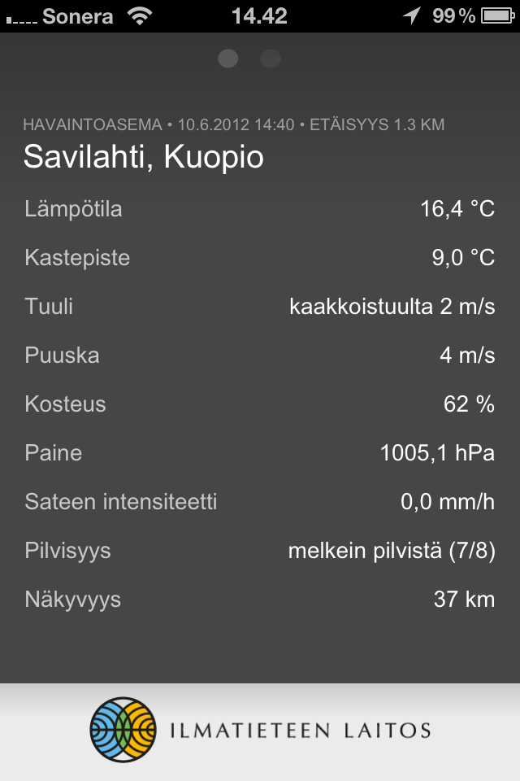
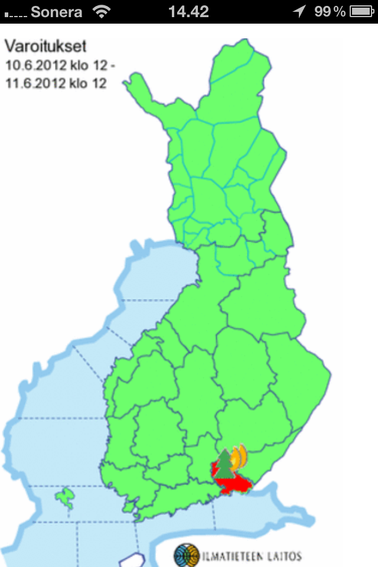
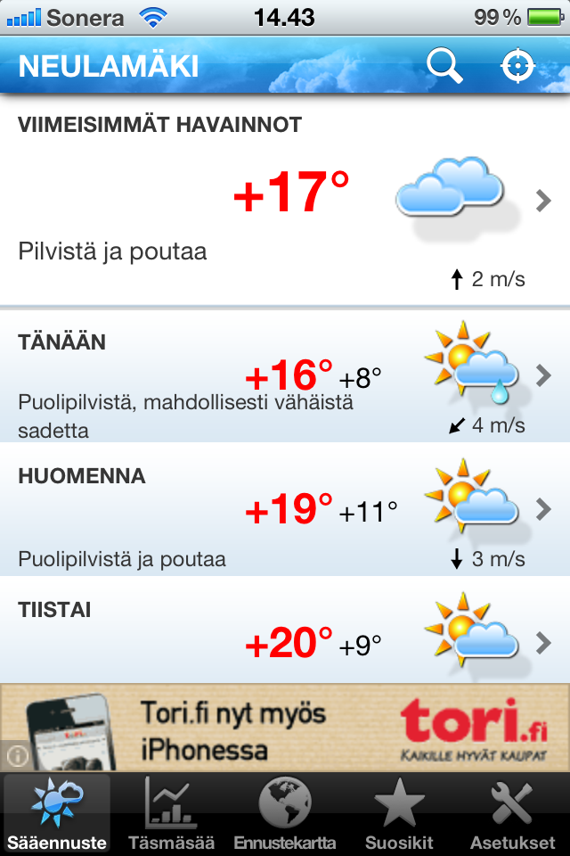
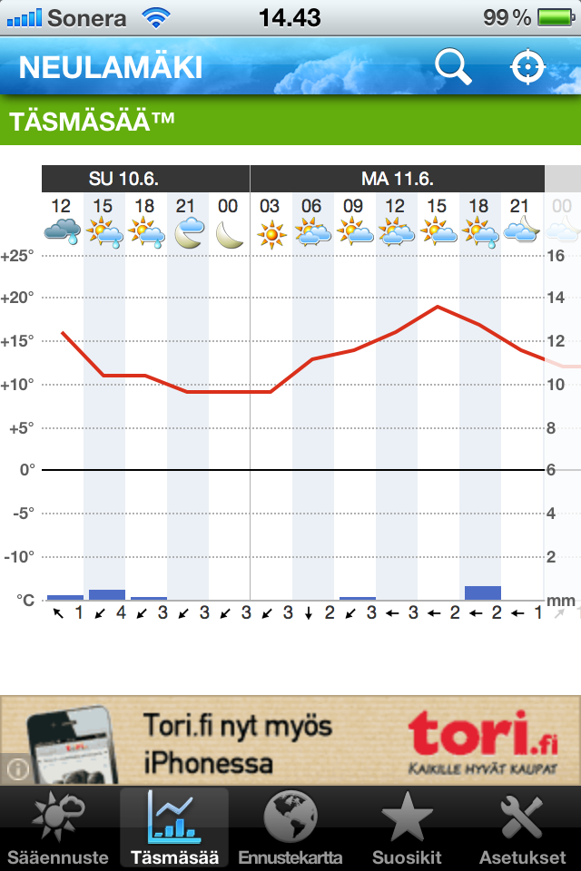
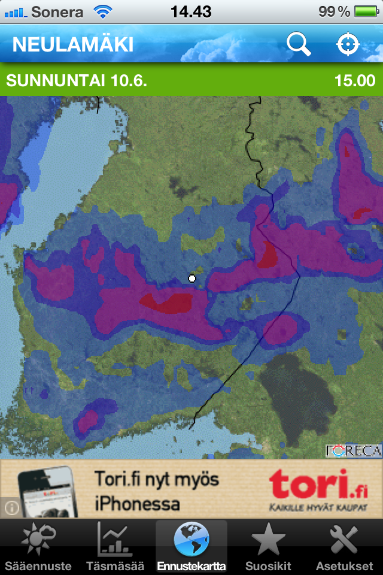

iPhonelle on tullut pari sääohjelmaa, jotka huomasin tuossa yksi päivä. Nimittäin Foreca ja Ilmatieteen laitos ovat tuoneet omat sääohjelmansa iPhonelle. Käytän molempien verkkosivuja ja halusin katsoa millaisia näiden ohjelmat ovat. Päätin siis hieman tutustua niihin.

### Ilmatieteen laitos

Ilmatieteen laitoken sääohjelma on kertakaikkiaan komean näköinen. Itselläni ei ollut mitään ongelmaa tuon kanssa kun koitin sitä suhteellisen nopeasti. Ulkoasultaan ohjelma on hyvä ja voisinpa sanoa sitä hieman ”Windows phonemaiseksi” ulkoasuksi. Alla vielä jokunen kuva Ilmatieteen laitoksen appsista.

  

### Foreca

Verrokiksi löysin Forecan appsin. Ensimmäisenä pistää silmään mainos. Ok, on Forecan omilla sivuillakin mainoksia, mutta pitikö se pistää nyt tuohon appsiinkin. Ulkoasu ei muutenkaan säväytä samalla tavalla kuin kilpailijan ohjelmassa. Mainoksen lisäksi muita ongelmia en tämän ohjelman käytössä ole törmännyt.

 

### Lopuksi

Toki iPhonelle on saatavana monta muutakin sääohjelmaa, kuin nämä kaksi. Nämä nyt sattuivat viime aikoina silmään ja varsinkin kun olen verkkosivuja käyttänyt avuksi niin nämä myös kiinnostivat itseäni.

Käytätkö itse jompaa kumpaa näistä vai täysin jotain muuta ohjelmaa? **Kerro ja kommentoi!**
