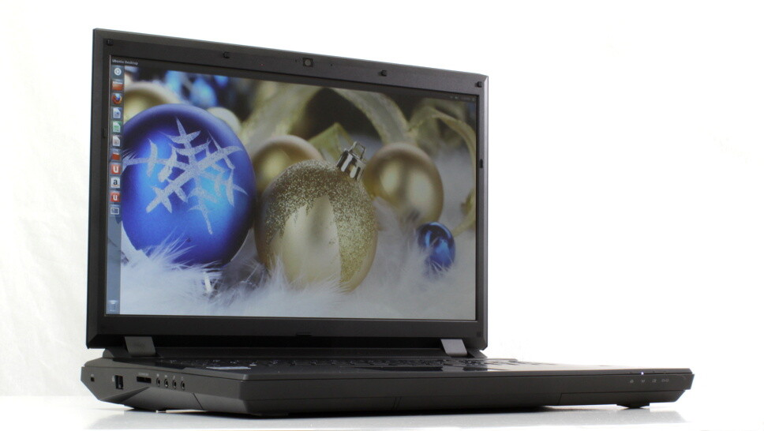

Heräsin ehkä hieman hitaasti tähän, mutta ei ole ensimmäinen kerta. System76 on tuonut markkinoille Ubuntun päällä pyörivän peliläppärin. Ajoitushan on loistava sillä Steam on beta vaiheessa Linux ympäristöllä. Bonobo Extreme mallinen läppäri on aikamoinen tehomylly läppäriksi.

Koneessa on kyllä tehoja aika huimasti sillä siitä on mm. i7 prosessori, muistia voi laittaa max. 32 gigaa sekä siinä on Nvidian näytönohjain. Koneessa on myös 17.3″ FullHD LED näyttö, joten kuvanlaadun ei pitäisi mikään huono olla tässä vekottimessa. Alla vielä tarkemmat speksit:

> Processor: 3rd Generation Intel Core i7 CPU’s\
> Display: 17.3″ 1080p Full High Definition LED Backlit Display (1920 x 1080)\
> Graphics: nVidia Geforce GTX 670MX or Geforce GTX 680M\
> Memory: 204 pin Dual Channel DDR3 @ 1600 MHz\
> Storage: 2 x 2.5″ 9mm Removable SATA II/III\
> Clickpad: Multitouch with two finger scrolling\
> Networking: Gigabit LAN (10/100/1000), WiFi\
> Wireless: Intel Centrino 802.11 bgn\
> Ports: SD Card Reader, HDMI 1.4a, Display Port 1.2, Ethernet, eSata USB 2.0 Combo Port, 4 x USB 3.0 (1 powered), 1 x USB 2.0, Headphone Jack, Microphone Jack, Line In Jack, S/PDIF Output\
> Camera: Built-In 2.0 MP High Resolution Camera\
> Security: Kensington® Lock, Fingerprint Reader for Biometric Login\
> Power Management: Suspend and Resume\
> Battery: 8 Cell Lithium-Ion Battery Pack\
> Power System: Full Range AC-in 100~240V, 50~60Hz, 90W AC Adapter, DC output 19V, 4.74A\
> Dimensions: 16.5″ x 11.54″ x 1.55~1.96″ (WxDxH)\
> Weight: 8.60 lbs. (3.90 kg.)

Mielenkiintoista nähdä miten pelimarkkinat siirtyy Linuxin puolelle kun alkaa näitäkin tupsahtaa markkinoille. Toki muihinkin peliläppäreihin saa Ubuntun asennettua Windowsin tilalle.

Lue lisää läppäristä System76 [sivuilta](https://www.system76.com/laptops/model/bonx6).
