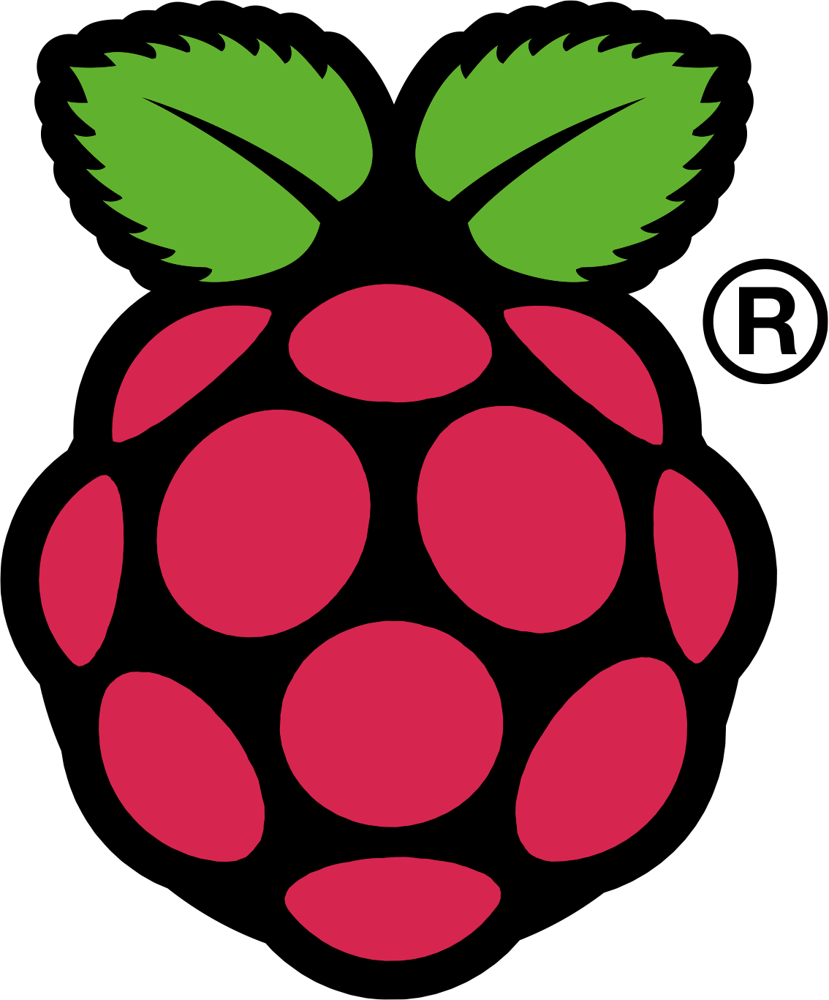

Raspberry Pi on käytännössä yhden piirilevyn tietokone jonka on kehittänyt Raspberry Pi Foundation. Itse innostuin tästä lähes heti kun kuulin projektista ja näin pre-order mahdollisuuden. Myöhästyin kuitenkin hieman, että olisin saanut laitteen käsiini nopeammin. Raspberry Pi tuli kuitenkin minulle postissa ja en ole kerennyt sitä säätämään sillä tarvitsen vielä SDHC-muistikortin, joka on postissa tulossa.

Itse tilasin Model B:n ja käytännössä ainoat erot Model A versioon on USB porttien määrä (B: 2 – A: 1), verkkosovitin (B: RJ45 – A: ei ole) ja tehonkulutus (B: 700 mA / 3.5W – A: 500 mA / 2.5W). Muuten laitteissa on 700 MHz ARM11 prosessori, Broadcomin näytönohjain, 256MB jaettua muistia, HDMI portti, komposiitti RCA portti ja 3.5mm ääniportti (ääni tulee myös HDMI:n kautta).

Raspberry Pi kykenee myös HDMI videoiden katsomiseen (tätä tulen testaamaan) ja moneen muuhun. Tällä hetkellä tarjolla on parikin eri Linux Distroa: Debianiin perustuva Raspbian ”Wheezy” (jota itse tulen kokeilemaan), Arch Linux ARM ja QtonPi.

Tulen pistämään Rasbperry Pi:n kiinni televisioon ja tekemään testejä miten sillä onnistuu elokuvien katselu, nettisurffaus ja muut hyvin perustoiminnot. Olisikohan tästä laitteesta jopa halvaksi olohuone-PC:ksi? Laitehan ei maksa kuin jokusen kympin postikuluineen ja siihen päälle muistikortti. Tietty näppäimistö menee USBilla kiinni ja samaten hiiri – kotelonkin voi tälle hankkia jos haluaa.

Tulen tekemään kattavampaa arviointia ja testausta kunhan olen saanut muistikortin. Mikäli haluatte minun testaavan jotain erityistä niin voitte ehdottaa tämän artikkelin kommentteihin. Odotellessa muita artikkeleitani tästä, voitte tutkailla Raspberry Pi tietokonetta lisää heidän kotisivuillaan osoitteessa <http://raspberrypi.org/>.
