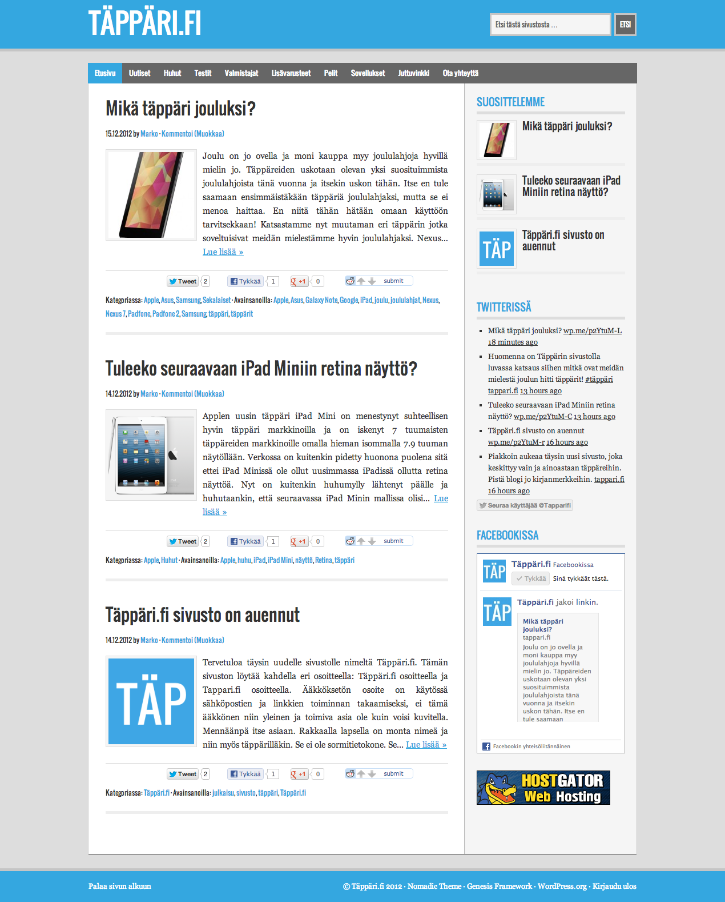

Julkaisin eilen uusimman projektini, [Täppäri.fi](http://tappari.fi) sivuston. Täppäri tulee keskittymään täysin täppäreihin eli tabletteihin eli taulutietokoneisiin.

[Täppäriiin](http://tappari.fi) tulen kirjoittelemaan arvosteluita, uutisia, huhuja sekä muita täppäreihin liittyviä artikkeleita. Pyrin saamaan täppäreitä testiin suoraan valmistajilta, mutta tämä prosessi voi kestää oman aikansa joten tällä hetkellä testilaitteet ovat omia.

Täppäri on tietysti rakennettu WordPressin päälle ja teemana on käytetty [Genesis Frameworkin](http://www.shareasale.com/r.cfm?b=346198&u=573489&m=28169&urllink=&afftrack=) teemaa.

Tulen tekemään töitä tämän sivuston eteen, jotta saisin tämän menestymään. Sisältöä pyrin tuottamaan tasaisesti ja sitä kautta saamaan vakaata lukijakuntaa. Ihmeitähän ei tunnetusti tehdä yhdessä yössä, mutta antamalla projektille aikaa saamme varmasti tästä hyvän sivuston.

Mikäli osoite jäi jollekkin vielä epäselväksi, se on [www.tappari.fi](http://tappari.fi/) tai [www.täppäri.fi](http://tappari.fi/)

Kertokaahan kommentteja ja mielipiteitä aivan vapaasti!
