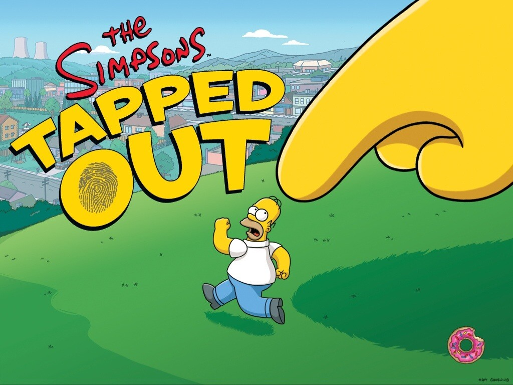
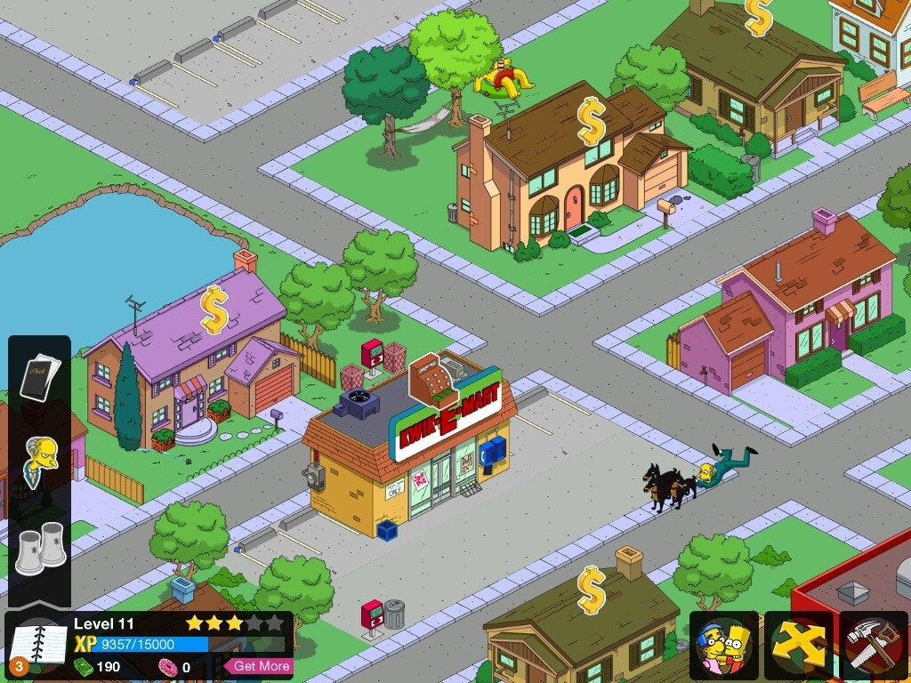
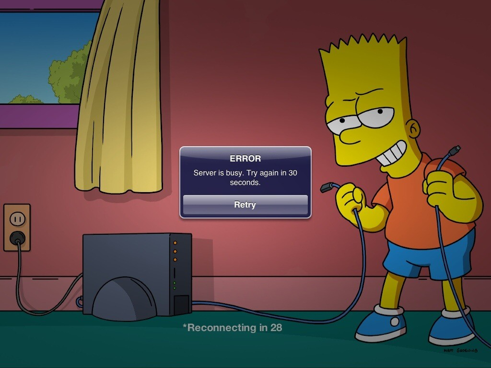
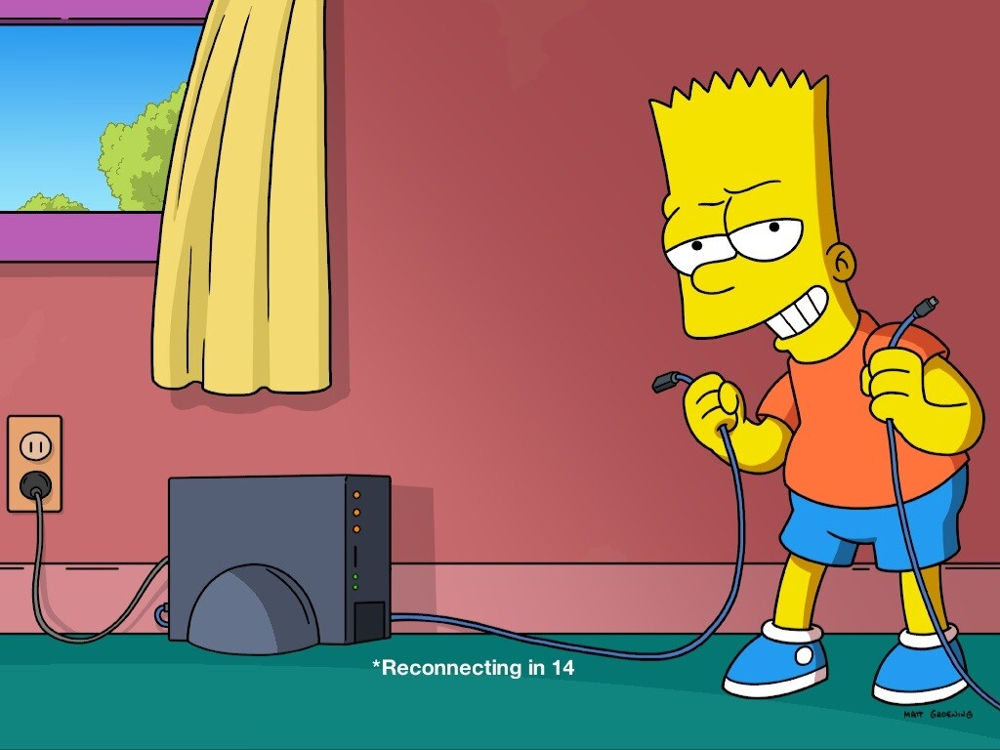
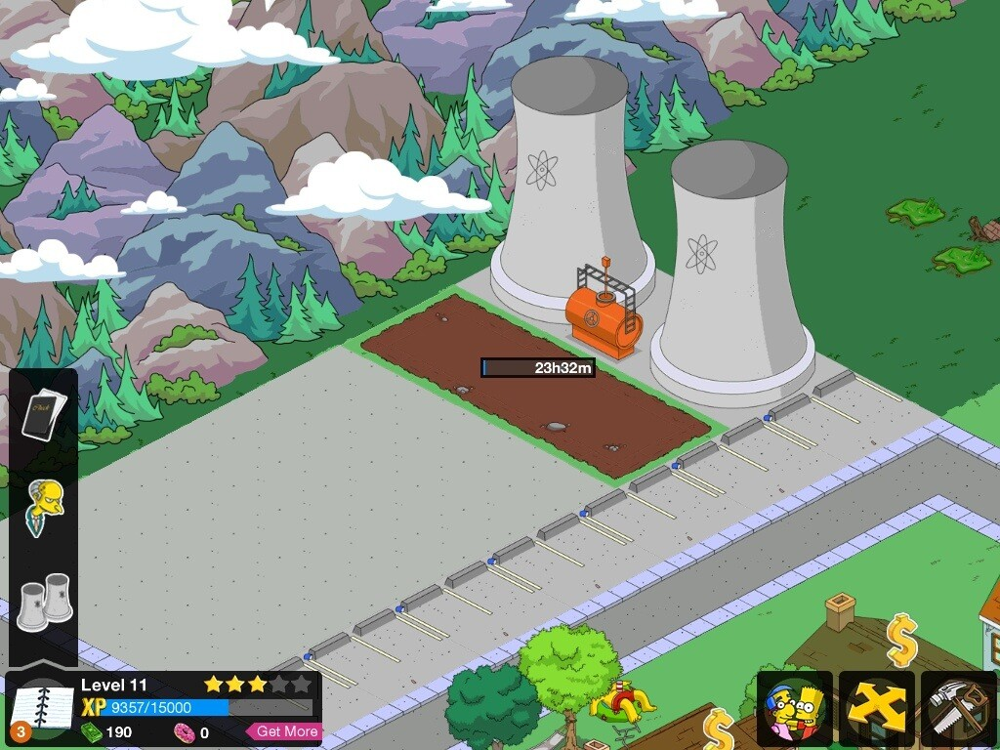
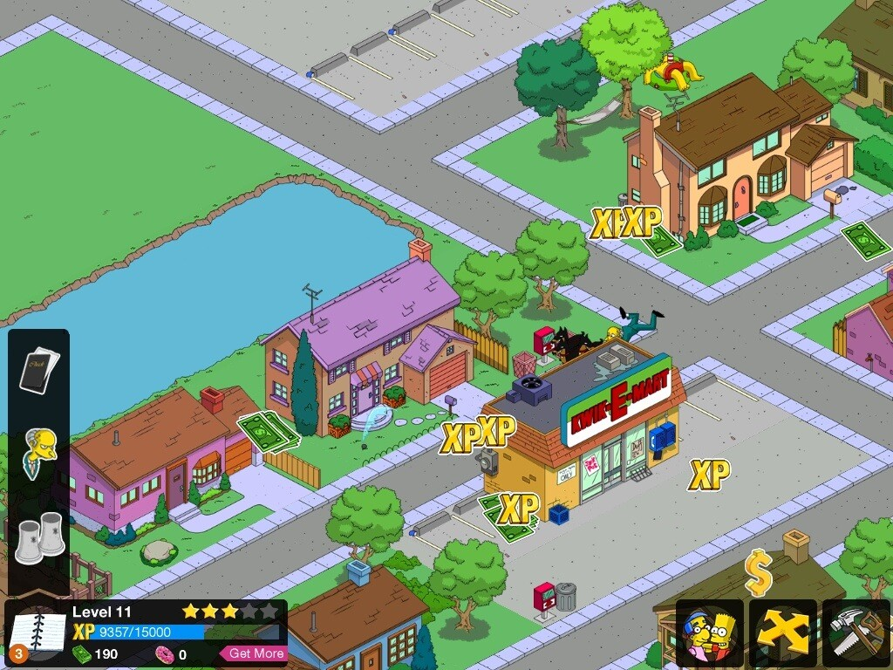
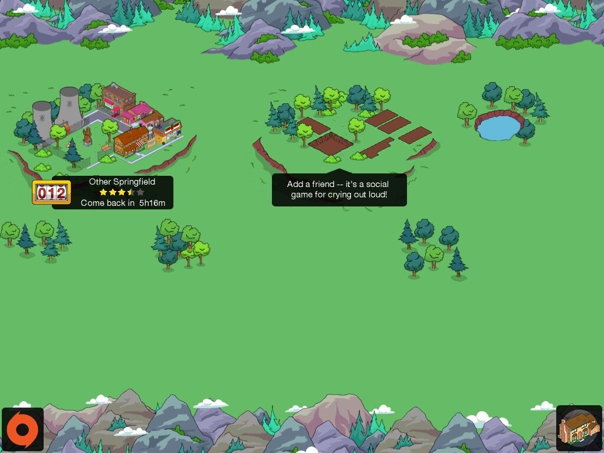
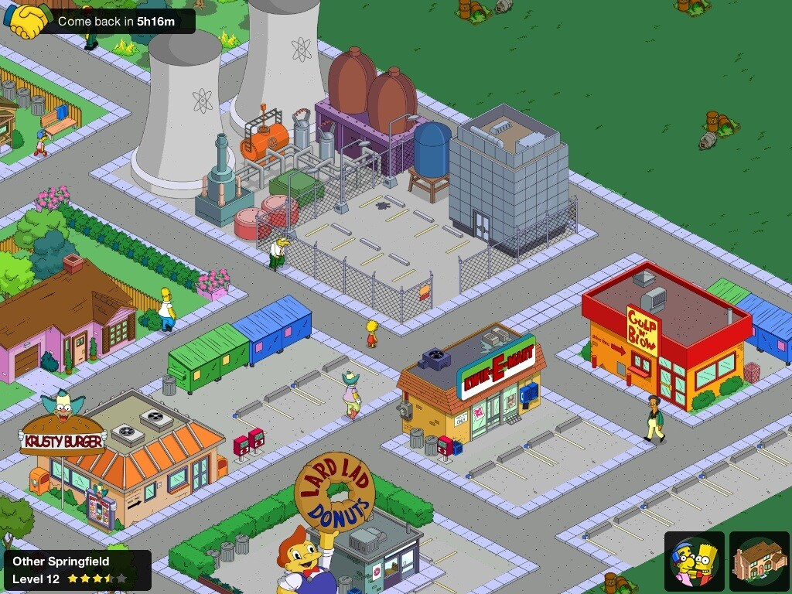

Otetaan nyt käsittelyyn iOS:llä oleva peli, jota itse ainakin tykkään pelata iPadillä huomattavasti enemmän kuin iPhonella. Kyseessä on EA:n tekemä The Simpsons™: Tapped Out niminen peli, jossa rakennetaan omaa Springfieldiä.

Kyseinen peli on täysin ilmainen, joten se kannattaa hankkia ja ainakin kokeilla. Pelissä on donitseja, joita voi ostaa jos haluaa hieman nopeutta pelin etenemiseen ja osa ostettavista tavaroista on saatavissa vain donitseilla. Eli EA osaa rahastaa tässäkin asiassa.

Kuten ylläolevasta näkee niin taloista, kaupoista ja ravintoloista kerätään rahaa ja kokemusta itselle, jotta päästään pelissä eteenpäin. Asukkaat voi ja kannattaa laittaa tekemään tehtäviä sillä siitä saa kokemusta ja rahaa. Asukkailta saat myös tehtäviä tehtäväksi, jotka liittyy yleensä juuri rakentamiseen ja jonkun tietyn toiminnon suorittamiseen.

Ongelmana on ollut lähinnä vain tuo yhteys palvelimeen. Oikealla oleva kuva kertoo sen pahimman. Kesken pelin voi hävitä yhteys palvelimeen ja joudut sitten koittaa yhteyden muodostamista uudestaan. Toinen ongelma on sitten se, että se on Originin kanssa kimpassa, peli oikeastaan vaatii Origin tilin, jotta voit jatkaa omaa peliäsi. Samaten tämän takia vaatii sen, että iPad on verkossa… Näin ainakin oletan, sillä miten muuten voit Originiin yhdistää? Ei hyvä tämä ominaisuus!

Pelissä voit myös lisäillä kavereita, jotta saat sitä kautta kokemusta ja rahaa hieman lisää. Pelissä tulee automaattisesti yksi Springfield, jossa voit käydä kerran päivässä hankkimassa rahaa ja kokemusta.

Kaiken kaikkiaan peli on loistavaa naputtamista ja ajanvietettä. Suosittelen iPadille sillä iPhonen näytöllä menee hieman liian pieneksi. Donitsit voisivat olla myös huomattavasti halvempia sekä pelin pitäisi toimia ilman Originia, vaikkapa sitten iOSin oman Game Centerin kautta!

Alla vielä lisää kuvia tästä pelistä:




