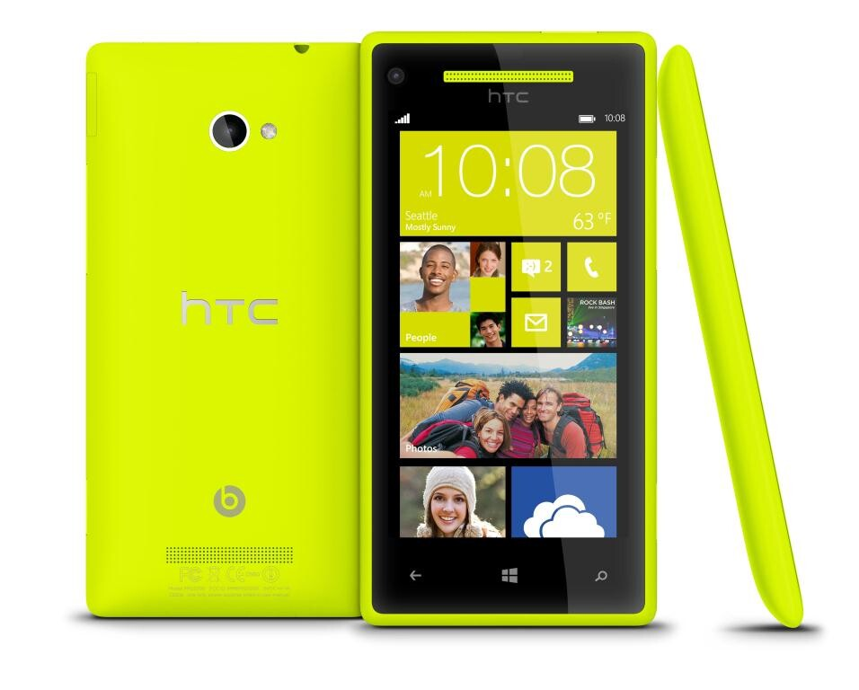

Joku kysyy tietenkin, että mihinkä kisaan? No siihen kisaan tietysti missä valitaan minulle seuraava puhelin! Kisa alkoi oikeastaan edellisestä [kirjoituksestani](/2012/nokia-920-iphone-5-vai-samsung-galaxy-s-3 "Nokia 920, iPhone 5 vai Samsung Galaxy S 3?") ja on elänyt sen jälkeen [Twitterissä](http://twitter.com/MarkoK) ja jopa Jannen [blogissa](http://www.raivogalleria.net/?p=1828)!

## HTC Windows Phone 8X – Uusi haastaja kisaan

HTC julkaisi tällä viikolla uusia puhelimia. Oletin aluksi, että tulossa olisi Android-pohjainen puhelin, mutta olinpa väärässä! Nyt vedettiin hieman mattoa Nokian alta ja julkaistiin ainut puhelin, jonka nimessä käytetään Windows Phonea!

Ulkoasultaan ja osittain muotoilultaan puhelin on aika lähellä Nokian Lumia 920 puhelinta ja käyttöjärjestelmähän on tässä sama Windows Phone 8.

Kauheasti eroja ei sinällään Nokialaiseen ole, mutta langatonta latausta tässä puhelimessa ei ole. Taitaa muuten aika tasavertaisia nämä kaksi puhelinta olla.

Mikäli haluatte nähdä hieman vertailua Lumia 920 ja HTC 8X puhelinten välillä niin voit mennä wpcentralin [sivuille](http://www.wpcentral.com/comparison-htc-one-8x-vs-nokia-lumia-920).

Lue lisää puhelimesta HTC:n [sivuilta](http://www.htc.com/www/smartphones/htc-wp-8x/).

## Galaxy S 3 tippuu kisasta

Näin pääsi käymään, en oikein innostunut tuosta mallista tänään kun kävin sitä Gigantissa hypistelemässä. SGS3 on oikeastaan alusta asti ollut se puhelin mikä on roikkunut minun valinnoissa hännillä. Nyt kun tuli uusi haastaja kisaan niin pitihän se yksi pudottaa pois.

Ehkä tämä puhelin vaatisi enemmän käyttöä, että saisin tästä paremmin kiinni. Tietysti Android luureja saa yleensä rootattua ja tätä kautta tuunattua hyvinkin pitkälle haluamakseen. En tosin tiedä onko tämäkään ihan täysin minua varten. Tämä on siis tällä erää pois kisasta ellei joku vakuuta minua!

## Kisan tilanne

Kolme puhelinta on siis vielä mukana iPhone 5 (joka julkaistaan viikon päästä), Lumia 920 (julkaisusta ei tietoa) sekä HTC WP 8X (julkaisusta ei tietoa). Tällä hetkellä kisan johdossa saattaa olla Nokian puhelin – yllättävää kyllä.

Harmillista tässä kisassa on se, että kahden puhelimen julkaisusta ei ole mitään havaintoa kun taas iPhone 5 tulee ensi viikolla. Sen saatavuus on taas jotain aivan muuta kun ilmeisesti ei mitään ennakkotilaustakaan järjestetty. Uskoisin kuitenkin, että saatavuus tulee ongelmaksi myös Lumian ja HTC:n kanssa.

Heitä oma lusikkasi soppaan ja kommentoi!
