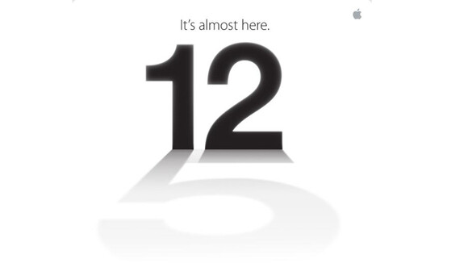

Applen huhutaan julkistavan uusi iPhone tämän viikon keskiviikkona (12.9). Kutsussa oli varjossa numero 5, joka taas viittaisi iPhone 5 malliin. Tämä ei kuitenkaan ole mitenkään varmaa, että onko uuden iPhonen nimi iPhone 5 vai pelkkä iPhone – sen näemme keskiviikkona.

En nyt lähde spekuloimaan mitä tulee keskiviikkona ja millainen uudesta iPhonesta tulee. Nyt keskitynkin spekuloimaan sitä miten se tulee myymään. Aina kun Apple julkistaa jotain niin se loppuu kauppojen hyllyltä. Applen tuotteissa tuppaa olemaan aivan älytön hypetys ennen ja jälkeen julkistuksen.

En nyt sinänsä puutu enempää tuohon hypeen sillä on muitakin syitä miksi tuleva iPhone tulee myymään hyvin. Mikäli on vielä ihmisiä, jotka käyttää iPhonen vanhempia malleja kuten 3G tai 3GS – niin he tulevat päivittämään uuteen puhelimeen lähiaikoina. Mikäli he ovat näin kauan Applen puhelinta käyttäneet niin on myös todennäköistä, että uusi puhelin on myös Applen tekemä. Tietty on myös mahdollista, että vanhemman puhelimen päivittäjät ostavat Apple fanaatikkojen käytetyt iPhone 4 ja 4S mallit.

Itse olen aika varmasti päivittämässä uuteen iPhoneen sillä oma iPhone 4 alkaa niin sanotusti vedellä viimeisiään omassa käytössäni. Tietty siinä on häiriönä keltainen ”läikkä” näytössä, joka ei lähde millään pois. Soneralla sanoivat, ettei mene takuuseenkaan. No siitä saa varapuhelimen :)

Täällä pohjolassa myyntiin vaikuttaa se milloinka iPhone tulee tänne ja mitenkä ennakkomyynti/varaus hoidetaan. Itse toivon, että puhelin tulisi myyntiin piakkoin täälläkin ja sen voisi pistää varaukseen heti seuraavana päivänä. Toivottavasti suomalaiset operaattorit ovat varautuneet ja heille on annettu edes jotain tietoa! Apple kun on pirun hyvä pitämään infon itsellään.

Keskiviikkona nähdään mitä kaikkea tulee ja jäädään odottelemaan sitä uutta iPhonea ja mitä kaikkea se paketti pitää sisällään. Toivoisin ainakin sen, että ne uudistaisi ne pirun kuulokkeensa!

Huomatkaa, että kaikki artikkelin spekuloinnit ovat täysin omia!!!
