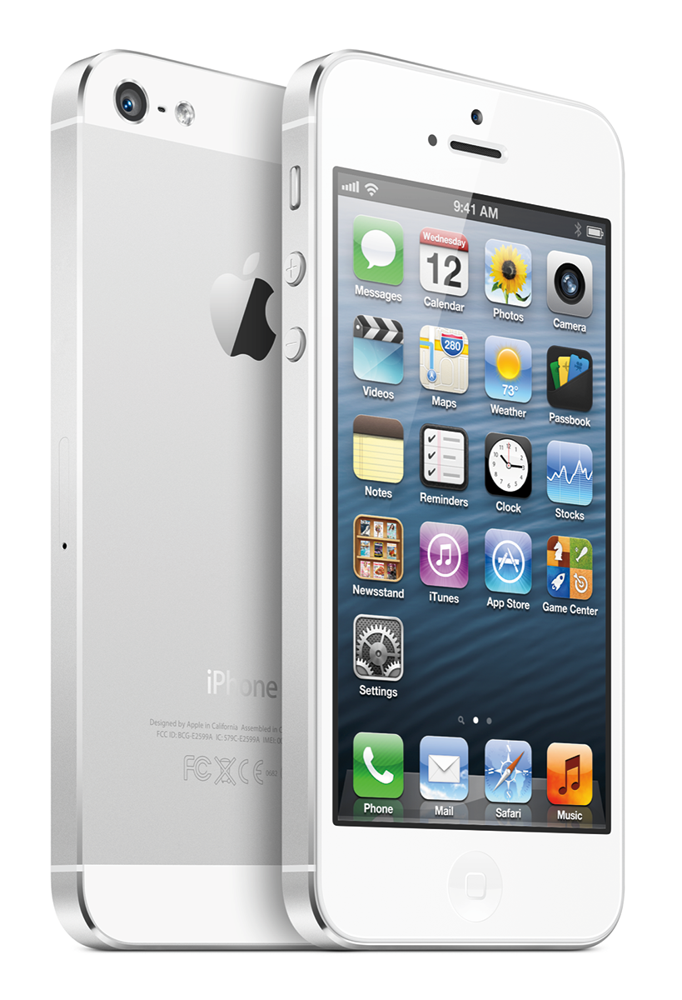

Juuri nyt on ehkä huonoin mahdollinen hetki pohtia uuden iPhone 5 puhelimen hankkimista. iPhone vitosen hinta on vielä suhteellisen suolainen ja tällä hetkellä huhutaan, että kesällä olisi tulossa uusi iPhone. Epäilen, että se olisi iPhone 5S eikä iPhone 6, kuten iPhone 4S tuli iPhone 4:n jälkeen.

Kun uusi iPhone tulee niin vanhan iPhonen hinta tippuu, näin tulee tapahtumaan kun uusi iPhone julkistetaan ja viimeistään silloin kun se alkaa tulemaan kauppoihin.

Tällä hetkellä ei siis kannata hankkia iPhone 5:sta sillä sen hinta tulee tippumaan parin kuukauden sisään. Itselläni oli tämä päätös tehtävänä sillä Lumia 900 ei ollut minulle sopiva ja päätinkin siirtyä takaisin iPhone 4 puhelimeeni.

Itselläni on vain vanhan iPhonen liittimen lisävarusteita kuten telakka yms. niin iPhone 5 ja sen uusi Lightning latausliitäntä tuottaa lisävarusteiden hankkimista. Telakkaan olen nimittäin erittäin kiintynyt sillä se tulee niin helposti laitettua siihen. Tässä tutkiessani huomasin ettei iPhone 5:lle ole edes Applen omaa telakkaa. Onko teillä jotain tietoa hyvästä telakasta iPhone 5 luurille?

Jännä nähdä mitä muutoksia uuteen kesällä julkistettavaan iPhoneen tulee ja kannattaako sitten loppujen lopuksi hankkia uusi iPhone vai iPhone 5. **Kertokaahan omat tietonne huhuista ja mitä itse tekisitte!**
