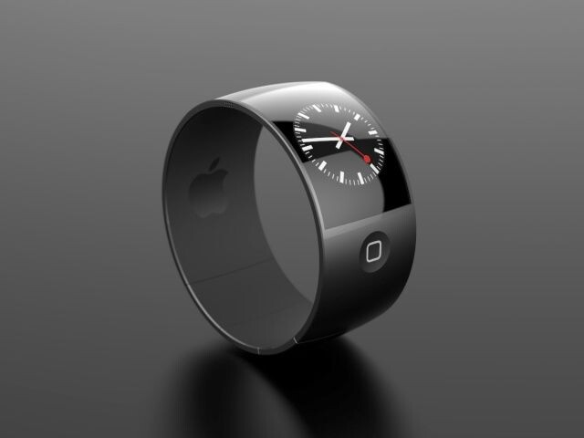

Apple on siinä maineessa, että sen huhutut tuotteet tekisivät kauppansa jo ennen julkaisua vaikka sen ominaisuuksista ei tiedetä vielä yhtään mitään.

Tämä on Applelle jo hirveän hyvä tilanne sillä he tietävät jo nyt, että tuo kannattaisi tehdä sillä uuden tutkimuksen mukaan 19% amerikkalaisista ostaisi huhutun ”iWatchin”. 5% vastaajista ilmoitti erittäin todennäköisesti ostavansa tulevan iWatchin. Lisäksi 14% ilmoitti mitä todennäköisimmin ostavansa iWatchin.

ChangeWave Research teetti kyselyn maaliskuussa ja siihen vastasi lähes 2000 amerikkalaista, kysely ei rajoittunut pelkästään Apple käyttäjiin.

Kuvassa on muuten yksi konseptikuvista jollainen iWatch voisi olla. Sitä ei tiedä vielä kukaan millainen siitä on tulossa tai milloinka se on tulossa. Ei ainakaan julkisuuteen ole tullut mitään tietoa siitä.

**Ostaisinko minä iWatchin?** En oikeastaan tiedä vastausta tuohon kysymykseen sillä päätös riippuu ominaisuuksista ja hinnasta. Kiva leluhan se voisi olla, mutta eri asia on se olisiko siitä mitään käytännön hyötyä. Normaalin kellon saat aika varmasti paljon edullisemmin kuin tuon iWatchin.

Jäädään odottelemaan mitä tulevaisuus tuo tullessaan ja katsotaan mitä Apple puskee markkinoille. Tällä hetkellä odotan uuden iPhonen julkaisua niin tippuisi tuon iPhone 5:n hinta ;)

*Lähde: [Macmaa](http://macmaa.com/2013/04/22/iwatchin-odotus-yhdysvalloissa-kiihtyy/)*
