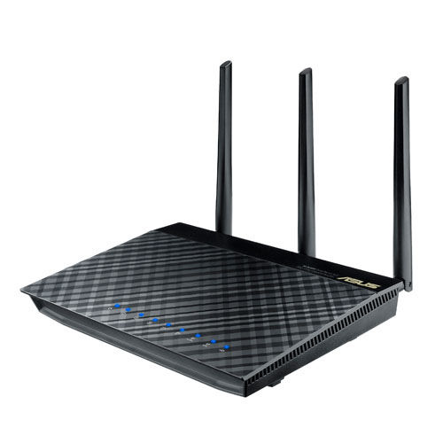
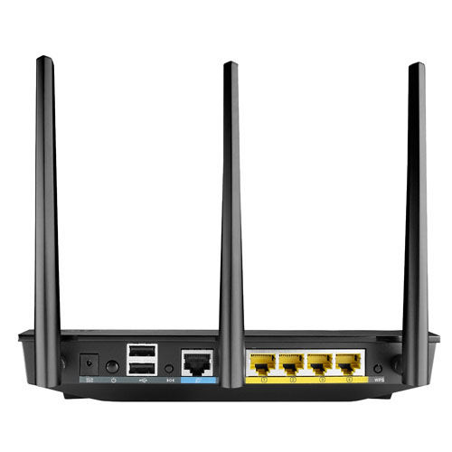
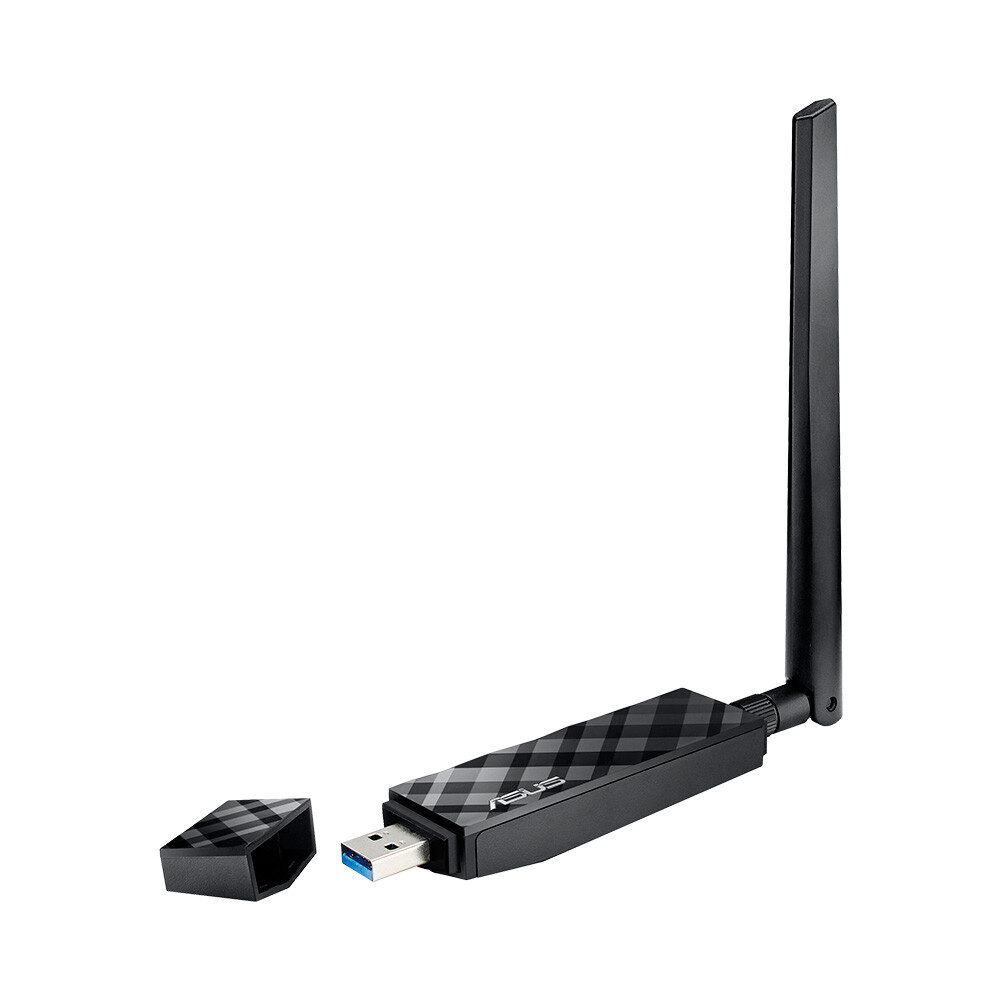
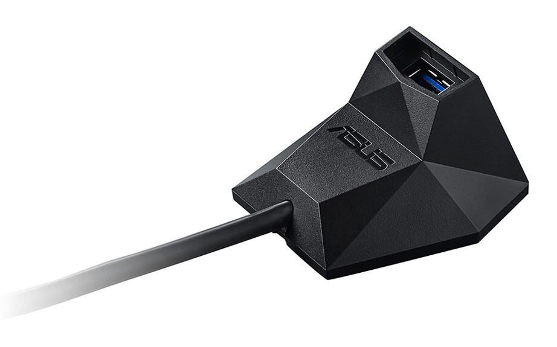

Sain Asukselta lainaan tällä kertaa verkkolaitteita. Sain testattavaksi AC-standardin verkkolaitteita – Asus RT-AC66U Gigabit Dualband AC1750 WLAN-reititin sekä Asus USB-AC56 kaksitaajuuksinen N1200 USB3.0 WLAN-adapteri. Tarkoituksena oli, että vertaan AC-standardin nopeutta omaan nykyiseen verkkooni verrattuna.

Oma verkkoni on tällä hetkellä hieman monimutkainen simppelisti selitettäväksi, mutta sanotaanko näin, että langaton verkko NATattuna ja standardina on N-standardi. Eli saan suhteellisen hyvän nopeuden jo tuolla standardilla, mutta koska minulla on 100 Mbps netti niin en pääse ihan tuohon nopeuteen langattoman verkon yli. DNA taitaakin luvata nopeudekseni 70-100 Mbps ja pääsenkin maksimissaan 77 Mbps nopeuteen.

### Asus RT-AC66 reititin

Asus RT-AC66U Gigabit Dualband AC1750 WLAN-reititin on tyylikäs ilmestys ja se tukeekin AC-standardia joka tarjoaa 1,75 gigabitin langatonta yhteyttä 2,4 ja 5 gigahertsin taajuusalueella. Laitteessa onkin yhtäaikaa päällä 2,4 ja 5 gigahertsin taajuusalueiden verkot – voit hallinnasta päättää haluatko molemmat päälle vai vain toisen ja nimetä molemmat eri nimillä.

Hallinnassa olikin paljon enemmän ominaisuuksia mitä oletin olevan, en ole tosin ihan äsken näin uusia reitittimiä konffinut. Itselleni ehkä mielenkiintoisimpana tuolta huomasin vierasverkon luonnin jolloin voit luoda vieraille oman avoimen verkon ja hallita hieman sitäkin.

RT-AC66 reitittimeen voit liittää 2 USB-laitetta eli voit heittää pari USB kiintolevyä kiinni siihen ja jakaa ne verkon yli tätä kautta. USB portteihin voit kytkeä myös mokkulan tai tulostimen. Samaten voit kytkeä vielä neljä RJ45 piuhaa ja saada neljä laitetta kiinni langallisen verkon kautta tähän reitittimeen.

Itse reitittimessä on myös kolme kappaletta irrotettavia antenneja. Laite tukee myös Asuksen WebStoragea ja uusin firmware tukee myös AiCloudia.

Itse keskityin tämän reitittimen kanssa kodin peruskäyttöön ja tämä toisi kyllä hurjasti nopeutta lisää lähiverkkooni ja varsinkin jos kotona olisi useampi AC-standardia tukeva laite. Tietysti tätä voisi hyödyntää lähiverkon tallennuslaitteena kun kytkisi ne ulkoiset kiintolevyt tähän reitittimeen kiinni.

### Asus USB-AC56 WLAN adapteri

Asus USB-AC56 kaksitaajuuksinen N1200 USB3.0 WLAN-adapteri on USB 3.0 väylää käyttävä WLAN adapteri (käy toki myös USB 2.0 väyläänkin). AC-standardin avulla tällä saadaan alla olevien mittauksien kaltaisia tuloksia ja tämä onkin mitä mainioin kaveri RT-AC66 reitittimelle. Tämä adapteri tukee molempia taajuksia eli 2.4 ja 5 gigahertsin taajuuksia, voit siis yhdistää vanhempiinkin WLAN reitittimiin tällä adapterilla.

Tässä WLAN adapterissa on irroitettava antenni joka ei ole pakollinen adapterin käyttämiseen – laitteessa on nimittäin kaksi sisäistäkin antennia. Antenni tuokin lisää kantavuutta verkolle ja löysinkin antennin kanssa naapurin verkkoja joita en muilla koneilla nähnytkään.

Adapterin mukana tulee myös näppärä telakka ja itse käytinkin tätä telakan kanssa pöytäkoneessani. Telakan avulla tämän saakin asemoitua hieman paremmin ja näin saat adapterin siihen missä on paras kuuluvuus, telakan johto olisi voinut olla hieman pitempi.

Toimintaan laitossa ei ollut minkäänlaisia ongelmia sillä tökkäsin adapterin vain USB porttiin ja Windows 8 hoiti ajureiden asennuksen suoraan itse. Mukana tuli myös CD-levy, jos ajureita ei jostain syystä löydykään verkosta tai et ole verkkoyhteyden päässä.

### Mittauksia ja päätelmiä

Tein mittauksia Speedtest.net sivuston avulla ja omalla N-standardin langattomalla pääsin 62 Mbps nopeuksiin ja sitten vastaavasti tuolla Asuksen AC-standardilla pääsinkin jo oman nettini maksiminopeuteen eli 77 Mbps. Testasin vielä langallisella verkollakin, eli pistin suoraan piuhan kiinni modeemiin – sillä sain nopeudeksi tuon saman 77 Mbps.

Ero normaaliin verrattuna on siis 15 Mbps eli saisin tuolla AC-standardin vehkeillä enemmän irti verkostani. Saisin kuitenkin enemmän laitteista irti mikäli minulla olisi useammassa laitteessa AC-standardia tukeva verkkokortti ja näin lähiverkko toimisi suhteellisen vikkelästi. Tätä en kuitenkaan päässyt testaamaan sillä en omistanut laitetta joka tukisi suoraan tuota AC-standardia ja sain vain yhden WLAN adapterin testiin.

Pullonkaulaksi muodostuikin loppujen lopuksi oma Internet eikä WLAN. AC-standardiin ei minun kannattaisi siis päivittää sillä nopeuteni nousu olisi niin pieni ettei se oikeastaan toisi hirveätä hyötyä. Lähiverkossa nopeus kyllä nousisi huomattavasti.

### Linkit:

- [Asus RT-AC66 reititin](http://www.asus.com/Networking/RTAC66U/)
- [Asus USB-AC56 WLAN adapteri](http://www.asus.com/Networking/USBAC56/)
