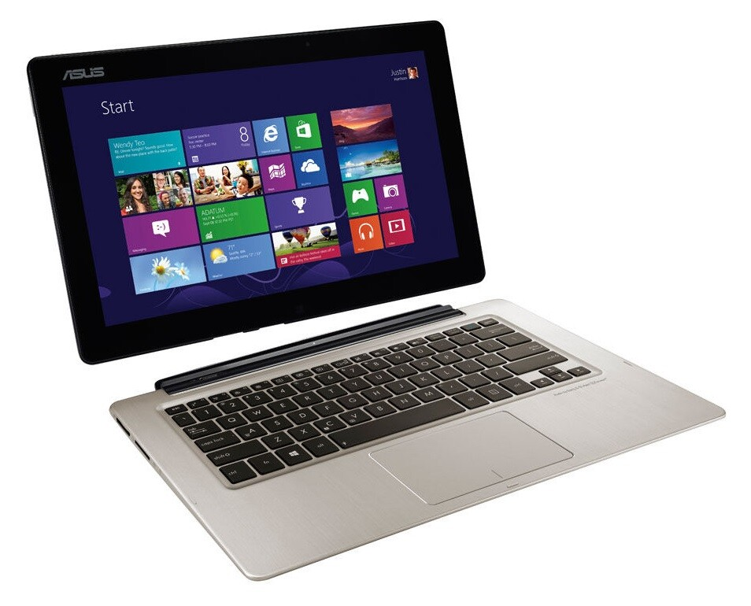
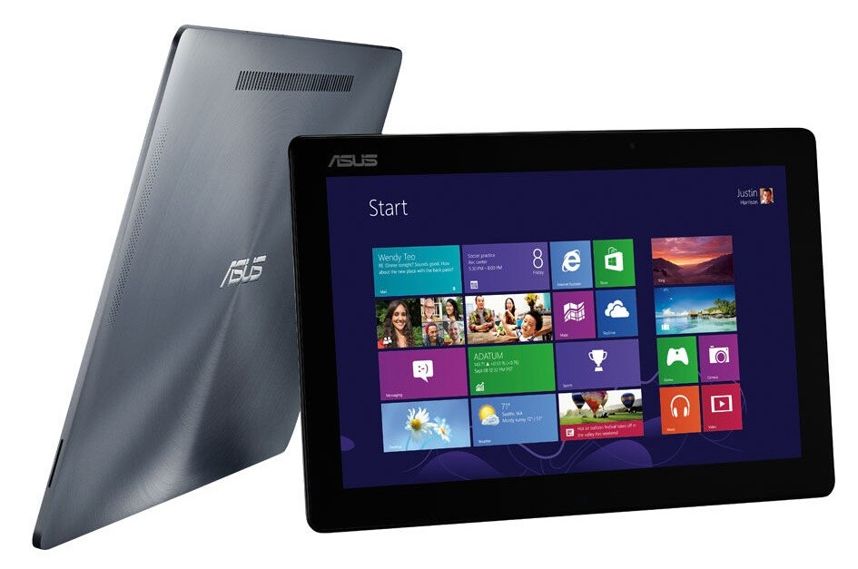

Sain torstaina Asukselta postissa Transformer Book TX300 läppärin kokeiltavaksi. Oikeastaan läppäri on ehkä väärä määritys tälle koneelle sillä tässä koneessa on irroitettava kosketusnäyttö, mutta tehoja on kuitenkin kuin läppärissä. Näppäimistö osa toimii siis ikään kuin telakkana ja siihen on survottu 500 gigan sata kiintolevy ja näin saadaan hieman lisä tilaa tuohon koneeseen.

Tuo näyttö tai oikeastaan ns. tabletti on tämän koneen erikoisuus. Siihenhän on laitettu rautaa suhteellisen pieneen tilaan. 13.3 FullHD kosketusnäyttö 1920×1080 resoluutiolla toimii hyvin sekä sen taakse on laitettu 128 Gigan SSD levy, Intel Core i7 3517U prosessori, 4 gigaa muistia sekä näytönohjaimeksi Intelin HD graphics 4000.

Ihan pelikonehan tämä ei ole, mutta tulen kokeilemaan paria peliä tuolla. FTL haluan kokeilla jo tuon kosketusnäytön takia sillä tuo peli toimisi hirmu hyvin tabletilla, mutta en tiedä miten Windows versio FTL:stä tykkää kosketusnäytösvä vai pitäisikö itse peli optimoida erikseen kosketusta varten.

Toimiston koneeksi tämä taas olisi omiaan. Teet työtä työpisteelläsi ja pitäisi lähteä näyttämään jotain työtoverille niin naps näyttö irti telakasta ja matkaan. Tehoiltaankin tämä on oikein passeli toimiston työjuhta ja näkisinkin tämän ehkä enemmän työkoneena. Tietysti sohvasurffauksessa tämä näytön irroitus toimi oikein passelisti sekä elokuvia voit katsella näppärästi pelkän näytön avulla, tuohan tuo isomman näytönkin kuin perus iPad.

Sanoinkin alussa, että tämä ei ole läppäri ja tämä on ns. tablet. Tämä ei ole oikeastaan kumpaakaan mielestäni sillä näyttö on liian iso tabletiksi ja ei se oikein mitenkään sovi kokonsa puolesta pelkästään tablet käyttöön. Tämä on ihan täysin erilainen kone kuin mitä itse omistan, joten tämän kanssa on hauska säätää viikon ajan.

Alla on vielä video tästä koneesta ja hieman vertailen kokoa tässä ja kerron näitä omia ensifiiliksiä päivän jälkeen. Videohan on kuvattu eilen, perjantaina.



Tästä tulee myös juttua [Podcastiini](/kategoria/podcast) sekä jos te haluatte tietää jotain tästä niin nyt kannattaa kysyä! Kiitos Asukselle kannettavan toimittamisesta!

Linkki Asuksen sivuille: [Transformer Book TX300](http://www.asus.com/Notebooks_Ultrabooks/ASUS_Transformer_Book_TX300/)
