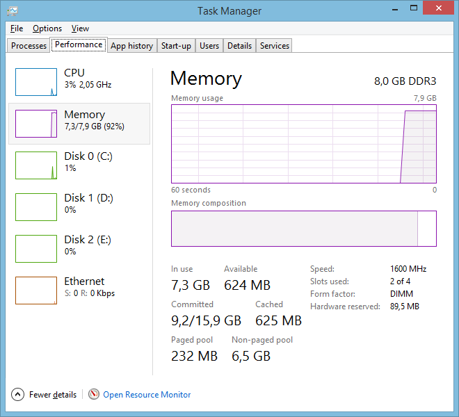
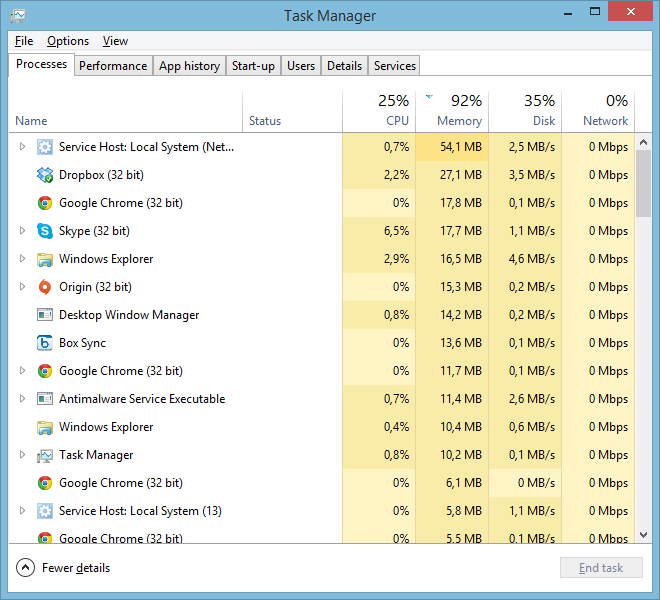

Niin tekee ja pahasti. Hankin joululomani aikana edukkaasti Battlefield 4 pelin ja nyt lauantaina pääsin pelaamaan. Jonkun aikaa pelattuani Battlefield 4 alkaa syömään muistia kuin mikäkin ja tuloksena on pelin ”lagaaminen” ja muisti 100 prosentissa. Oikealla oleva kuva näyttääkin sen, että muisti on lähes kokonaan käytössä ja cachessakaan ei ole juuri mitään. Koneessani on tuo 8 gigaa muistia ja peli pyörii vallan mainiosti aina siihen pisteeseen asti kun muisti menee kokonaan käyttöön.

Toinen kuva onkin sitten tutkimista siitä mikä sitä muistia käyttää, kuvan mukaan ei yhtään mikään… Tämä onkin se mielenkiintoisin asia sillä muisti on käytössä ja ainut millä olen saanut muistin ”nollattua” on ollut koneen uudelleenkäynnistys.

En ole ongelman kanssa yksin, EA:n foorumeilla on [65 sivua](http://answers.ea.com/t5/Battlefield-4/BF4-PC-Memory-leaking-94-Memory-usage-with-12GB/td-p/1731447/page/65) jauhantaa tästä ja ongelma on jatkunut todella pitkään eikä korjausta ole vieläkään tullut! Toivotaan, että jonkinlainen korjaus tähän tulee sillä lievästi sanottuna ärsyttää kun kesken kierroksen peli jumittaa ja kone pitää käynnistää uudelleen.

**Päivitystä**\
Kuten tuossa ketjussakin sanoin niin tein hieman temppuja [tämän Reddit ketjun](http://www.reddit.com/r/Battlefield/comments/1q14u9/bf4_i_have_multiple_fixes_that_make_the_game_90/) mukaan ja en ole saanut hetkeen muistivuotoa aikaiseksi. Toivottavasti tämä auttaa muita!
